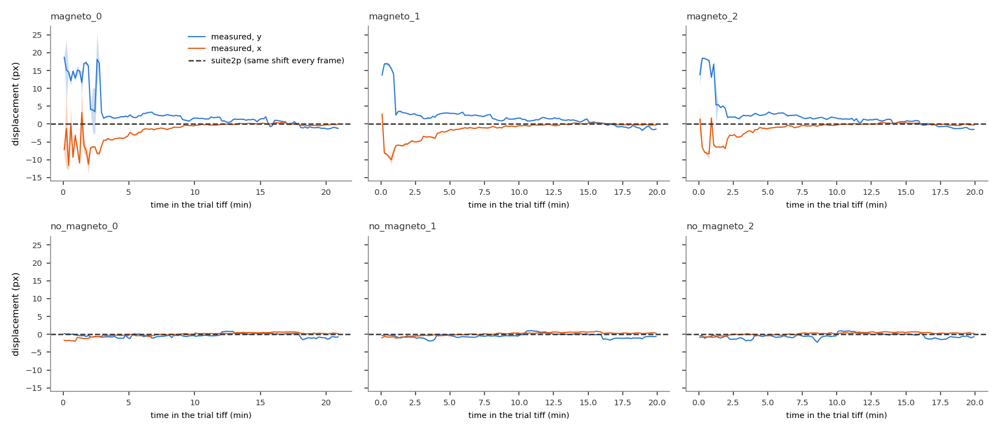
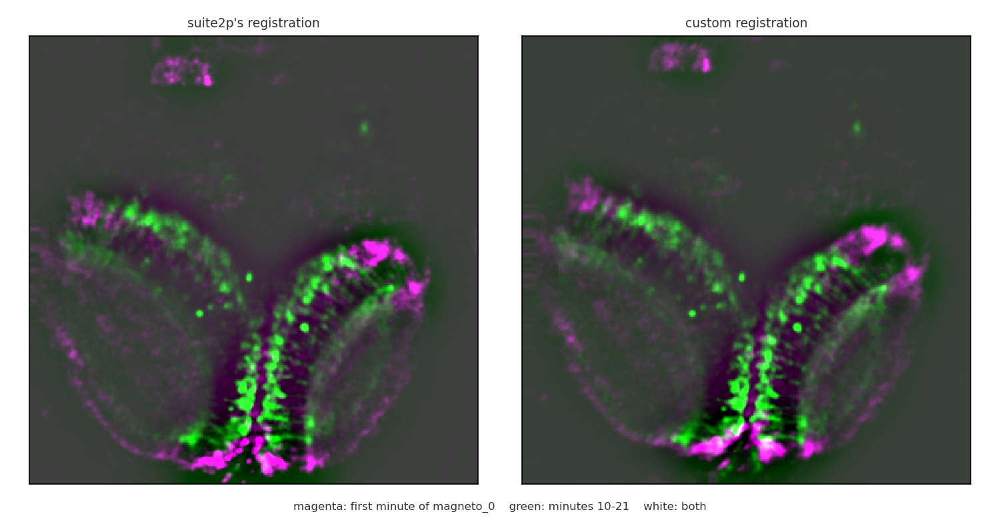
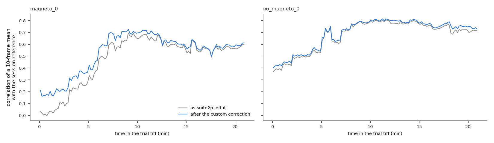
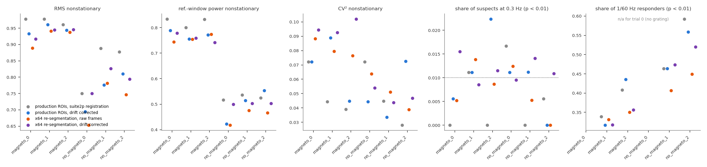
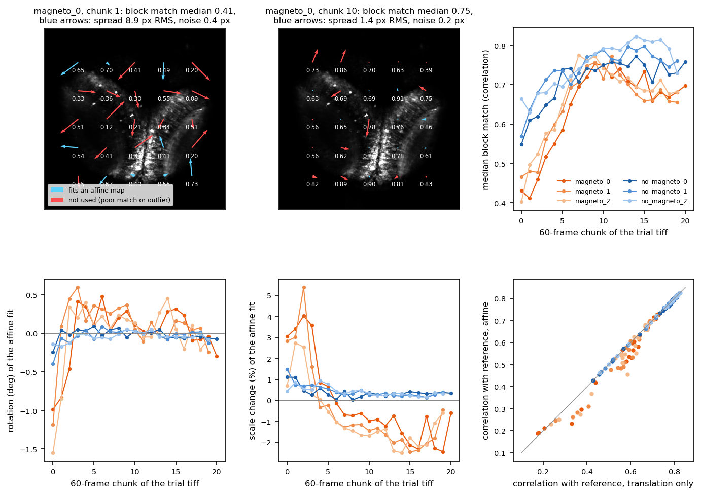
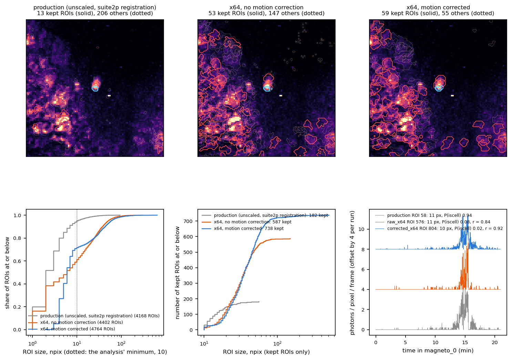

# Correcting 20220915_fish1's drift: the shifts can be measured, but fixing them barely changes the nonstationarity; the segmentation is the bigger problem

**Date:** 2026-10-12
**Scope:** One photon-starved zebrafish session, 2022_09_15-fish1_cytoGCaMP (the six `engert_20220915_fish1_*` recordings).
- **Question:** can its motion be measured and corrected where suite2p's registration fails, and does correcting it explain the session's nonstationarity ([`nonstationarity.md`](nonstationarity.md))?
- **No production code, YAML, NWB file or suite2p output was changed.** The corrected traces live on local disk only, in `C:/Users/dan/suite2p_v1_custom_reg/`.

**Related:**
- [`nonstationarity.md`](nonstationarity.md): this session is the most nonstationary in the data.
- [`cv2.md`](cv2.md) section 4: the photon-starved movies.
- `.claude/CLAUDE.md`, "Registration (2026-10-07)": why suite2p returns one shift.

## Summary

**suite2p does not correct any motion in this session.** It applied the same shift to every one of its 7,320 frames: rigid (−45, 28) px, then −7.6 px in all 36 nonrigid blocks.

**The fish does move, and the motion can be measured:**
- **How:** cross-correlate 10-frame averages with the session's mean image.
- **How much:** in the three coil-on trials it is displaced by up to 20 px in the first 1–3 minutes, then settles within 3.6 px. In the coil-off trials it stays within 2.3 px.
- **Precision:** the median measurement error is 0.04 px. After correction, the remaining misalignment is under 0.12 px in 95% of bins.

**Correcting the drift doesn't fix the nonstationarity.** Re-extracting the traces with the drift corrected lowers the share of nonstationary ROIs only modestly. In the coil-on trials it goes from 96–98% to 93–96% (RMS) and from 80–83% to 76–79% (reference-window power).

**What remains is a slow change in the image itself, not a shift.**
- Even with the drift corrected, each 10-frame average resembles the session's mean image less in the first ~7 minutes of a trial than later.
- This happens with the coil off too, where the fish barely moves.
- Local block shifts confirm there is more than a translation. But no rotation, stretch or other affine warp improves the match (section 5).

**The bigger problem is the segmentation (section 6).** Production's ROIs here are mostly fragments of cells.
- Giving suite2p the tiffs ×64 with its registration off, as medaka is run, triples the kept ROIs (182 → 524 within the same field) and doubles their median size (14 → 31 px).
- Giving it the drift-corrected movie adds 21% more (635, median 36 px).
- **The conclusions hold with the better ROIs.** The 0.3 Hz suspects stay at chance (about 1%), the grating responders roughly triple in number at a similar share, and nonstationarity barely changes (section 7).

| | finding |
|---|---|
| **Established** | suite2p's registration is constant over all 7,320 frames of this session (asserted in `analyze.py`). |
| **Established** | The drift is measurable from 10-frame averages: up to 20 px in the coil-on trials' first 1–3 min, ≤ 3.6 px afterwards, ≤ 2.3 px in the coil-off trials. Median precision 0.04 px; residual after correction ≤ 0.12 px (95th percentile). |
| **Established** | Correcting it improves the image match where the motion is. In the first minute of magneto_0 the bins' correlation with the reference rises from 0.02 to 0.17 (median). Later in the trial it changes little (0.58 → 0.60). |
| **Established** | It changes the traces' nonstationarity, the Fourier suspects and the grating responders only a little (Table 1). |
| **Established** | The flat stretches at exactly 100 in a trace are frames with no photons in the ROI's pixels, not truncation (section 4). |
| **Established** | Beyond the translation, local block shifts are 1.2–7.4 px RMS (error ~0.2 px) and reproducible across interleaved trials (r 0.74–0.97). But they are not a rotation or a stretch: an affine correction never improves the match (section 5). |
| **Established** | suite2p on the tiffs ×64 with its registration off triples the kept ROIs within production's field (182 → 524) and doubles their median size (14 → 31 px). Adding the drift correction raises them to 635 (36 px) (section 6). |
| **Leading hypothesis, untested** | The image content changes over the first ~7 min of each trial and between the coil-on and coil-off acquisitions, perhaps through axial (z) drift, the fish settling, or brightness changes. No in-plane correction can remove that. |
| **Established** | With the re-segmented ROIs, the 0.3 Hz suspects stay at chance (25 of 2,107 coil on, 22 of 1,911 coil off; about 1% expected). About 3.5× as many grating responders are found, at a similar share (41% vs 45%). Nonstationarity drops only a few points (section 7). |
| **Open** | The other photon-starved zebrafish sessions likely have the same fragmented segmentation; not yet re-segmented. |

## What was measured

**suite2p's shift.** This comes from the session's `ops.npy`:
- `yoff`, `xoff`: suite2p's rigid shift per frame;
- `yoff1`, `xoff1`: its nonrigid block shifts per frame.

Each has a single value over all 7,320 frames. In these dim movies (98.4% of pixels at the camera offset of 100), suite2p's reference image after its integer halving is nearly flat. Every frame then registers to the same position (`.claude/CLAUDE.md`, "Registration").

**The drift** is the displacement of each 10-frame average relative to a session reference, `measure.py`:
- **Cross-correlation:** each average and the reference are smoothed (σ = 1.5 px), background-subtracted (σ = 20 px) and tapered with a Hann window. The displacement is the cross-correlation peak, refined to subpixel by a parabola.
- **Reference:** two passes. The first uses the plain mean of all frames. The second uses the mean of the bins after shifting each by its first-pass displacement.
- **Precision:** each bin's odd and even frames are measured separately; the error is half their difference.
- **Chunks:** each trial tiff is stitched from 60 s chunks taken from different times in the session. Bins never straddle a chunk, and the per-frame displacement is interpolated between bin centres within a chunk only.

**Correction** (`extract.py`):
- Production registers each raw frame exactly as suite2p did, then extracts each ROI's trace with suite2p's weights (`pipeline/ophys_extraction.py`).
- The custom version uses the same code with the measured drift added to suite2p's block shifts.
- The ROIs and their weights are production's.
- **Control:** with zero drift added, it reproduces production's `F_full.npy` exactly (max error 0).

## Findings

### 1. suite2p leaves the drift in; it can be measured



<sub>**Figure 1. Displacement of each 10-frame average from the session reference, per trial.** Blue: y. Orange: x. Shading: ± measurement error (odd vs even frames). Dashed: suite2p, which applies the same shift to every frame (zero relative to its own constant). Time is time in the trial tiff. Each trial's first minutes are chunks from the start of that acquisition.</sub>

- **The coil-on trials begin far from their settled position.** magneto_0 starts 14–19 px off in y and moves back and forth for about 3 minutes. magneto_1 and _2 settle within about a minute. All three then creep back by 2–4 px over the trial.
- **The measurement error grows where the fish moves fastest.** In magneto_0's first three minutes it reaches up to 11 px: the odd and even frames of a bin disagree, so the fish moved within those 10 s.
- **The coil-off trials stay within 2.3 px throughout.** They are a separate acquisition from the coil-on ones.



<sub>**Figure 2. The first minute of magneto_0 (magenta) over its minutes 10–21 (green), as registered by suite2p (left) and with the drift corrected (right).** Each image is smoothed and background-subtracted. White = both. In the left panel the two layers are offset, most clearly along the bright bands. In the right panel they overlap more, but several magenta structures still have no green counterpart.</sub>

### 2. The correction helps, but the image content keeps changing



<sub>**Figure 3. Correlation of each 10-frame average with the session reference, before (grey) and after (blue) the correction.** magneto_0, where the fish drifts, and no_magneto_0, where it barely moves.</sub>

- **The correction raises the match where there was motion.** In magneto_0's first minute it goes from 0.02 to 0.17 (median).
- **The match still climbs for about 7 minutes after correction:** to 0.6–0.7 in magneto_0, and from 0.4 to 0.75 in no_magneto_0, where the fish never moves more than 2.3 px.
- **So the early frames differ from the later ones by more than a shift.** A lateral correction can't remove that.
- **Leading hypothesis, untested:** axial (z) drift as the fish settles, or brightness changes. A z-stack would be needed to tell.

### 3. The traces change only a little

**Table 1.** Production's ROIs (about 180 per trial), suite2p registration → custom correction.
- Nonstationarity: share of ROIs with block-shuffle p < 0.05 at K = 10 ([`nonstationarity.md`](nonstationarity.md)).
- Suspects: production Fourier p < 0.01 at 0.3 Hz.
- Responders: p < 0.01 at 1/60 Hz (n/a for trial 0, which has no grating).

| trial | RMS | reference-window power | CV² | suspects at 0.3 Hz | 1/60 Hz responders |
|---|---|---|---|---|---|
| magneto_0 | 98% → 93% | 83% → 79% | 7% → 7% | 0 → 1 | n/a |
| magneto_1 | 98% → 96% | 80% → 76% | 4% → 9% | 2 → 2 | 61 → 57 |
| magneto_2 | 96% → 94% | 83% → 77% | 4% → 4% | 0 → 4 | 73 → 78 |
| no_magneto_0 | 75% → 69% | 52% → 42% | 7% → 4% | 3 → 2 | n/a |
| no_magneto_1 | 89% → 78% | 54% → 51% | 4% → 3% | 0 → 2 | 83 → 83 |
| no_magneto_2 | 88% → 81% | 52% → 55% | 3% → 7% | 1 → 0 | 106 → 100 |



<sub>**Figure 4. Table 1 per trial, as shares of each trace set's ROIs.** Grey: production's ROIs, suite2p's registration. Blue: production's ROIs, drift corrected. Orange and purple: the ×64 re-segmentations of section 7. Dotted line: the 1% of suspects expected by chance.</sub>

- **Nonstationarity drops by a few points, and this session stays the most nonstationary in the data.** Its excess comes mostly from what Figure 3 shows, not from the lateral drift.
- **Suspects stay at chance** (0–4 per trial; about 2 expected among 180 ROIs at p < 0.01). They move in both directions.
- **Grating responders barely change.**

### 4. The trace's flat stretches are empty frames, not truncation

The example ROI in [`nonstationarity.md`](nonstationarity.md) Figure 1 (magneto_0, ROI 58) reads exactly 100 for 75% of frames. Is that a clipped trace, like suite2p's halved traces were ([`cv2.md`](cv2.md))?

- **The raw tiff is photon counting on an offset of 100.** In magneto_0, 98.4% of pixel values are 100, 1.4% are 101 (one photon), 0.18% are 102. A value of 99 occurs in 0.00008% of pixels, and the maximum is 162.
- **Production's traces are full resolution.** They don't halve or truncate (`pipeline/ophys_extraction.py`).
- **ROI 58 is tiny:** 11 pixels, of which 6 are not shared with another ROI and are used. A frame reads exactly 100 when none of those 6 pixels caught a photon, which is most frames while the cell is quiet.

**Video.** [`custom_registration/roi58_magneto_0.mp4`](custom_registration/roi58_magneto_0.mp4) (1.8 MB) shows a 48 × 48 px crop around ROI 58 over the whole trial.
- **Layout:** 5-frame means in mean photons per frame. Left: as production registered it. Right: with the drift corrected.
- **Overlays:** the ROI's outline; dotted marks the 6 pixels used.
- **Below:** the ROI's trace and the drift, with a cursor.
- **Checked:** the trace computed from these frames equals production's `F_full.npy` row (max error 0).
- **What it shows:**
  - In the first 3 minutes the whole field shifts by up to 20 px.
  - The burst at minutes 13–16 comes from a bright cell whose lower edge overlaps the outline.
  - With the drift corrected (about 1.5 px there), less of that cell falls inside the mask, and the ROI's burst shrinks (blue trace).
  - A 6-pixel mask is very sensitive to a pixel or two of misalignment.

**Wider video with every ROI.** [`custom_registration/roi58_magneto_0_crop96_all_rois.mp4`](custom_registration/roi58_magneto_0_crop96_all_rois.mp4) (6.1 MB) shows a 96 × 96 px crop with the same layout.
- **Outlines:** ROI 58 in teal. The 12 other production ROIs in red. The 206 other ROIs that suite2p found there but production drops in dotted light red.
- **What it shows is a segmentation problem.** The active cell is split into fragments.
  - ROI 58 (11 px), ROI 22 (11 px, 2 px away) and ROI 113 (10 px, 4 px away) are all production ROIs on the same cell.
  - Three more suite2p ROIs of 1–5 px sit on it too.
  - Most bright, clearly active cells in the crop have no production ROI at all.
- **Session-wide:**
  - suite2p found 4,168 ROIs in this session, and 94% of them are smaller than 10 pixels; the median in this crop is 2 pixels.
  - Only 12% have P(iscell) > 0.5.
  - Production's thresholds keep the few fragments that pass, so its ROIs are pieces of cells, not cells.
- **Tested in section 6:** detection fragments the cells mainly because it runs on the halved, photon-starved movie. Motion correction helps less.

### 5. What the translation leaves behind is not a rotation or a stretch

The correction is a pure x/y translation: one shift per frame for the whole field. Does the fish also rotate, stretch or deform?

**How it was tested** (`blocks.py`):
- **Chunk averages:** each 60-frame chunk of a trial tiff (122 chunks) is averaged and moved back by its rigid shift.
- **Block shifts:** the average is cut into a 5 × 5 grid of 128 px blocks, kept 24 px clear of the frame edge. Each block is cross-correlated with the same block of the reference, as in `measure.py`.
- **Usable blocks:** each block's error is estimated from its odd vs even frames. A block is used only if its error is under 0.5 px and its best match correlates above 0.4 with the reference.
- **Affine fit:** per chunk, an affine map (translation, rotation, scale and shear) is fitted to the block shifts, dropping blocks more than 2 px off the fit.
- **Does the affine map help?** It is applied to the chunk average, and the average's correlation with the reference is compared with the translation-only correction.

If the motion were a pure translation, every block would sit at ~0. Under a rotation, the block shifts would turn around the centre; under a scale change, they would point outward.



<sub>**Figure 5. Shift of each 128 px block after the translation is removed.**
- **Top left and middle:** two chunks of magneto_0, over the reference image. Arrows are drawn at 4× length; the number under each arrow is the block's match with the reference. Blue: blocks used in the affine fit. Red: blocks not used (poor match, or an outlier).
- **Top right:** median block match per chunk, per trial.
- **Bottom left and middle:** the fitted rotation and scale change per chunk.
- **Bottom right:** each chunk's correlation with the reference, translation only (x) vs affine (y). The grey line is equality.</sub>

**Table 2.** Medians over chunks. Chunks 0–6 are the unsettled start of each trial tiff (Figure 3).
- **Spread:** RMS of the usable blocks' shifts about their mean.
- **Gain:** the affine map's change in correlation with the reference.

| | block match | spread | measurement error | \|rotation\| | \|scale change\| | gain from affine |
|---|---|---|---|---|---|---|
| coil on, chunks 0–6 | 0.55 | 7.4 px | 0.26 px | 0.40° | 1.0% | −0.009 |
| coil on, chunks 7+ | 0.71 | 4.8 px | 0.21 px | 0.12° | 1.5% | −0.014 |
| coil off, chunks 0–6 | 0.68 | 2.3 px | 0.19 px | 0.07° | 0.6% | +0.001 |
| coil off, chunks 7+ | 0.76 | 1.2 px | 0.18 px | 0.04° | 0.3% | −0.001 |

**There is more than a translation:**
- **The blocks disagree with each other far beyond their measurement error.** The spread is 4.8–7.4 px in the coil-on trials and 1.2–2.3 px in the coil-off trials, against an error of about 0.2 px.
- **The pattern is real, not noise.** The three trials of one acquisition interleave their chunks, so chunk j of each trial is recorded within a few minutes of the others.
  - The block fields of the three trials at the same chunk index correlate at r = 0.97 (coil on, chunks 7+), 0.74 (coil on, chunks 0–6) and 0.79–0.86 (coil off).
  - The scale-change curves of the three coil-on trials also track each other (Figure 5, bottom middle): +3 to +5% at the start, falling to −2 to −2.5% late.

**But it is not a rotation or a stretch that a warp can undo:**
- **The rotation is tiny:** a median of 0.04–0.4°.
- **The affine map never improves the match.** It raises the correlation by more than 0.01 in 6 of 122 chunks and lowers it in 35. The coil-on chunks fall below the equality line in Figure 5, bottom right.
- **The early chunks' blocks match poorly anywhere.** In the coil-on trials' first 7 chunks, the median block match is 0.55, against 0.71 later. The block shifts point in every direction (top left).

**Interpretation.**
- **Established:** the fish's image changes locally, reproducibly across trials, and most in the coil-on acquisition. An in-plane rotation or stretch doesn't capture the change.
- **Leading hypothesis, untested:** the change is in what is imaged rather than where.
  - A shift of the focal plane (z) would replace structures rather than move them. Cross-correlating a block then locks onto the nearest similar structure, which looks like a reproducible but uncorrectable local shift.
  - The coil-on and coil-off trials are separate acquisitions. The reference averages both, so the coil-on acquisition may simply sit at a slightly different depth.
- **What this rules out:** a nonrigid, per-block correction (suite2p's own kind) could chase these block shifts. But it would be warping one plane onto another, so it isn't recommended without z information.

### 6. Giving suite2p the scaled movie triples the kept ROIs and doubles their size; the drift correction adds a further 21–26%

Does cell detection on a motion-corrected movie give whole cells instead of fragments?

**Runs** (`segment.py`). suite2p is run twice more, on local disk. Every setting is production's except:
- **Scaled input:** the tiffs are multiplied by 64. suite2p halves uint16 input; the scaling keeps the 1-photon steps that the halving destroyed in production. Medaka is run the same way.
- **Registration off** (`do_registration = 0`): in this session production's registration applied the same shift to every frame anyway.

The two runs differ in one thing only:
- **raw_x64:** the raw frames;
- **corrected_x64:** each frame moved back by `measure.py`'s drift (bilinear).

So raw_x64 vs production is the effect of the scaling, and corrected_x64 vs raw_x64 the effect of the drift correction. `compare_segmentation.py` compares the three.



<sub>**Figure 6. The three segmentations.**
- **Top:** the same 96 × 96 px crop of the corrected run's maximum projection, around production ROI 58 (teal). Production's ROIs are moved into the raw frame's coordinates by suite2p's constant shift (−52.6, 20.4 px).
  - Red solid: kept ROIs (P(iscell) > 0.5 and npix ≥ 10, the analysis' thresholds). Light red dotted: the others.
  - Teal dashed: the ROI whose magneto_0 trace correlates best with production ROI 58's.
- **Bottom left:** ROI size, all ROIs.
- **Bottom middle:** ROI size, kept ROIs.
- **Bottom right:** magneto_0 traces of production ROI 58 and its best-correlated ROI in each new run, in photons per pixel per frame above the offset.</sub>

**Table 3.** The three segmentations. All three runs stop at suite2p's limit of 5,000 ROIs, before overlap removal.

| run | ROIs | median npix | < 10 px | P(iscell) > 0.5 | kept | kept, inside production's field | median npix, kept |
|---|---|---|---|---|---|---|---|
| production | 4,168 | 2 | 94% | 517 | 182 | 182 | 14 |
| raw_x64 | 4,402 | 6 | 59% | 611 | 587 | 524 | 31 |
| corrected_x64 | 4,764 | 6 | 71% | 1,508 | 738 | 635 | 36 |

"Inside production's field" counts only ROIs centred where production could detect. Production's detection ran on the frame minus the margins its constant shift cut off (387 × 421 of 477 × 477 px); the new runs see the whole frame.

**What changed:**
- **Most of the improvement comes from the scaling.** Kept ROIs go from 182 to 587 (524 within production's field), and their median size from 14 to 31 px.
  - In the crop, production's few small fragments become ROIs that cover whole bright cells.
  - The analysis also drops ROIs outside the fish's outline and flat traces. For production that leaves the same 182, so the comparison holds.
- **The drift correction adds 151 more kept ROIs** (738; 524 → 635 within production's field), slightly larger (median 36 px). It also adds about 900 more ROIs with P(iscell) > 0.5, mostly too small to keep.
- **ROI 58's cell is no longer split three ways, but it is still split.**
  - In raw_x64, one kept ROI (14, 21 px, P(iscell) 0.95) covers the cell; its trace correlates with production ROI 58's at r = 0.72.
  - In corrected_x64, the cell is shared by two kept ROIs, 35 (30 px) and 2056 (20 px, r = 0.77).
  - In both runs, the trace that best matches ROI 58's burst comes from a small ROI on the cell's lower edge, which isn't kept: raw_x64 ROI 576 (11 px, r = 0.84) and corrected_x64 ROI 804 (10 px, P(iscell) 0.02, r = 0.92).
  - So ROI 58's burst at minutes 13–16 sits at the lower edge of the bright cell. It may be a neighbouring cell, or a part of the cell that suite2p's detection treats separately.
- **Section 7** puts the new ROIs' traces through the nonstationarity and Fourier analyses.

### 7. With 3–4× more ROIs, the suspects stay at chance and nonstationarity barely moves

Does the better segmentation change the session's conclusions?

**How it was tested** (`analyze.py`). The two re-segmentations go through the same analyses as Table 1, as two more trace sets:
- **ROI selection:** production's rule, applied to each run's ROIs: P(iscell) > 0.5, npix ≥ 10, inside the fish outline (the YAML's outline parameters on that run's own mean image), and flatline removal.
- **Traces:** suite2p's `F.npy` / 32, in raw photon units like `F_full.npy`. The re-segmented movie is already aligned, so its traces need no warp.
- **Self-test:** the same loader applied to production's plane0 reproduces production's ROIs and traces in all six recordings (`check_loader`, asserted).

**Table 4.** Pooled over the three trials of each acquisition.
- Suspects: p < 0.01 at 0.3 Hz. The chance p is a one-sided binomial test against 1%, which approximates the eps-corrected null.
- Responders: p < 0.01 at 1/60 Hz, grating trials (_1, _2) only.

| trace set | ROIs, coil on / off | suspects, coil on | suspects, coil off | responders, grating trials |
|---|---|---|---|---|
| production ROIs, suite2p registration | 539 / 538 | 2 (0.4%, p = 0.97) | 4 (0.7%, p = 0.79) | 323 of 717 (45%) |
| production ROIs, drift corrected | 539 / 538 | 7 (1.3%, p = 0.30) | 4 (0.7%, p = 0.79) | 318 of 717 (44%) |
| ×64, raw frames | 1,733 / 1,701 | 16 (0.9%, p = 0.66) | 10 (0.6%, p = 0.97) | 880 of 2,291 (38%) |
| ×64, drift corrected | 2,107 / 1,911 | 25 (1.2%, p = 0.22) | 22 (1.2%, p = 0.28) | 1,108 of 2,680 (41%) |

Per trial, see `results_summary.csv` and Figure 4. The largest single count is 11 of 709 in magneto_0, drift corrected (binomial p = 0.10).

**What changed:**
- **The 0.3 Hz suspects stay at chance in every trace set.** With four times the ROIs, there are more suspects in absolute terms, but at about the 1% expected, with the coil on and off alike. The better segmentation reveals no magnetic response.
- **The grating responders are found again, at a similar share.** 38–41% of the re-segmented ROIs respond, against 45% of production's. That is about 1,100 responding ROIs instead of 320, so the positive control works with whole cells.
- **Nonstationarity barely moves** (Figure 4).
  - RMS: 89–95% of ROIs in the coil-on trials, against 96–98% for production's.
  - Reference-window power: 74–78%, against 80–83%.
  - Coil-off trials: 65–83% (RMS) and 42–50% (reference-window power).
  - CV² stays near chance (4–10%).
- **So the session's nonstationarity is not caused by the fragmented ROIs either.** Neither segmentation nor drift correction removes it, which points again to slow changes in the image itself (sections 2 and 5).

## Implications

1. **Registering this session ourselves is feasible.** The drift is measured precisely from 10-frame averages, and it plugs into production's own extraction with one change: per-frame block shifts.
2. **It isn't worth putting into production for nonstationarity's sake.** It removes only a few points of the session's nonstationarity. The rest is a slow change in image content that lateral registration can't touch.
3. **The known-limitation status can stay.**
   - The suspect counts are at chance with either registration.
   - Motion locked to the stimulus was already < 0.04 px in every recording.
4. **The segmentation matters more than the registration.**
   - Giving suite2p the tiffs ×64, as medaka already is, triples the kept ROIs (182 → 524 within the same field) and doubles their median size (section 6).
   - Production's zebrafish ROIs in the photon-starved sessions are therefore mostly fragments. This likely holds for every photon-starved zebrafish session, not only this one.
   - Run through the analyses (section 7), the re-segmentation leaves the 0.3 Hz suspects at chance and recovers about 3.5× as many grating responders at a similar share.
   - **Suggested next step:** decide whether to re-segment every photon-starved zebrafish session the same way (×64, registration off, drift-corrected frames) and put it into production. That would change their ROI counts and neuron numbers in Fig 2 and the neuron-count tables.
5. **Don't add a nonrigid or affine correction.** What the translation leaves is real and reproducible, but no in-plane warp improves the match (section 5). It looks like a change of focal plane, which needs z information to correct.
6. **Small ROIs magnify misalignment.** A 1–2 px offset moves a neighbouring cell in or out of a 6-pixel mask (section 4). The scaled segmentation largely removes this, since its kept ROIs have a median of 31–36 px.

## Reproducing

```bash
# from a checkout whose data/ holds the NWB files and the parquet (or set NS_DATA_DIR to one)
python docs/custom_registration/measure.py        # magneto2 env, ~3 min, CPU: drift -> shifts.npz
python docs/custom_registration/extract.py        # suite2p1.0 env, GPU, ~1 min: F_custom.npy
NS_DATA_DIR=<checkout>/data python docs/custom_registration/analyze.py   # magneto2, ~4 min; needs segment.py's runs
python docs/custom_registration/analyze.py --figures-only
python docs/custom_registration/roi_video.py --roi 58 --trial magneto_0   # suite2p1.0 env, GPU
python docs/custom_registration/blocks.py         # magneto2, ~1 min: block shifts, affine fits (section 5)
python docs/custom_registration/segment.py --variant corrected   # suite2p1.0, GPU, ~2 min each
python docs/custom_registration/segment.py --variant raw
python docs/custom_registration/compare_segmentation.py          # magneto2 (section 6)
```

**In the folder:**
- `measure.py`, `extract.py`, `analyze.py`, `roi_video.py`, `blocks.py`, `segment.py`, `compare_segmentation.py`;
- `results_blocks.csv` / `results_affine.csv`: per chunk and block, the shift left after the translation; per chunk, the affine fit and correlations;
- `results_segmentation.csv`: per ROI of the three segmentations, size, P(iscell), centre, overlap with production ROIs 58 / 22 / 113;
- `results_bins.csv`: per 10-frame bin, the displacement, precision, residual and correlation before and after;
- `results_rois.csv`: per ROI and trace set (production's ROIs with either registration, and the two re-segmentations), the nonstationarity p-values and the Fourier p-values;
- `results_summary.csv` (Tables 1 and 4, per trial);
- the figures and the video.

**Large intermediates, local disk only:** `C:/Users/dan/suite2p_v1_custom_reg/2022_09_15-fish1_cytoGCaMP/`, holding:
- `shifts.npz`, `F_custom.npy` and `registered_means.npz`;
- `s2p_raw_x64/` and `s2p_corrected_x64/`, each with the ×64 tiffs suite2p read (`tiffs/`, 3.3 GB) and its output (`output/suite2p/plane0/`, including a 3.3 GB `data.bin`).

**Checks run by the scripts:**
- **Control:** zero added drift reproduces production's `F_full.npy` exactly (`extract.py`, max error 0).
- **Re-segmentation loader:** on production's plane0 it reproduces production's ROI sets and traces in all six recordings (`analyze.py`, `check_loader`).
- **Video:** the ROI trace recomputed from the video's frames equals `F_full.npy` (`roi_video.py`, max error 0).
- **Reconciliation with production:**
  - The harness's 0.3 Hz p-values on production's traces match the parquet to 4 × 10⁻⁷, with identical suspect counts in all six recordings (`analyze.py`).
  - Not bit-identical: the null grid's upper end is rounded differently.
- **suite2p's constant shifts:** asserted from `ops.npy` (`analyze.py`, `compare_segmentation.py`).
- **Production-to-raw coordinates:** ROI 58's trace computed from raw pixels at production's constant shift correlates with `F_full.npy` at r = 0.99. That is the best integer offset within ±40 px. (A mean-image cross-correlation gave a wrong offset, because production's mean image is the halved one.)

### Parameters

| parameter | value |
|---|---|
| bin for motion measurement | 10 frames (10 s) |
| chunk (bins never straddle) | 60 frames |
| search range | ± 40 px |
| smoothing / background | Gaussian σ 1.5 px / σ 20 px |
| per-frame drift | 3-bin median filter, linear interpolation within a chunk |
| correction | added to suite2p's nonrigid block shifts (bilinear warp, as production) |
| ROIs | production's: P(iscell) > 0.5, npix ≥ 10, inside the outline, flatline removal |
| nonstationarity | K = 10 chunks, 1,000 block shuffles of 10 s, p < 0.05 |
| Fourier test | production `fit_Fourier` + eps-corrected null; 0.3 Hz, Q_frac 0.15; 1/60 Hz, Q_frac 0.5; p < 0.01 |
| video | 48 × 48 px crop, 5-frame means, 15 fps, H.264 |
| block test | 60-frame chunks; 5 × 5 blocks of 128 px, 24 px from the edge; ±12 px search; block used if error < 0.5 px and match > 0.4; affine refit without blocks > 2 px off |
| re-segmentation | production's suite2p 1.1.0 settings, `do_registration = 0`, tiffs ×64 (corrected: bilinear shift, fill 100, rounded) |
