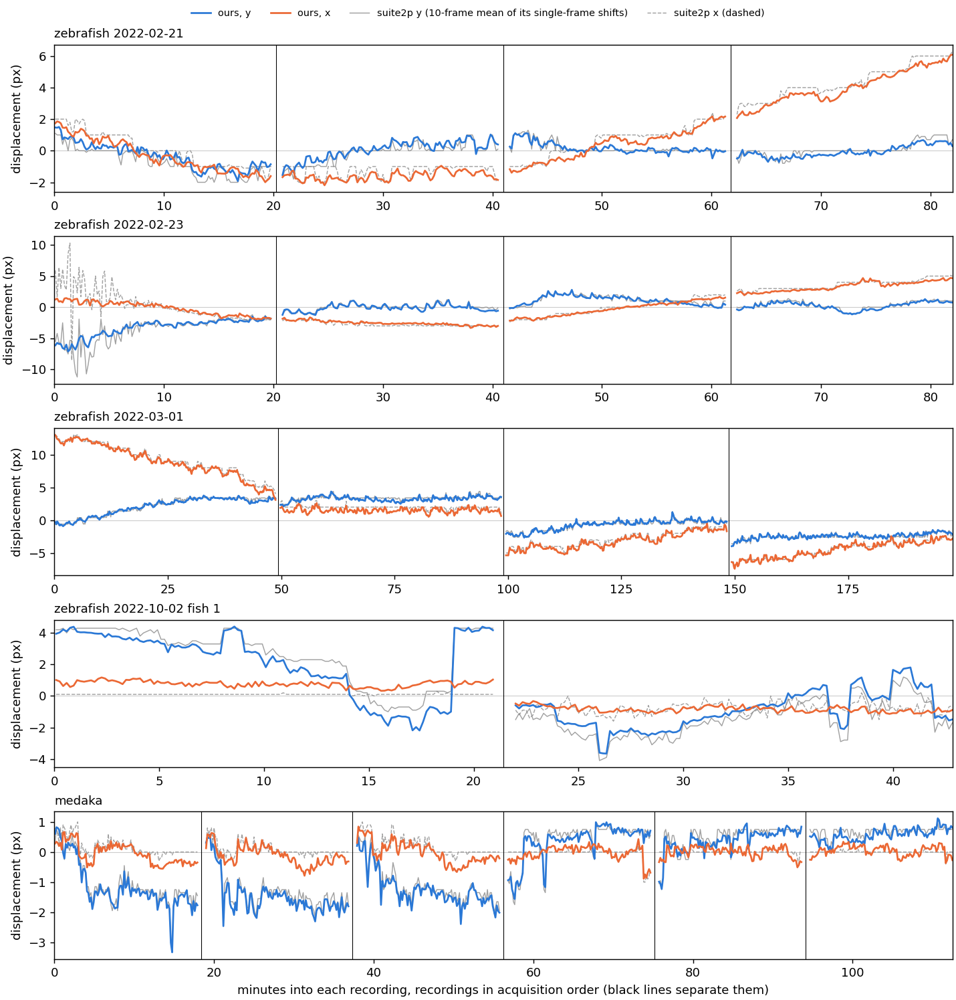
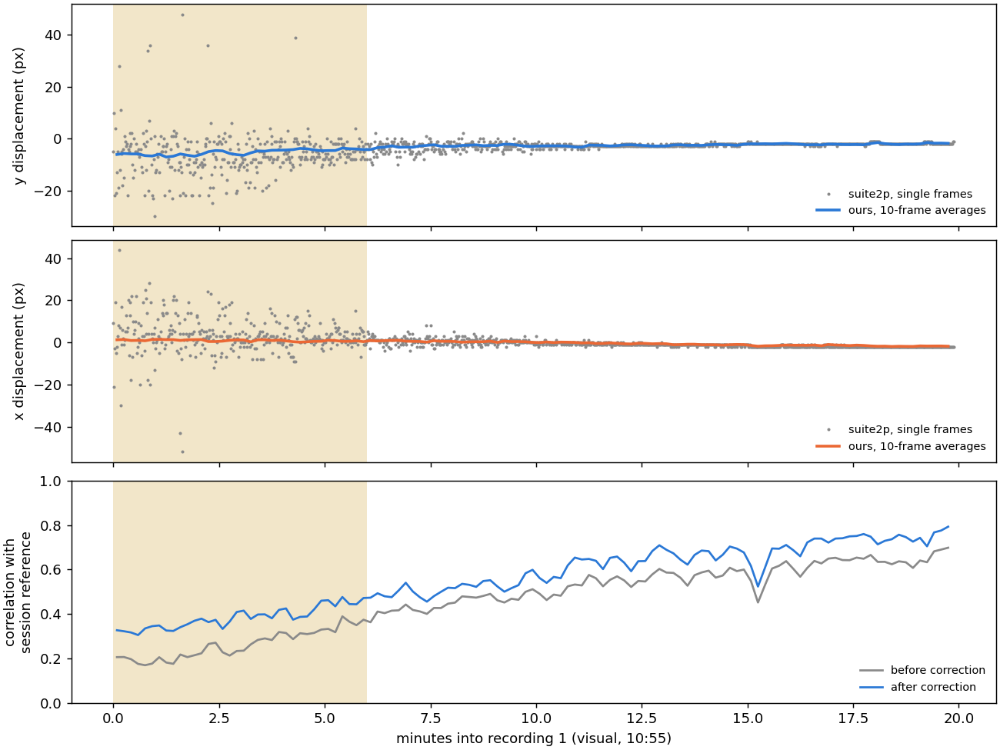
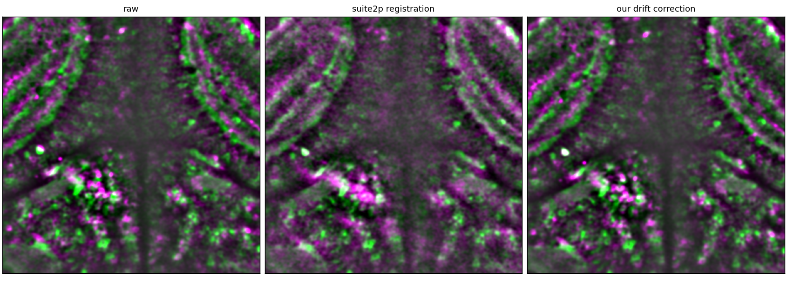

# Lateral drift in every imaged fish: up to 15 px in the suite2p-registered fish, which suite2p tracks; its single-frame shifts fail only in the first minutes of one recording

**Date:** 2026-11-16

**Scope:** the 10 imaging fields of view behind the 50 engert/medaka YAMLs.
- **Measured here:** the five that suite2p registered, i.e. the three 2022 Q1 zebrafish sessions, 2022-10-02 fish 1 (tiffs saved ×256) and medaka (×64).
- **Measured before:** the five photon-starved zebrafish, whose drift we correct ourselves ([`resegmentation.md`](resegmentation.md)). Their numbers are re-read here so that all ten fish are reported the same way.
- **No production code, YAML or NWB file changed.**

**Related:**
- [`custom_registration.md`](custom_registration.md): the drift measurement (method; 2022-09-15 fish 1).
- [`resegmentation.md`](resegmentation.md): the drift correction in production for the five photon-starved zebrafish.
- [`photon_starved_imaging.md`](photon_starved_imaging.md): the index for the photon-starved recordings.
- [`zplane.md`](zplane.md): focal-plane drift in one session.

**Why this report.** The Methods draft gave drift only for the five fish we correct ourselves. The other five were registered by suite2p, and their motion had never been measured on the same footing. A first look at suite2p's shifts showed one frame of 2022-02-23 shifted by 70.8 px, close to suite2p's 70 px limit.

## Summary

We measured the drift of the five suite2p-registered fish with the same method as the other five: 10-frame averages, cross-correlated with a session reference (§ The measurement).

- **Every fish's drift is now measured on the same footing,** with a median precision of 0.02–0.06 px (Table 1).
- **Drift in the suite2p-registered fish:** at most 3–7 px in four of them. In 2022-03-01 it reaches 15 px, as a slow drift over the 50-minute first recording.
- **suite2p tracks the same motion.** Averaged over the same 10 frames, its rigid shifts agree with ours to 0.2–0.6 px rms.
- **One exception: the first ~6 minutes of 2022-02-23's first recording** (visual, 10:55; Figure 2).
  - Our measurement shows a smooth drift of about 6 px that settles.
  - suite2p's single-frame shifts scatter around it by about 15 px SD in the first minute, and reach 70.8 px in one frame. They are failed single-frame matches, not motion.
  - That recording is a visual positive control. Its 1/60 Hz result barely changes without those minutes: 878 → 843 ROIs with q ≤ 0.05, of 1,262.

| | finding |
|---|---|
| **Established** | All ten fish have a drift measurement with precision 0.02–0.06 px (Table 1). The largest drift is 20 px (2022-09-15 fish 1) and 15 px (2022-03-01); the other eight drift at most 2–7 px. |
| **Established** | Where suite2p's single-frame shifts are consistent (SD within a 10-frame bin < 1 px), they agree with our measurement to 0.17–0.64 px rms (Table 2). |
| **Established** | In the first ~6 min of 2022-02-23 recording 1, suite2p's single-frame shifts are noise around the real drift (Figure 2). This is the only recording where they fail on a large scale. |
| **Established** | The visual positive control from that recording does not depend on those minutes (§ 3). |
| **Ruled out** | The 70.8 px frame (frame 98) as real motion: the seven 10-frame averages around it stay within 1.2 px of each other. |
| **Leading hypothesis, untested** | In those first minutes the image also changes in ways no translation fixes: the correlation with the session reference rises from 0.33 to 0.8 over 20 min even after correction, and after a rigid correction the edges still look offset outwards on both sides (Figure 3, by eye). This would be the fish settling in z or swelling, as in 2022-09-15 fish 1. |

## The measurement

**Drift** is the displacement of each 10-frame average of the raw movie relative to a reference image of the session. The method is `docs/custom_registration/measure.py`, imported unchanged:
- **Correlation:** both images are smoothed (σ 1.5 px), background-subtracted (σ 20 px) and tapered. The displacement is the cross-correlation peak within ±40 px, made sub-pixel by a parabola.
- **Reference:** two passes. The first is the mean of all frames; the second is the mean of all averages after aligning each by its first-pass displacement.
- **Boundaries:** averages never span two recordings, nor two 60-frame chunks in the stitched trial tiffs (2022-10-02 fish 1, medaka).

**Precision** is half the difference between the displacements measured from each average's odd and even frames. These halves cover the same 10 s, so they differ only by measurement error.

**"Max drift"** in the tables is the largest displacement from the reference, as in [`resegmentation.md`](resegmentation.md). The figures show displacement from the session's median position.

**suite2p's shifts** are its rigid offsets (`ops["yoff"]`, `ops["xoff"]`), averaged over the same 10 frames. Its non-rigid block shifts come on top and are not compared here. suite2p's shifts have the same sign as ours.

## Findings

### 1. Every fish drifts by a few pixels; two drift by 15–20 px

**Table 1.** One row per field of view (`results_summary.csv`; per recording: `results_recordings.csv`).

| fish | motion corrected by | max drift (px) | precision, median (px) |
|---|---|---|---|
| zebrafish 2022-02-21 | suite2p | 6.0 | 0.024 |
| zebrafish 2022-02-23 | suite2p | 7.2 | 0.033 |
| zebrafish 2022-03-01 | suite2p | 14.8 | 0.028 |
| zebrafish 2022-10-02 fish 1 | suite2p | 4.5 | 0.056 |
| medaka | suite2p | 2.9 | 0.048 |
| zebrafish 2022-09-14 fish 2 | ours (whole pixels) | 2.8 | 0.036 |
| zebrafish 2022-09-15 fish 1 | ours (whole pixels) | 20.0 | 0.039 |
| zebrafish 2022-10-01 fish 1 | ours (whole pixels) | 2.7 | 0.039 |
| zebrafish 2022-10-01 fish 2 | ours (whole pixels) | 2.0 | 0.042 |
| zebrafish 2022-10-02 fish 2 | ours (whole pixels) | 2.5 | 0.024 |



<sub>**Figure 1. Drift of the five suite2p-registered fish.** Displacement from each session's median position. Blue: ours, y. Orange: ours, x. Grey: suite2p's rigid shifts averaged over the same 10 frames (solid y, dashed x). Recordings are in acquisition order, separated by black lines; the x axis is minutes into each recording, at about one frame per second. In 2022-10-02 fish 1 and medaka, each recording is stitched from 60 s chunks recorded minutes apart, so steps at chunk boundaries are expected.</sub>

- **The 2022 Q1 sessions drift slowly and steadily.** In 2022-03-01, x falls by 10 px over the 50-minute first recording. Between recordings, minutes to an hour apart, the position can jump by several pixels.
- **Medaka's two acquisitions sit about 2 px apart in y** (coil-on vs coil-off), the block shift found in [`medaka_concat_suite2p.md`](medaka_concat_suite2p.md).

### 2. suite2p tracks the same motion, except in the first minutes of 2022-02-23

**Does suite2p's registration follow the motion we measure?** The comparison uses only bins where suite2p's 10 single-frame shifts agree with each other (SD < 1 px). Elsewhere a mean of its shifts says little.

**Table 2.** Ours vs suite2p, per fish (`results_summary.csv`).

| fish | bins with suite2p SD > 1 px | r, y | r, x | rms difference y / x (px) | suite2p's largest single-frame shift (px) |
|---|---|---|---|---|---|
| 2022-02-21 | 0% | 0.92 | 0.99 | 0.28 / 0.40 | 7.1 |
| 2022-02-23 | 13% | 0.98 | 1.00 | 0.24 / 0.34 | 70.8 |
| 2022-03-01 | 0% | 1.00 | 1.00 | 0.24 / 0.43 | 13.0 |
| 2022-10-02 fish 1 | 35% | 0.98 | 0.87 | 0.63 / 0.64 | 6.4 |
| medaka | 0% | 0.99 | 0.68 | 0.17 / 0.23 | 3.2 |

- **Agreement is within a fraction of a pixel everywhere.** Medaka's low r in x (0.68) is because there is almost no x motion to correlate: the SD of x is 0.28 px.
- **2022-10-02 fish 1's single frames are noisier** (35% of bins with suite2p SD > 1 px). The 10-frame means still agree with ours to 0.6 px.



<sub>**Figure 2. The first recording of 2022-02-23 (visual, 10:55).** *Top, middle:* y and x displacement from the session median. Grey dots: suite2p's rigid shift of each frame. Line: ours, per 10-frame average. *Bottom:* correlation of each 10-frame average with the session reference, before and after our correction. Shaded: the first 6 minutes, left out in § 3.</sub>

- **suite2p's single frames scatter around the real drift.** In the first minute their SD within a 10-frame bin is about 15 px. Our 10-frame averages move smoothly from −6 px to −2.5 px in y over the first 12 minutes.
- **The scatter shrinks as the image matches the reference better.** The averages' correlation with the reference rises from 0.2 to 0.7 over the 20 minutes. Single frames in the first minutes are too unlike the reference to be aligned reliably on their own.
- **In practice, suite2p moved these frames back and forth by up to tens of pixels.** Their registered movie jitters in the first minutes, so the ROI traces there mix neighbouring pixels.



<sub>**Figure 3. The first minute of 2022-02-23 recording 1 (magenta) over its minutes 10–20 (green)**, raw, as suite2p registered it, and with our rigid correction. White = both. Each image is smoothed (σ 1.5 px) and background-subtracted (σ 20 px); central 400 × 400 px. suite2p's first-minute mean is blurred by its frame-to-frame jitter.</sub>

- **No single translation aligns the first minute.** After our correction, structures near the left and right edges still appear offset outwards on both sides, as if the image had grown or changed plane rather than only moved. This is read off the overlay, not measured.
- **suite2p's image looks better aligned but blurred.** Its non-rigid shifts can follow some of this locally, but its first-minute mean is an average of jittered frames.

### 3. The visual positive control from that recording does not depend on its first minutes

**Does the jitter in the first 6 minutes drive the visual control's result?** `engert_20220223_visual` was refitted at 1/60 Hz without its first 360 frames, through production's `fit_Fourier` and `corrected_pvalues` (`results_visual_refit.csv`).

| | full recording | without the first 6 min |
|---|---|---|
| frames | 1,194 | 834 |
| ROIs with p < 0.05 | 702 | 651 |
| ROIs with q ≤ 0.05 (Storey, this recording) | 878 | 843 |

- **The result stands.** The ROIs' normalized Fourier responses correlate at r = 0.93 between the two fits. The small drop is consistent with the 30% fewer frames.
- **Check:** the full-length refit reproduces the p-values stored by production exactly (max difference 0).

## Implications

1. **The Methods can report drift for every fish.** Suggested text: "Lateral drift, measured from 10-frame averages (precision 0.02–0.06 pixels), was at most 2–7 pixels in eight of ten fields of view, and 15 and 20 pixels in two, where the fish drifted slowly over a 50-minute recording or settled during the first minutes of a session. Where suite2p's registration was used, its displacements agreed with these measurements to within 0.2–0.6 pixels (rms)."
2. **suite2p's registration is adequate for the five fish it registered,** with one exception: the first ~6 minutes of 2022-02-23's visual recording, where its single-frame shifts are unreliable. That recording is only a positive control, and its result doesn't depend on those minutes. No production change is proposed.
3. **If that recording should be cleaned anyway,** the options are to drop its first 6 minutes, or to register it with our 10-frame drift instead of suite2p's single-frame shifts. Either is a small YAML/processing change; neither changes Fig 2B's verdict for this recording.
4. **Open:** the non-translational change in that recording's first minute (Figure 3) is not yet explained. A z-stack, if one exists for the 2022 Q1 sessions, would test the focal-plane hypothesis as [`zplane.md`](zplane.md) did for 2022-10-01 fish 1.

## Reproducing

```bash
# magneto2 env, from the repo root; local disk only (tiff copies in C:/Users/dan/suite2p_v1_production/<run>/tiffs)
python docs/drift_all_fish/measure_all.py            # ~25 min, the five suite2p-registered runs
python docs/drift_all_fish/analyze.py                # tables, figures, overlay cache, visual refit (~2 min)
python docs/drift_all_fish/analyze.py --figures-only # replot from the CSVs and cache
```

**Folder:**
- `measure_all.py`: the drift measurement; writes `results_bins_<run>.csv`, one row per 10-frame average, with suite2p's shifts over the same frames.
- `analyze.py`: `results_summary.csv` (per fish), `results_recordings.csv` (per recording), `results_visual_refit.csv`, and the three figures. It reads the five photon-starved zebrafish from `docs/resegmentation/results_bins_<run>.csv`.
- Cache (not in git): `C:/Users/dan/suite2p_v1_custom_reg/drift_all/<run>.npz` (reference and mean images) and `2022_02_23_s2p_overlay.npz` (from suite2p's `data.bin`).

**Checks:**
- **Same method as production's drift correction:** `measure_all.py` imports `prep`, `xcorr_shift`, `measure` and `corr` from `docs/custom_registration/measure.py`; nothing is reimplemented.
- **Visual refit reproduces production:** asserted in `analyze.py` (max p-value difference 0).
- **Agreement with suite2p (tripwire), asserted in `analyze.py`.** As first written, the tripwire was "r < 0.8 on either axis in the settled bins means the harness is broken". It fired for medaka x (r = 0.68). The x motion there is only 0.28 px SD, and the two agree to 0.23 px rms, so this is a lack of motion, not a disagreement. The tripwire was revised after seeing this: an axis fails if it moves (SD > 0.5 px) and r < 0.8, or if the rms difference exceeds 1 px. All five fish pass.

### Parameters

| | |
|---|---|
| bin | 10 frames |
| smoothing / background / taper | Gaussian σ 1.5 px / σ 20 px / Hann |
| search range | ±40 px |
| reference | two passes (mean of frames; mean of pass-1-aligned bins) |
| boundaries | recordings; 60-frame chunks in 2022-10-02 fish 1 and medaka |
| 2022-10-02 fish 1 | magneto_1 and no-magneto_1 only (the _2/_3 tiffs are byte-identical copies) |
| "settled" bins | suite2p's single-frame SD within the bin < 1 px |
| visual refit | `engert_20220223_visual`, f = 1/60 Hz, Q_frac 0.60, T = 1.0212 s, first 360 frames dropped |
