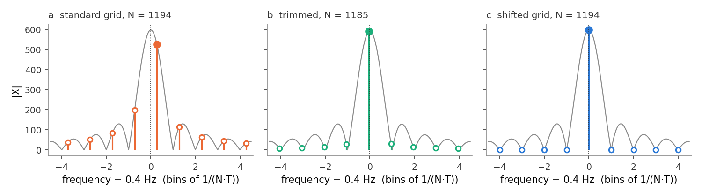
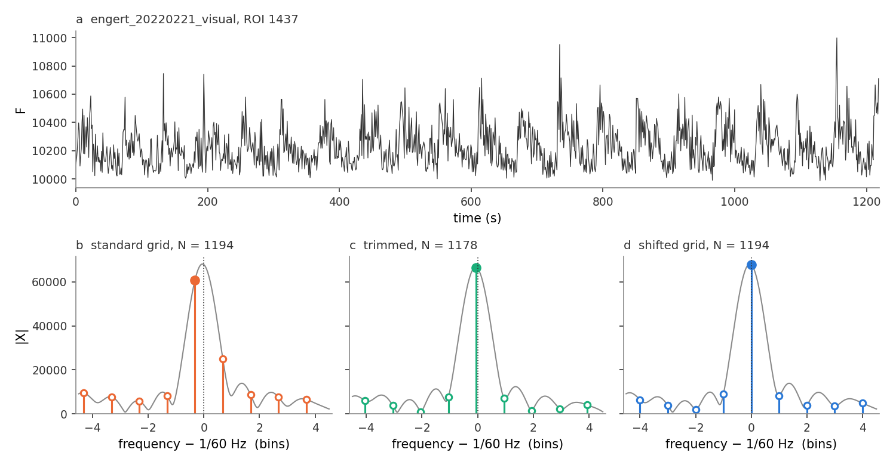

# Testing the stimulus frequency exactly: a shifted Fourier grid for traces that are not whole stimulus cycles

**Date:** 2026-10-12
**Scope:** The imaging Fourier test, `magpyneto2.engert_helpers.fit_Fourier`. **Production code changed:**
`fit_Fourier` gained `align=` (`"shift"`, the new default; `"trim"`; `"none"`, the old behaviour), and
`remove_flatlines` now calls it with `align="none"`. The twelve 2022 Q1 zebrafish recordings were
re-analysed (`pipeline/analysis.py`) and `pipeline/aggregate.py` re-run. The other 38 imaging recordings
are unchanged, bit for bit.
**Related:** [frame_timing.md](frame_timing.md) (where the 1.0212 s frame period comes from).

## Summary

`fit_Fourier` reads each ROI's Fourier coefficient at the FFT bin closest to the stimulus frequency.
The bin is exactly on the stimulus only when the trace lasts a whole number of stimulus cycles. In
the twelve 2022 Q1 zebrafish recordings (frame period 1.0212 s) it doesn't: the bin misses the
stimulus by up to 0.36 bins, and the test sees only 65–78% of a sinusoidal response's power. Two
fixes were implemented and compared on simulated and real data. **Trimming** drops 8–27 frames from
the end. **Shifting the grid** moves every analysed frequency by the same fraction of a bin, so that
one of them lands on the stimulus. Both keep the null intact and recover the lost power. The shift
keeps every frame, so it is slightly more sensitive, and it is now the default.

| | finding |
|---|---|
| **Established** | 20 of the 104 (recording, frequency) tests, all in the 12 recordings of 2022_02_21, 02_23 and 03_01, are off the grid. In 14 of them (every 0.4 Hz test, and the grating tests of the 1194-frame recordings) the miss costs 22–35% of a sinusoid's power; the other 6 lose at most 1% (Table 1). Every other test is on the grid to within 0.0004 bins. |
| **Established** | Both fixes leave the null intact. On white noise, 0.95–1.19% of p-values fall below 0.01 under all three grids (Table 3). |
| **Established** | The shift recovers the full power (99.5–100.5%) on all N frames. Trimming recovers 99.2–99.8% but uses up to 1.5% fewer frames, which costs up to 2% sensitivity (Table 4). |
| **Established** | On the grating recordings, where a real response is expected at 1/60 Hz and 1/30 Hz, the shift raises the number of ROIs with p < 0.01 from 594 to 762 (02_21) and from 414 to 494 (02_23) at 1/60 Hz, and from 64 to 208 and from 20 to 46 at 1/30 Hz. Trimming gains a little less: 753, 476, 182 and 38 (Table 5). |
| **Established** | The magnetic 0.4 Hz test changes by a few suspects either way, and no recording changes flag status in Fig 2A or 2B. |
| **Ruled out** | Zero-padding as a third fix: its extra bins are correlated (power correlation 0.81 between neighbours at 4× padding), so they can't serve as the null. |
| **Open** | `remove_flatlines`' √2 test drops 1.50% of ROIs, which is exactly the rate expected by chance for ordinary traces (506 dropped of 33,845 vs 498 expected). It isn't catching delta-spike traces any more. Not changed here (section 6). |

## 1. Which recordings are off the grid

**The question.** For each imaging recording and each frequency the analysis tests, does the
analysed trace last a whole number of stimulus cycles? If not, by how much does the tested bin miss
the stimulus, and how much of a response does that cost?

A recording's trace is $x_n$, $n = 0, \dots, N-1$, sampled every $T$ seconds. $N$ is the number of
frames `fit_Fourier` analyses; for every recording here it is all frames. The trace is
mean-subtracted, and its Fourier coefficient at frequency $\nu$ is

$$X(\nu) = \sum_{n=0}^{N-1} x_n \, e^{-2\pi i \nu n T}.$$

The FFT evaluates this on the **standard grid** $\nu_k = k/(NT)$. Adjacent bins are $1/(NT)$ apart,
which is one cycle over the whole recording. The stimulus frequency $f$ sits at the fractional bin
position

$$\kappa = f N T \quad (\text{the number of stimulus cycles in the trace}).$$

`fit_Fourier` reads the nearest bin, $k_0 = \operatorname{round}(\kappa)$. That bin misses the stimulus by
the **bin offset**

$$\delta = \kappa - k_0, \qquad |\delta| \le \tfrac12 .$$

Consider a sinusoidal response $x_n = A\cos(2\pi f n T)$. Its coefficient at a bin $\delta$ bins away
is reduced by the Dirichlet kernel. The share of its power that remains in the bin is

$$\rho(\delta) = \frac{|D_N(\delta)|^2}{N^2} = \left(\frac{\sin \pi\delta}{N \sin(\pi\delta/N)}\right)^2 \approx \left(\frac{\sin \pi\delta}{\pi\delta}\right)^2 .$$

$\rho = 1$ at $\delta = 0$, and $\rho = 4/\pi^2 = 0.41$ at $\delta = \tfrac12$. The lost power doesn't
disappear: it leaks into the neighbouring bins, which the test uses as its noise estimate
(Figure 1a).

**Table 1.** The tests that are off the grid ($|\delta| \ge 0.01$). The frame period is $T = 1.0212$ s
in all of them. 0.4 Hz has no 2F test because 0.8 Hz is above Nyquist (0.49 Hz).

| recordings | frames $N$ | test | $f$ (Hz) | cycles $\kappa$ | offset $\delta$ (bins) | power kept $\rho$ |
|---|---|---|---|---|---|---|
| 02_21, 02_23: magnet, nostim, visual+magnet | 1194 | 1F (magnetic) | 0.4 | 487.725 | −0.275 | 0.775 |
| 02_21, 02_23: visual (1F), visual+magnet (visual) | 1194 | grating | 1/60 | 20.322 | +0.322 | 0.702 |
| 02_21, 02_23: visual | 1194 | 2F of grating | 1/30 | 40.645 | −0.355 | 0.648 |
| 03_01: visual+magnet a, b | 2936 | 1F (magnetic) | 0.4 | 1199.297 | +0.297 | 0.741 |
| 03_01: visual a, b (1F), visual+magnet a, b (visual) | 2936 | grating | 1/60 | 49.972 | −0.028 | 0.997 |
| 03_01: visual a, b | 2936 | 2F of grating | 1/30 | 99.943 | −0.057 | 0.990 |

All other tests are on the grid: the 0.3 Hz and 0.1 Hz zebrafish and the medaka (38 recordings,
$T = 1.0$ s, 1080, 1200 or 1260 frames) at 0.1, 0.2, 0.3 and 1/60 Hz. Their largest offset is 0.0004
bins, which comes from writing 1/60 Hz as `visual_f: 0.016667` in the YAMLs. `results_alignment.csv`
lists all 104 tests.

The non-integer frame period isn't the cause in itself. Only the product $fNT$ matters: 1194 frames
of 1.0212 s last 1219.3 s, which is 487.7 cycles of 0.4 Hz. With $T = 1.0$ s, 1194 frames would be
off the grid too (477.6 cycles). Resampling the trace to a different $T$ doesn't change its duration,
so it can't help.

## 2. Two ways to put the stimulus on a bin

**The idea.** Either change the duration so that it holds whole cycles (trim), or keep the duration
and move the frequencies at which the transform is evaluated (shift). Figure 1 shows both on a pure
0.4 Hz sinusoid.

### Trimming

Drop the fewest frames from the end so that the trace lasts a whole number of cycles. With 1.0212 s
frames a stimulus cycle is not a whole number of frames (2.448 frames at 0.4 Hz, 58.75 at 1/60 Hz),
so exact alignment is usually impossible, and a tolerance is needed. `whole_cycle_length` picks

$$N' = \max\{\, N' \le N : |f N' T - \operatorname{round}(f N' T)| \le 0.05 \,\},$$

which keeps $\rho \ge 0.992$. This drops 9 frames at 0.4 Hz and 16 at 1/60 Hz in the 1194-frame
recordings. In the 2936-frame recordings it drops 8 frames at 0.4 Hz, 27 at 1/30 Hz and none at
1/60 Hz ($|\delta| = 0.028$ is already within tolerance). A recording tested at two frequencies is
trimmed differently for each, so its two tests don't use the same frames.

Trimming costs frames. For a weak response in white noise of variance $\sigma^2$, the expected
statistic is

$$\mathbb{E}[\mathrm{NFC}^2] \approx 2 + \frac{A^2 N \rho}{2\sigma^2},$$

so sensitivity scales with $N\rho$, the number of frames used times the share of power kept.

### Shifting the grid

Evaluate the transform at the frequencies

$$\nu_k = f + \frac{k}{NT} = \frac{k_0 + k + \delta}{NT}, \qquad k = -M, \dots, M .$$

$k = 0$ is the stimulus itself. The $2M$ others are the off-frequency coefficients that estimate the
noise, still spaced $1/(NT)$ apart: the whole grid has moved by $\delta$ bins. This is an ordinary
FFT of a demodulated trace:

$$X(\nu_k) = \sum_n \left(x_n \, e^{-2\pi i \delta n / N}\right) e^{-2\pi i (k_0 + k) n / N},$$

so `fit_Fourier` multiplies each mean-subtracted trace by $e^{-2\pi i \delta n/N}$ and then reads
FFT bins $k_0 - M, \dots, k_0 + M$ as before.

**Why the null survives.** The NFC null assumes the $2M$ off-frequency coefficients are
independent, with equal variance, under noise. For white noise of variance $\sigma^2$, the covariance
of two shifted coefficients is

$$\operatorname{Cov}\big(X(\nu_j), X(\nu_k)\big) = \sigma^2 \sum_n e^{2\pi i (\nu_k - \nu_j) n T} = \sigma^2 \sum_n e^{2\pi i (k-j) n / N} = N\sigma^2 \, \mathbb{1}[j = k].$$

This depends only on the spacing $k - j$, not on where the grid starts. So the shifted coefficients
are exactly as uncorrelated as the standard ones.

There is one approximation. For a real-valued trace, the standard grid is symmetric about 0 Hz,
which makes each coefficient's real and imaginary parts equally variable. The shifted grid breaks
that symmetry by an amount set by the pseudo-covariance $\mathbb{E}[X(\nu_j)X(\nu_k)]$. Relative to
$N\sigma^2$ this is about

$$\frac{|\sin 2\pi\delta|}{\pi\,(2k_0 + j + k + 2\delta)},$$

which is largest for the lowest bin in use. The worst case here is the 1/60 Hz test in the
1194-frame recordings, whose window starts at bin 10, and there it is about 1.4%. Section 3 checks
that this doesn't matter.

### Not done: zero-padding

Zero-padding the trace to $4N$ before the FFT samples $X(\nu)$ every quarter bin. A padded bin then
lands within 1/8 bin of the stimulus. But the padded bins are averages over overlapping frequencies,
so neighbours are correlated. In white noise, the power correlation between padded bins is 0.81 at
1/4 bin apart, 0.41 at 1/2 bin, 0.10 at 3/4 bin and 0.006 at one bin (`results_zero_pad.csv`). Used
as the null they would leave far fewer than $2M$ independent coefficients. Keeping only every fourth
padded bin, counted from the stimulus, fixes that, and gives back the shifted grid. That works only
when the stimulus falls on a padded bin, whereas the shift is exact for any $\delta$. (Zero-padding
the *spectrum* is a different operation: it interpolates the trace in time and leaves the bin spacing
$1/(NT)$ unchanged.)



<sub>**Figure 1. A pure 0.4 Hz sinusoid on the three grids.** N = 1194 frames, T = 1.0212 s (the 2022_02_21 and 02_23 recordings). Grey: the magnitude of the transform at every frequency. Filled dot: the coefficient tested at the stimulus. Open dots: the off-frequency coefficients used to estimate the noise. Dotted line: 0.4 Hz. The x axis is in bins of 1/(N·T), for that panel's N. **a**, the standard grid. The tested bin is 0.275 bins above the stimulus and holds 77% of the power; the bin below holds much of the rest. **b**, trimmed to 1185 frames. **c**, the shifted grid.</sub>

## 3. Does the null survive?

**The question.** If a fix changed the null, pure noise would give an excess of small p-values. Do
the p-values stay uniform under all three grids, for the same $N$, $T$, frequency and window that
each real test uses?

20,000 white-noise traces per test were run through production `fit_Fourier` and
`corrected_pvalues` (the eps-corrected null used for every imaging p-value).

**Table 3.** Share of p-values below 0.01 and 0.05 on white noise (`results_null.csv`, which also
has KS tests and the correlation of neighbouring off-frequency coefficients).

| $N$ | test | $M$ | p < 0.01, none / trim / shift | p < 0.05, none / trim / shift |
|---|---|---|---|---|
| 1194 | 0.4 Hz | 73 | 1.00% / 0.95% / 1.00% | 5.0% / 5.1% / 5.2% |
| 1194 | 1/60 Hz (Q_frac 0.6) | 12 | 1.14% / 1.16% / 1.15% | 5.4% / 5.2% / 5.3% |
| 1194 | 1/60 Hz (Q_frac 0.5) | 10 | 1.19% / 1.16% / 1.19% | 5.4% / 5.3% / 5.5% |
| 1194 | 1/30 Hz | 24 | 0.95% / 0.96% / 1.00% | 5.0% / 5.2% / 5.1% |
| 2936 | 0.4 Hz | 180 | 1.02% / 1.17% / 1.19% | 5.1% / 5.2% / 5.3% |
| 2936 | 1/60 Hz (Q_frac 0.6) | 30 | 1.04% / 1.04% / 1.09% | 5.1% / 5.1% / 5.1% |
| 2936 | 1/60 Hz (Q_frac 0.5) | 25 | 0.98% / 0.98% / 0.99% | 4.9% / 4.9% / 5.0% |
| 2936 | 1/30 Hz | 60 | 1.02% / 0.98% / 0.95% | 5.0% / 5.1% / 5.0% |

- **No grid changes the null.** Across the three grids, the share below 0.01 is 0.95–1.19%. With
  20,000 traces the standard error is 0.07%.
- **The slight excess at M = 10–12 is shared by all three grids,** the standard one included. It's a
  property of the corrected null at small $M$, not of the grid. The 1.4% asymmetry estimated in
  section 2 is not visible on top of it.
- Neighbouring off-frequency coefficients are uncorrelated under every grid (power correlation
  −0.016 to +0.014).

## 4. How much response each fix recovers

**The question.** For a pure sinusoid at the stimulus frequency, how much of its power does the
tested coefficient hold under each grid, and how sensitive does that make the test ($N\rho$,
section 2)?

**Table 4.** A noiseless cosine through production `fit_Fourier` (`results_sinusoid.csv`). Power
kept: $|X|^2 / (N_\text{used}/2)^2$. Sensitivity: power kept × $N_\text{used}/N$.

| $N$ | test | none | trim: frames, power, sensitivity | shift |
|---|---|---|---|---|
| 1194 | 0.4 Hz | 0.776 | 1185, 0.992, 0.984 | 1.001 |
| 1194 | 1/60 Hz | 0.698 | 1178, 0.994, 0.981 | 0.995 |
| 1194 | 1/30 Hz | 0.652 | 1176, 0.997, 0.982 | 1.005 |
| 2936 | 0.4 Hz | 0.742 | 2928, 0.997, 0.994 | 1.001 |
| 2936 | 1/60 Hz | 0.997 | 2936, 0.997, 0.997 | 0.999 |
| 2936 | 1/30 Hz | 0.989 | 2909, 0.998, 0.989 | 0.999 |

- **The standard grid costs a quarter to a third of a response** at 0.4 Hz and in the 1194-frame
  recordings' grating tests. It costs almost nothing in the 2936-frame grating tests.
- **The shift recovers all of it.** Values slightly above 1 are leakage from the cosine's
  negative-frequency image. They are largest at low $\kappa$ and are not a gain.
- **Trimming recovers the power but gives up 1–2% sensitivity** in the frames it drops. At 1/30 Hz in
  the 2936-frame recordings, it drops 27 frames to move a test that was only 0.057 bins off, and
  ends up no better than the standard grid.

## 5. What it changes in the real recordings

**The question.** In the twelve recordings, how many ROIs pass p < 0.01 under each grid? In the
grating recordings, a real visual response is expected at 1/60 Hz and its harmonic 1/30 Hz, so a fix
that works should raise those counts. At 0.4 Hz no response is expected, so the counts should stay
near chance.

Each recording was run through production `compute_fourier_results` three times, with `fit_Fourier`
pinned to each grid. The ROI set is identical across the three runs. "Suspects" are ROIs above the
eps-corrected null's 99th percentile, and "bound" is the 95% binomial bound, the same test as Fig 2.
The NFC² ratio is the median, over the ROIs that are suspects under any grid, of their NFC² under a
grid divided by their NFC² on the standard grid.

**Table 5.** Suspects per test; bound in brackets (`results_summary.csv`; per-ROI values in
`results_rois.csv`).

| recording | test | ROIs | none | trim | shift | NFC² ratio, trim / shift |
|---|---|---|---|---|---|---|
| 02_21 visual | 1/60 Hz | 1545 | 594 [22] | 753 | **762** | 1.55 / 1.62 |
| 02_21 visual | 1/30 Hz | 1545 | 64 [22] | 182 | **208** | 1.71 / 1.88 |
| 02_21 visual+magnet | 1/60 Hz | 1540 | 552 [22] | **584** | 578 | 1.31 / 1.35 |
| 02_23 visual | 1/60 Hz | 1262 | 414 [19] | 476 | **494** | 1.30 / 1.33 |
| 02_23 visual | 1/30 Hz | 1262 | 20 [19] | 38 | **46** | 1.39 / 1.50 |
| 02_23 visual+magnet | 1/60 Hz | 1265 | 608 [19] | 694 | **708** | 1.46 / 1.51 |
| 03_01 visual a | 1/60 Hz | 1440 | 786 [21] | 786 | 787 | 1.00 / 1.01 |
| 03_01 visual a | 1/30 Hz | 1440 | 172 [21] | 178 | 170 | 1.02 / 1.02 |
| 03_01 visual b | 1/60 Hz | 1439 | 739 [21] | 739 | 738 | 1.00 / 1.02 |
| 03_01 visual b | 1/30 Hz | 1439 | 368 [21] | 376 | 375 | 1.04 / 1.03 |
| 03_01 visual+magnet a | 1/60 Hz | 1446 | 723 [21] | 723 | 722 | 1.00 / 1.01 |
| 03_01 visual+magnet b | 1/60 Hz | 1439 | 784 [21] | 784 | 785 | 1.00 / 1.01 |
| 02_21 magnet | 0.4 Hz | 1544 | 13 [22] | 7 | 8 | |
| 02_21 nostim | 0.4 Hz | 1538 | 15 [22] | 11 | 12 | |
| 02_21 visual+magnet | 0.4 Hz | 1540 | 14 [22] | 15 | 12 | |
| 02_23 magnet | 0.4 Hz | 1262 | 14 [19] | 12 | 16 | |
| 02_23 nostim | 0.4 Hz | 1270 | 16 [19] | 17 | 17 | |
| 02_23 visual+magnet | 0.4 Hz | 1265 | 12 [19] | 17 | 15 | |
| 03_01 visual+magnet a | 0.4 Hz | 1446 | 18 [21] | 12 | 12 | |
| 03_01 visual+magnet b | 0.4 Hz | 1439 | **24** [21] | 22 | **22** | |

- **The grating response comes through more strongly once the test is on the stimulus.** In the
  1194-frame recordings, the responders' NFC² rises by 1.33–1.88× under the shift, close to the
  $1/\rho$ = 1.42 (1/60 Hz) and 1.54 (1/30 Hz) that the lost power predicts. Two effects pull in
  opposite directions: the median includes weak responders whose NFC² is partly noise (toward 1),
  and on the standard grid the leaked response also inflates the noise estimate (away from 1,
  Figure 1a).
- **The shift beats trimming in 5 of the 6 tests that move,** and has the larger NFC² ratio in all 6,
  as Table 4 predicts.
- **In 03_01, nothing moves.** Its grating tests were only 0.03–0.06 bins off.
- **At 0.4 Hz the counts move by a few, in both directions, and none crosses its bound.** The shift
  moves the test frequency by 0.27–0.30 bins, so the counts partly reflect a fresh draw of noise.
  The one flagged test, 03_01 visual+magnet b, goes from 24 to 22 (bound 21). Since PR #64, that
  recording is a visual positive control and is no longer part of Fig 2A's magnetic population.
- **Fig 2 is unchanged.** No recording changes flag status in Fig 2A (magnetic) or Fig 2B (visual).
  This was checked with `fig2.flag_sessions_with_excess_suspects` on the aggregated parquet before
  and after the re-run. It is not part of `analyze.py`, because the pre-change parquet isn't kept.



<sub>**Figure 2. One grating-responsive ROI.** 2022_02_21 visual, ROI 1437, the strongest 1/60 Hz responder under the shifted grid. **a**, its full-resolution fluorescence trace (1194 frames, T = 1.0212 s). **b–d**, the magnitude of its transform around 1/60 Hz (grey), and the coefficients each grid reads (filled: tested; open: noise estimate), as in Figure 1. On the standard grid (**b**) the tested bin is 0.32 bins below the peak, and the bin above it picks up much of the response, which then counts as noise.</sub>

## 6. A side finding: the √2 test in `remove_flatlines`

**The question.** The first version of the shift changed which ROIs survived `remove_flatlines` in
the twelve recordings (26–53 ROIs per recording dropped or kept differently, `results_sqrt2.csv`).
Why?

`remove_flatlines` runs `fit_Fourier` at 0.2 Hz with $T = 1$ and drops every trace whose NFC is
within 1% of $\sqrt2$. That's the value an isolated delta spike gives on the standard grid. For
1194- and 2936-frame traces, 0.2 Hz is off the grid, so the shift changed each trace's NFC. A
different set of traces then fell within the 1% band.

That band also catches ordinary traces by chance. Under the null, $\mathrm{NFC}^2/2$ is
exponentially distributed with mean 1, so the expected share is
$e^{-0.99^2} - e^{-1.01^2} = 1.47\%$. Across all 50 recordings, the test drops 506 of 33,845 ROIs
(1.50%), against 498 expected by chance (`results_sqrt2.csv`). Per recording the counts scatter
around the expectation; the largest excess is 15 against 7.2 (20220914_fish2_magneto_2). So the test isn't finding delta-spike traces in the full-resolution data. It's
dropping about 1.5% of ordinary ROIs at random.

**What was done.** `remove_flatlines` now calls `fit_Fourier` with `align="none"`, so it drops
exactly the ROIs it dropped before. The re-analysed recordings keep their ROI sets (confirmed:
`results_reconcile.csv`). Replacing the test is left open (implication 3).

## Implications

1. **`fit_Fourier` now tests the stimulus frequency exactly** (`align="shift"`, the default). Only the
   twelve 2022 Q1 recordings change. The grating tests of the 1194-frame recordings gain 5–225% more
   suspects, and the magnetic tests keep their flag status.
2. **Trimming stays available** (`align="trim"`) for comparison. It is worse on both counts that
   matter: it uses fewer frames, and it uses different frames for different frequencies of the same
   recording.
3. **`remove_flatlines`' √2 test should be replaced** by a direct check for a delta-spike trace (for
   example, one frame holding most of the trace's deviation from its median). As it stands, it
   removes 1.5% of real ROIs at random and appears to catch nothing else in the full-resolution
   traces. That change would alter the ROI sets of all 50 recordings, so it should be a separate
   step.
4. **`fourier_df.n_frames` is wrong for these recordings and doesn't reflect trimming.** The analysis
   stages write $120\lfloor N/60 \rfloor$ (2280 for a 1194-frame trace), not the $N$ that
   `fit_Fourier` analyses. Nothing reads it for the statistics, but it shouldn't be quoted.
5. **Any future recording with a non-integer number of stimulus cycles is handled automatically.**
   Recordings with whole cycles are untouched: below 0.01 bins, `fit_Fourier` keeps the standard
   grid, which also covers the 0.016667 rounding of 1/60 Hz.

## Reproducing

```bash
# magneto2 env, from the repo root. ~10 min (reads all 50 imaging NWB files).
python docs/fourier_grid_shift/analyze.py
python docs/fourier_grid_shift/analyze.py --figures-only     # replot only

# the production re-run this report describes
python pipeline/analysis.py --all --filter engert_2022022 --workers 24
python pipeline/analysis.py --all --filter engert_20220301 --workers 24
python pipeline/aggregate.py
```

`docs/fourier_grid_shift/` holds `analyze.py`, the CSVs listed in its docstring, and the two figures.
`results_rois.csv` (7 MB, per ROI) is gitignored and regenerated by the full run.

**Checks run by the script:**

- **Control, three grids on already-aligned recordings.** In the 38 recordings that are on the grid,
  all three grids must give identical NFC for every ROI. Max |ΔNFC| = 0 for both the shift and the
  trim (`results_control.csv`; the script asserts it).
- **Null tripwire.** Each grid's share of white-noise p-values below 0.01 must be within 0.4
  percentage points of 1% (asserted). Observed: 0.95–1.19%.
- **Reconciliation with production output.** The NFC persisted in every recording's NWB file must
  match exactly one of the script's grids. Before the pipeline re-run, all 50 matched the standard
  grid (the 38 aligned recordings match every grid). After it, all 50 match the shift, with
  max |ΔNFC| = 0 (`results_reconcile.csv`). Both checks also confirm the ROI sets are identical.
- **Production code throughout.** Nothing is reimplemented. The script calls `fit_Fourier`,
  `corrected_pvalues`, `suspect_count_significance` and the analysis stages' own
  `compute_fourier_results`, swapping only `fit_Fourier`'s `align`.

### Parameters

| parameter | value |
|---|---|
| frame period $T$ | 1.0212 s (2022 Q1), 1.0 s (others), from each YAML's `sample_period` |
| analysed frames $N$ | $\min(120\lfloor n/60\rfloor, n)$, i.e. all $n$ frames here |
| shift applied when | $\lvert\delta\rvert \ge 0.01$ bins |
| trim tolerance | $\lvert\delta'\rvert \le 0.05$ bins, searching up to $N/10$ frames |
| off-frequency window | each YAML's `Q_frac` (0.15 at 0.4 Hz; 0.60 for the 1F of `visual` recordings); 0.50 for `visual_f` |
| suspects, bound | NFC above the eps-corrected null's 99th percentile; 95% binomial bound |
| white-noise traces | 20,000 per (N, frequency, grid), seed 0 |
| zero-padding check | 4×, N = 1194, 0.4 Hz, 20,000 traces, seed 1 |
| √2 test | 0.2 Hz, T = 1, `Q_frac` 0.15, rtol 0.01 (as in `remove_flatlines`) |
