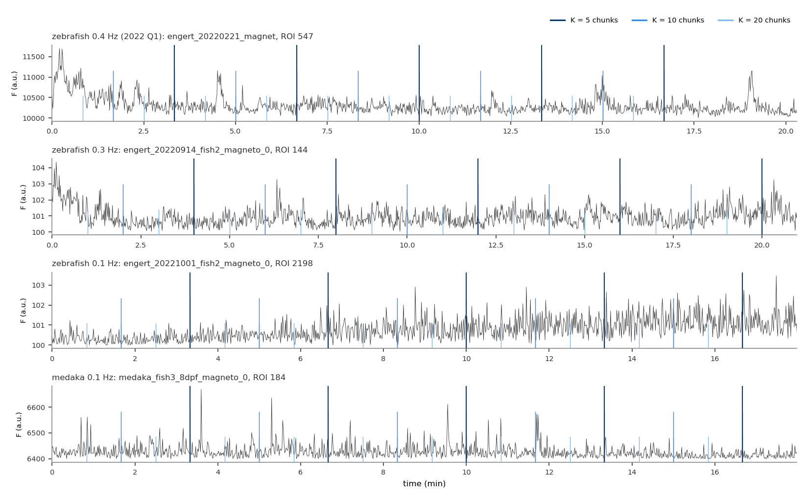
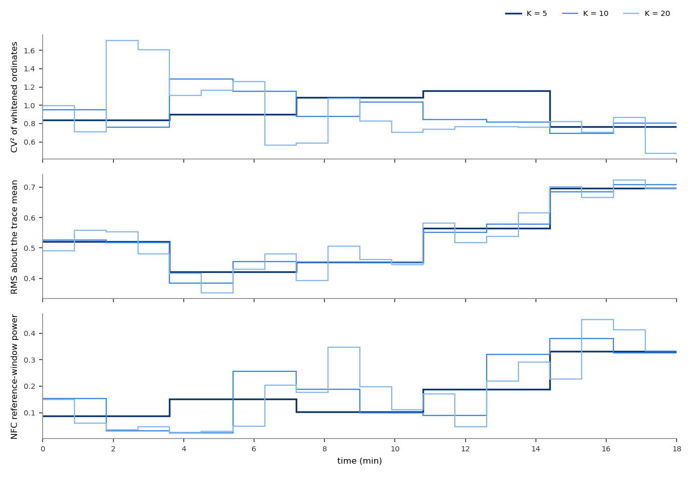
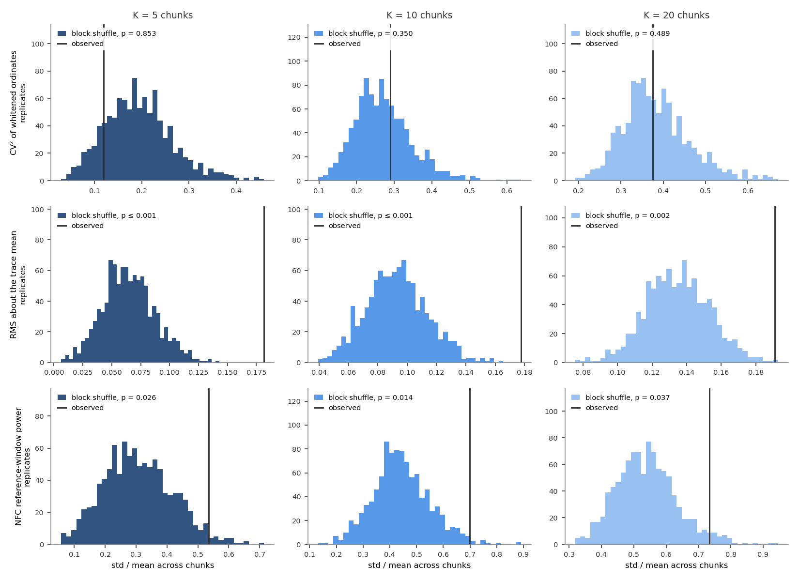
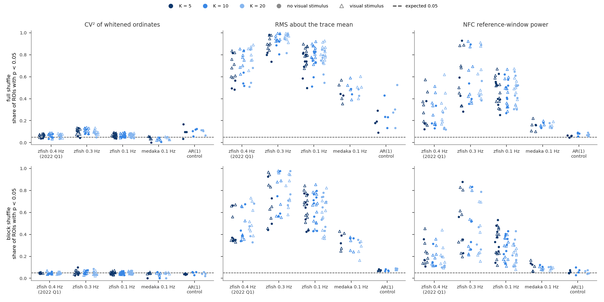

# Nonstationarity of the imaging traces

**Date:** 2026-10-12. **Branch:** `nonstationarity-doc`. **Script:** `docs/nonstationarity/nonstationarity.py --workers 24` (~20 min on 24 cores; `--figures-only` replots).

**Question.** Do a ROI's statistics change within a recording more than they would in a stationary trace with the same values and the same short-range autocorrelation? fit_Fourier's null assumes they don't.

**Summary.**
- **The shape of the spectrum is stationary.** CV² is flagged in 4.6–4.9% of ROIs, which is chance.
- **Level and amplitude are not.** The RMS about the trace mean is nonstationary in 55–59% of ROIs, and in 25–98% per recording.
- **The power in the NFC reference window is nonstationary in 21–29% of ROIs.** This is the power NFC divides by.
- **1F suspects are only slightly more often nonstationary in that window:** 32% vs 26%. Nonstationarity is widespread, and it is not what singles out the suspects.

## Method

**Population.**
- All 50 imaging recordings: every `experiments/engert_*.yml` and `medaka_*.yml`, coil on and off, with and without a visual stimulus. 33,339 ROIs in total.
- The ROIs are production's: P(iscell) > 0.5, npix ≥ 10, inside the fish outline, flatline removal; no coverage threshold.
- The traces are the full-resolution ones production analyses, over the N frames fit_Fourier uses.

**Chunks.** Each trace is cut into K = 5, 10 and 20 equal chunks; the remainder frames at the end are dropped. Three metrics are computed in each chunk:

| metric | per chunk | what it detects |
|---|---|---|
| **CV²** | var/mean² of the chunk's periodogram ordinates from 0.05 Hz to just below Nyquist, stimulus bin excluded (the CV² of [`cv2.md`](cv2.md)). Each ordinate is first divided by that ROI's mean ordinate at the same frequency over the K chunks, so the spectrum's slope does not count. | a change in how spiky or event-like the trace is; 1 for Gaussian noise |
| **RMS** | √mean((x − whole-trace mean)²) | a change in baseline level or amplitude |
| **reference-window power** | mean periodogram power in the NFC reference window: M = round(Q_frac·f / resolution) bins on each side of the stimulus bin, stimulus bin excluded, at the chunk's own resolution | a change in the power NFC divides by |

Chunks have coarser frequency resolution than the whole trace, so the same window in Hz holds fewer bins:

| | K = 5 | K = 10 | K = 20 |
|---|---|---|---|
| medaka | 6 | 4 | 2 |
| 0.1 Hz zebrafish | 12–16 | 6–8 | 4 |
| 0.3 Hz zebrafish | 22 | 10–12 | 6 |
| 2022 Q1 (0.4 Hz) | 30–72 | 14–36 | 8–18 |
| 2022 Q1 visual-only (1/60 Hz) | 4–12 | 2–6 | 2 |

- At fine resolution the reference-window metric is noisy.
- The null is built the same way, so p stays valid; only the power to detect nonstationarity drops.

**Dispersion across chunks.** The dispersion is the coefficient of variation of the K chunk values, std/mean.
- A raw std carries the trace's units, so it can't be compared across ROIs.
- The per-ROI p-value is essentially the same either way, because shuffling doesn't change the mean.

**Null.** The dispersion's null comes from 1,000 replicates of each of two shuffles of the whole trace. Within a recording, every ROI shares the same permutation in a given replicate.
- **Full shuffle:** every frame is permuted. This destroys short-range autocorrelation as well as slow structure, so it tests "independent frames", not only "stationary".
- **Block shuffle:** contiguous 10 s blocks are permuted. This keeps the values and the autocorrelation within 10 s and destroys only slower structure. 10 s is at most 1/5 of the shortest chunk (54 frames at K = 20).
- p = (1 + number of replicates with dispersion ≥ observed) / 1001. The smallest possible p is therefore 0.001.

**Control.** In each recording, up to 20 ROIs were replaced by stationary Gaussian AR(1) traces with the same lag-1 autocorrelation and variance, and run through the same procedure. Rows with `synthetic=True` in the results table.
- **Block shuffle:** p < 0.05 in 4.5–8.0% of the 1,000 traces across the nine metric × K conditions, i.e. calibrated. RMS is slightly high, 7–8%.
- **Full shuffle:** CV² is flagged in 11–13% and RMS in 20–34%. These traces are stationary by construction, so the full shuffle over-rejects through autocorrelation alone.
- **The block shuffle is therefore the null used below.**

## The procedure on example traces

**Figure 1. One ROI from each recording group, with the chunk boundaries.** Tall dark lines: K = 5. Medium: K = 10. Short light: K = 20. The finer splits include the coarser boundaries. Each ROI is the one at the 95th percentile of its recording's trace std/mean (an active cell, not an outlier). Traces: full resolution, all N frames analysed.

**Figure 2. The three metrics, chunk by chunk, for Figure 1's 0.1 Hz zebrafish ROI** (engert_20221001_fish2_magneto_0, ROI 2198). Each step is one chunk; colour = K. The ROI's activity grows over the recording (Figure 1, third row), and RMS and reference-window power rise with it. CV² wanders around 1 with no trend.

**Figure 3. Where the same ROI's dispersions sit on the two nulls.** Rows: metric. Columns: K. Histograms: dispersion (std/mean across chunks) in 1,000 shuffles, 40 bins; grey = full shuffle, blue = block shuffle (shade = K). Black: observed. CV² is typical (block p = 0.48–0.81). RMS is beyond every replicate at all three K (p ≤ 0.001). Reference-window power is in the top 1–5% (block p = 0.009–0.052).

## Population

**Figure 4. Share of ROIs whose dispersion has p < 0.05, per recording.** Columns: metric. Top row: full-shuffle null. Bottom row: block-shuffle null. Within each group, colour = K (dark = 5, medium = 10, light = 20). Filled circles: recordings without a visual stimulus. Open triangles: recordings with the grating. AR(1) control: the synthetic traces pooled per recording group, one point per group and K. Dashed: 0.05, the share expected when every ROI is stationary.

Under the block null, the share of ROIs with p < 0.05 (all 33,339 ROIs):

| | K = 5 | K = 10 | K = 20 |
|---|---|---|---|
| CV² | 4.9% | 4.8% | 4.6% |
| RMS | 55% | 57% | 59% |
| reference-window power | 29% | 27% | 21% |

- **Recording groups differ.** 0.3 Hz and 0.1 Hz zebrafish are the most nonstationary (RMS 38–98% of ROIs per recording), then 2022 Q1, then medaka (RMS 25–46%, reference-window power at most 15%).
- **The grating makes no consistent difference.**
- **Coil on vs coil off.** Comparing each magneto recording with its no_magneto twin (same fish, same trial number; 19 pairs, K = 10):
  - RMS nonstationarity is higher with the coil on in 14 of 19 pairs (median +8 percentage points, Wilcoxon p = 0.03);
  - reference-window power is higher in 12 of 19 (+8 points, p = 0.016);
  - CV² does not differ (p = 0.83).
- **But coil condition and acquisition order are confounded.** The two conditions are separate acquisitions. Medaka's no-magnet folder is named `14844_after`, so it was recorded later; the order is unknown for the zebrafish.
- **The 1F suspects** are the 2,885 ROIs with production 1F p < 0.01. At K = 10 they are nonstationary about as often as the other ROIs in CV² (5.3% vs 4.7%) and RMS (57% vs 57%). In reference-window power the rate is slightly higher: 32% vs 26%, Fisher p = 1.5e-12.

## What this means for the test

- **The spectral shape fit_Fourier's null assumes holds chunk by chunk.** CV² is at chance in every group.
- **What changes over time is how much power the trace has.**
  - Level and amplitude drift: activity epochs, the onset transient visible at the start of several traces in Figure 1, slow drift.
  - With them, the power in the NFC reference window drifts.
- **A recording with drifting power** is a mixture of quieter and louder stretches. The periodogram ordinates of such a mixture are more variable than a single exponential.
- **The modest suspect enrichment (32% vs 26%) suggests this costs some calibration.** It is not the main source of the suspects.

Outputs (gitignored, next to the script):
- `results_nonstationarity.csv`: one row per ROI, with each metric × K × null's observed dispersion, p and ratio to the null median, plus the 1F p-value;
- `results_nonstationarity_examples.npz`: the four example recordings' traces, chunk series and null replicates.
