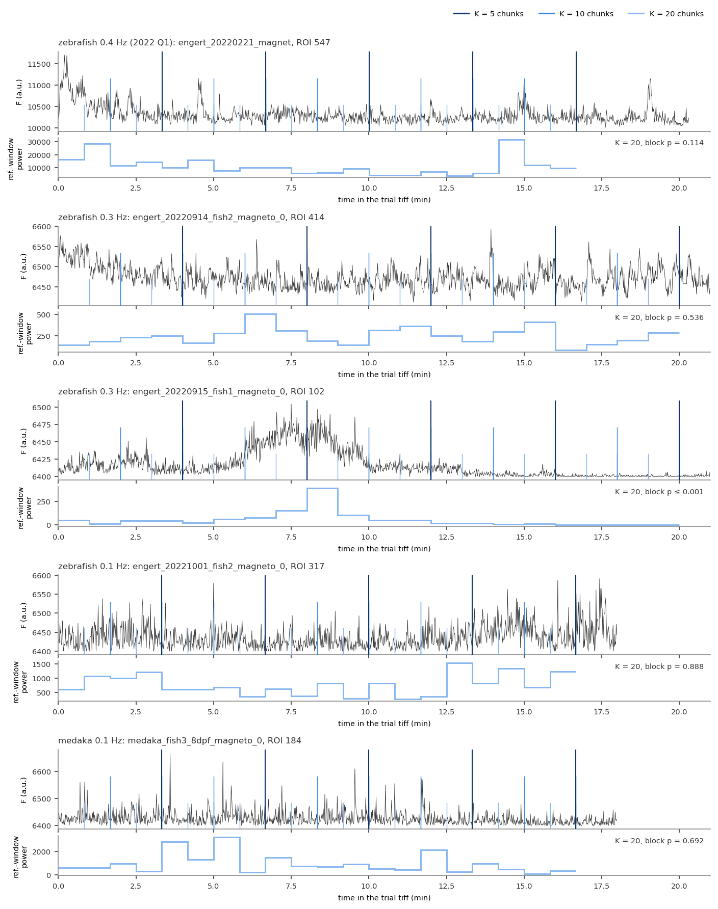
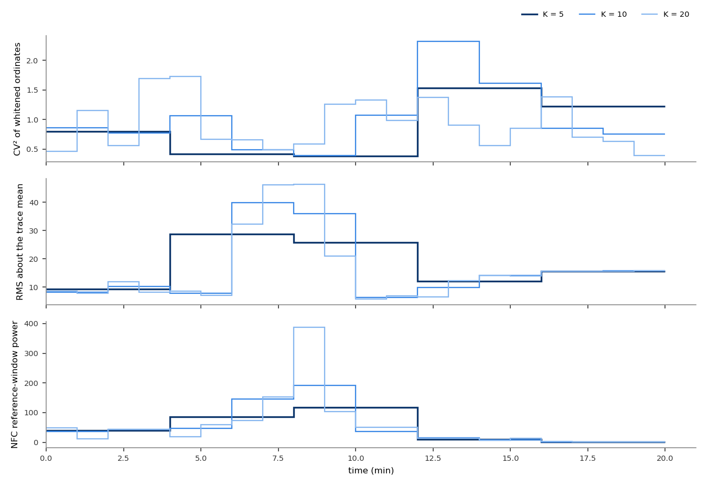
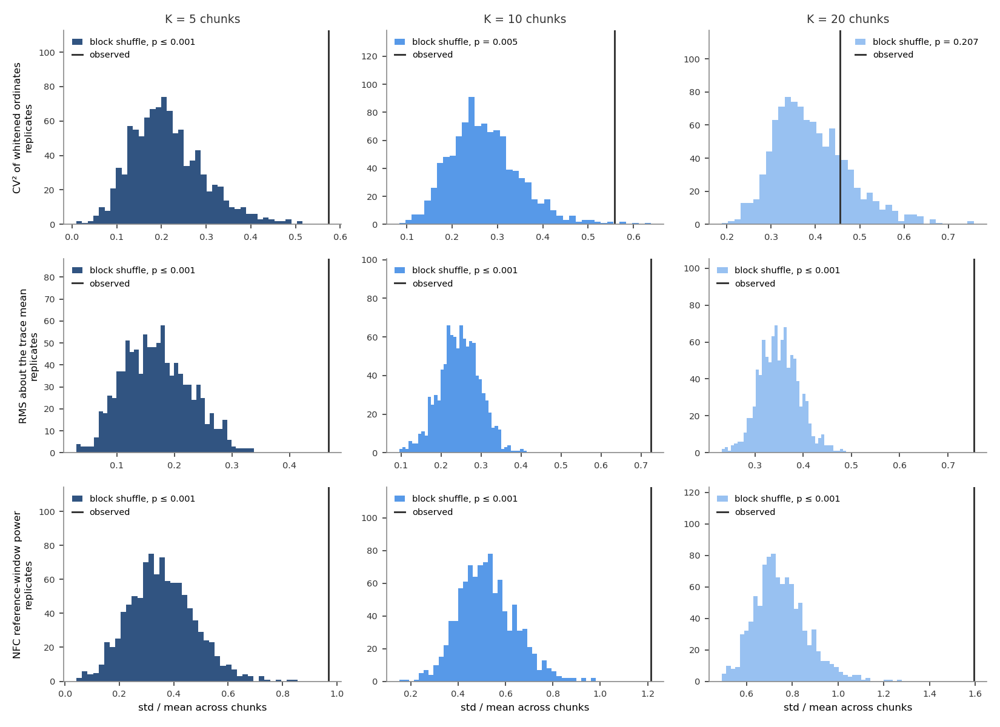
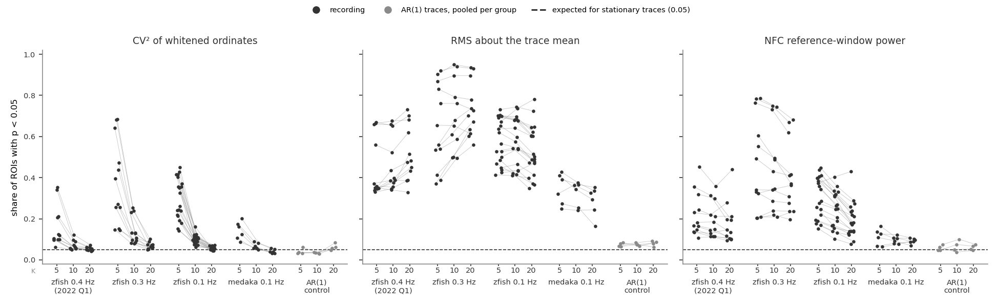
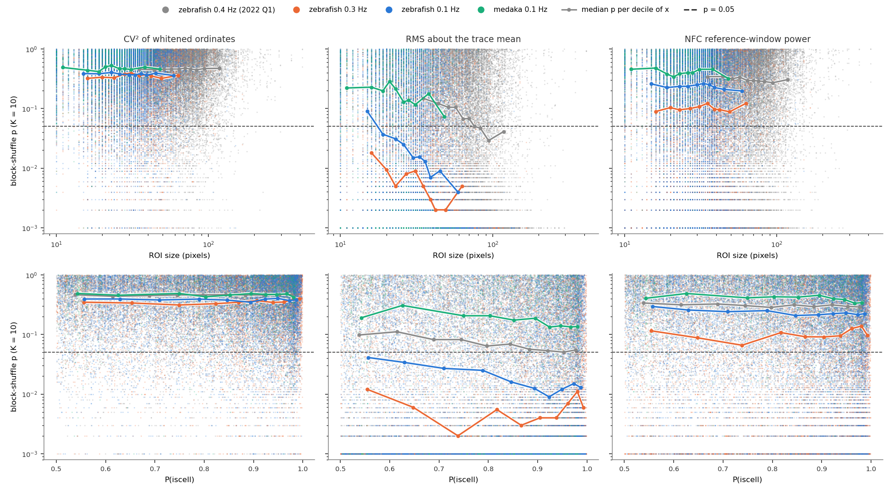

# Nonstationarity of the imaging traces: power changes within a recording in half the ROIs, the spectral shape changes with it, and neither picks out the suspects

**Date:** 2026-10-14 (rerun on the re-segmented zebrafish ROIs of [`resegmentation.md`](resegmentation.md), with the CV² normalisation fixed; first version 2026-10-12). **Script:** [`nonstationarity/nonstationarity.py`](nonstationarity/nonstationarity.py). **Related:** [`fourier_grid_shift.md`](fourier_grid_shift.md) (the shifted Fourier grid used for the 2022 Q1 chunks), [`zplane.md`](zplane.md) (focal-plane drift), [`photon_starved_imaging.md`](photon_starved_imaging.md) (index of the photon-starved imaging fixes).

**Question.** Do a ROI's statistics change within a recording more than they would in a stationary trace with the same values and the same short-range autocorrelation? fit_Fourier's null assumes they don't. If they do, does that explain the excess of suspects (ROIs with production p < 0.01 at the stimulus frequency)?

## Summary

- **Power is nonstationary in about half of all ROIs.** The overall level and amplitude of the trace (RMS) change across the recording far more often than chance; the power in the NFC reference window, which NFC divides by, changes in a quarter (Table 2).
- **The shape of the spectrum changes too, mostly together with the power.** In long chunks a fifth of the ROIs are flagged; the flags fall almost only on ROIs whose power also changes, and a chunk's spectral shape moves opposite to its power. An earlier version of this report found the shape stationary; that came from a normalisation bug, now fixed.
- **The 0.3 Hz zebrafish are the most nonstationary group, mostly because of one fish, 20220915_fish1.** Its coil-on trials, now corrected to under a pixel of lateral drift, are still the most nonstationary recordings in the data, so lateral drift doesn't explain them. Focal-plane drift explains only a few points in the one session where it can be measured ([`zplane.md`](zplane.md)).
- **Nonstationarity doesn't produce the suspects.** Suspects are flagged no more often than the other ROIs, and in the reference window less often (Table 5).

## Method

**Population.**
- All 50 imaging recordings: every `experiments/engert_*.yml` and `medaka_*.yml`, coil on and off, with and without a visual stimulus. 40,255 ROIs.
- The ROIs are production's: P(iscell) > 0.5, npix ≥ 10, inside the fish outline, flatline removal; no coverage threshold. The five photon-starved zebrafish sessions use the re-segmented production ROIs ([`resegmentation.md`](resegmentation.md)): drift-corrected in whole pixels and about twice the size of the previous ones.
- The traces are the full-resolution ones production analyses, over the N frames fit_Fourier uses.

**Chunks of whole stimulus cycles, nested across resolutions.** Each trace is cut into K = 5, 10 and 20 equal chunks.
- **Each chunk holds a whole number of cycles of the recording's analysis frequency f,** so a response at f stays in one Fourier coefficient and doesn't leak into its neighbours.
- **The resolutions nest.** A K = 5 chunk is exactly two K = 10 chunks and four K = 20 chunks, so all three resolutions use the same frames. The K = 20 chunk length L is the longest ≤ N/20 for which L, 2L and 4L all hold whole cycles. Frames after the last chunk are not used.
- **With 1 s frames this is exact:** chunks are multiples of 10 frames, which is one cycle of 0.1 Hz and three cycles of 0.3 Hz.
- **In the 2022 Q1 recordings it can't be exact,** because the frame period is 1.0212 s. A cycle there is 2.448 frames at 0.4 Hz and 58.75 frames at 1/60 Hz. The leftover, at most 0.07 cycles, is removed by shifting the chunk's Fourier grid by that fraction of a bin, as production does for whole traces (`fit_Fourier(align="shift")`, [`fourier_grid_shift.md`](fourier_grid_shift.md)).

**Table 1.** Chunk length in frames (stimulus cycles) and reference-window coefficients per chunk, and the frames used (the same at every K).

| recordings | N | f | frames used | K = 5 | K = 10 | K = 20 |
|---|---|---|---|---|---|---|
| medaka | 1080 | 0.1 Hz | 1000 | 200 (20), 6 | 100 (10), 4 | 50 (5), 2 |
| 0.1 Hz zebrafish | 1080 | 0.1 Hz | 1000 | 200 (20), 12 | 100 (10), 6 | 50 (5), 4 |
| 0.1 Hz zebrafish (20221002_fish1) | 1260 | 0.1 Hz | 1200 | 240 (24), 14 | 120 (12), 8 | 60 (6), 4 |
| 0.3 Hz zebrafish | 1200 / 1260 | 0.3 Hz | 1200 | 240 (72), 22 | 120 (36), 10 | 60 (18), 6 |
| 2022 Q1, 02_21 and 02_23 | 1194 | 0.4 Hz | 980 | 196 (80), 24 | 98 (40), 12 | 49 (20), 6 |
| 2022 Q1, 03_01 | 2936 | 0.4 Hz | 2840 | 568 (232), 70 | 284 (116), 34 | 142 (58), 18 |
| 2022 Q1 visual, 02_21 and 02_23 | 1194 | 1/60 Hz | 1180 | 236 (4), 4 | 118 (2), 2 | 59 (1), 2 |
| 2022 Q1 visual, 03_01 | 2936 | 1/60 Hz | 2360 | 472 (8), 10 | 236 (4), 4 | 118 (2), 2 |

Nesting costs frames only in the 1194-frame 0.4 Hz recordings and the 03_01 grating test (about 80% used); everywhere else at least 92% of the frames are used.

**Three metrics per chunk.**

| metric | per chunk | what it detects |
|---|---|---|
| **CV²** | var/mean² of the chunk's periodogram ordinates from 0.05 Hz to just below Nyquist, stimulus coefficient excluded (the CV² of [`cv2.md`](cv2.md)). Each ordinate is first divided by the same ROI's mean ordinate at that frequency over its K chunks ("whitened"), so the ROI's average spectral shape doesn't count, only how a chunk departs from it. | a change in the shape of the spectrum; scale-free, so a pure change of gain leaves it unchanged |
| **RMS** | √mean((x − whole-trace mean)²) | a change in baseline level or amplitude |
| **reference-window power** | mean power of the M = round(Q_frac × cycles) coefficients on each side of the stimulus coefficient, stimulus coefficient excluded: production's NFC window at the chunk's resolution | a change in the power NFC divides by |

At fine resolution the reference window holds only a few coefficients (Table 1), and a chunk's CV² rests on fewer ordinates, so both are noisier there. The null is built the same way, so p stays valid; only the power to detect a change drops.

**Dispersion across chunks.** The test statistic is the coefficient of variation of the K chunk values, std/mean. It is scale-free, so it can be compared across ROIs.

**Null: block shuffle.** The dispersion's null comes from 1,000 shuffles of the whole trace in contiguous 10 s blocks.
- Block shuffling keeps the values and the autocorrelation within 10 s and destroys only slower structure.
- Within a recording, every ROI gets the same permutation in a given replicate.
- p = (1 + number of replicates with dispersion ≥ observed) / 1001, so the smallest possible p is 0.001. A ROI is called nonstationary in a metric when p < 0.05.

**Control: stationary synthetic traces.** In each recording, 20 ROIs were replaced by synthetic traces (1,000 in all) and run through the same procedure (rows with `synthetic=True` in the results table).
- The synthetic traces are first-order autoregressive, AR(1): x<sub>t</sub> = ρ·x<sub>t−1</sub> + ε<sub>t</sub>, with Gaussian ε. ρ is the ROI's own lag-1 autocorrelation (median 0.24; the 10th–90th percentile range runs from 0.00–0.41 in medaka to 0.04–0.80 in the 0.3 Hz zebrafish), and the trace is scaled to the ROI's mean and variance.
- They keep the ROI's short-range memory (the calcium decay) and are stationary by construction: exactly the case the null must not flag.
- **The block shuffle is calibrated on them:** p < 0.05 in 3.4–7.6% of synthetic traces across the nine metric × K combinations, highest (7–8%) for RMS.
- **Why not permute single frames:** that destroys short-range autocorrelation along with slow structure, so it tests "independent frames" rather than "stationary". On the same AR(1) traces it flags RMS in 18–28%. The script still computes it (`p_full_*` columns); nothing in this report uses it.

## In one ROI, an activity epoch changes the power and the spectral shape together

**What to look for.** If a cell's trace is stationary, each chunk should look like a random sample of the same process: the chunk-to-chunk scatter of each metric should be no larger than after block shuffling. A cell that is active for a few minutes and quiet otherwise should instead show high power in the active chunks.



<sub>**Figure 1. One ROI per recording group (two for the 0.3 Hz zebrafish, one per fish), each as a pair of panels.** *Upper:* the raw full-resolution trace with the chunk boundaries: tall dark lines K = 5, medium K = 10, short light K = 20 (where lines coincide the darker one shows; the last dark line ends the last chunk). *Lower:* the ROI's reference-window power in each K = 20 chunk, with its block-shuffle p. Each ROI is the one at the 95th percentile of its recording's trace std/mean (an active cell, not an outlier). Time is time in the trial tiff.</sub>



<sub>**Figure 2. The three metrics, chunk by chunk, for Figure 1's 20220915_fish1 ROI** (engert_20220915_fish1_magneto_0, ROI 102). Each step is one chunk; shade = K (dark = 5, light = 20).</sub>



<sub>**Figure 3. Where the same ROI's dispersions fall on the block-shuffle null.** Rows: metric. Columns: K. Histograms: dispersion (std/mean across chunks) in 1,000 block shuffles; shade = K. Black line: observed dispersion. Legends give the block-shuffle p.</sub>

The 20220915_fish1 ROI is quiet except for one activity epoch a few minutes long (Figure 1, third pair). The epoch alone raises RMS and reference-window power in its chunks (Figure 2), and puts both dispersions beyond every shuffle at every K (Figure 3).

The spectral shape moves the other way: CV² is lowest in the active chunks and highest in the quiet ones (Figure 2, top). That is what whitening predicts when activity changes the spectrum's shape as well as its size. The ROI's mean spectrum is dominated by the active chunks, which have the slow, red spectrum of calcium events; a quiet chunk's flatter noise spectrum, divided by it, is no longer flat, so its CV² rises. The CV² dispersion is beyond all shuffles at K = 5 but typical at K = 20, where each chunk's CV² rests on only about 20 ordinates.

Time in these figures is time in the trial tiff, which is stitched from 60 s chunks of the session, interleaved with the other two conditions' chunks ([`full_resolution_rerun.md`](full_resolution_rerun.md) section 3). A few minutes of tiff time therefore span several times as long in the session.

## Power changes in half of all ROIs, most in the 0.3 Hz zebrafish and least in medaka

**The question.** Is the example typical? A stationary population would put about 5% of ROIs below p = 0.05 in every metric, as the AR(1) traces do.



<sub>**Figure 4. Share of ROIs with block-shuffle p < 0.05, per recording.** Columns: metric. Within each recording group, the three columns of points are K = 5, 10 and 20 (labelled under the axis); a thin line joins one recording's three K. Black: recordings (50). Grey: the AR(1) traces, pooled per recording group. Dashed: 0.05, the share expected when every ROI is stationary.</sub>

**Table 2.** Share of ROIs with block-shuffle p < 0.05, all 40,255 ROIs pooled.

| | K = 5 | K = 10 | K = 20 |
|---|---|---|---|
| CV² | 24% | 9.1% | 5.7% |
| RMS | 52% | 54% | 55% |
| reference-window power | 29% | 25% | 22% |

**RMS and reference-window power are nonstationary in every recording group, at every K** (Figure 4). The groups are ordered the same way in both metrics: the 0.3 Hz zebrafish highest, then the 0.1 Hz zebrafish, the 2022 Q1 zebrafish, and medaka lowest. Every recording is above the AR(1) traces in RMS; in reference-window power only the least nonstationary medaka recordings come close to them.

**The grating trials are slightly less nonstationary in reference-window power, and no different otherwise.** Comparing trials 1–2 (grating) with trial 0 (no grating) of the same fish and coil condition, the reference-window share is lower with the grating in 11 of 12 fish × coil pairs (K = 10; Wilcoxon p = 0.03), by a few points. RMS shows no consistent difference, and CV² none that reaches significance. A periodic, stationary grating response that adds the same power to every chunk would lower the window's relative dispersion; this is not tested. The 2022 Q1 recordings are not compared: their visual-only recordings are tested at 1/60 Hz, with a different reference window.

**Coil on vs coil off: on tends to be more nonstationary, but the comparison is weak.** Each magneto recording was compared with its no_magneto twin (same fish, same trial number; 19 pairs, K = 10). With the coil on, the RMS share is higher in 13 of 19 pairs (median +11 percentage points, Wilcoxon p = 0.04), the reference-window share in 12 of 19 (p = 0.13), and the CV² share in 15 of 19 (p = 0.01, consistent with CV² tracking power, next section). Three things keep this from being an effect of the coil:
- the 19 pairs come from seven fish, so they are not independent;
- coil on and off are separate acquisitions, so coil is confounded with acquisition order (medaka's coil-off folder is named `14844_after`, recorded later; the order is unknown for the zebrafish);
- in 20221001_fish1, coil on and coil off were imaged at different focal planes ([`zplane.md`](zplane.md)).

## The spectral shape changes too, almost only where the power changes

**The question.** fit_Fourier's null uses the shape of the spectrum around f. Does the shape change within a recording, independently of the power?

**What each explanation predicts.** A change of gain alone (bleaching, a focal-plane drift that dims a cell, a uniform change in activity) scales every ordinate of a chunk equally and leaves whitened CV² unchanged. Activity epochs change the shape: active chunks have the red spectrum of calcium events, quiet chunks a flatter one. Then CV² is flagged mainly in ROIs whose power also changes, and moves opposite to the power from chunk to chunk (as in Figure 2).

**The result follows the activity-epoch prediction.**
- CV² is nonstationary well above chance at K = 5 and falls to near chance at K = 20 (Table 2, Figure 4). The AR(1) control is calibrated at every K, so the fall reflects lower power at fine resolution (fewer ordinates per chunk), not a failing null.
- The CV² flags fall on ROIs that are also flagged for power. Among ROIs whose RMS and reference-window power are both stationary, CV² is flagged at about the chance rate at every K; at K = 5, 89% of the CV² flags are in ROIs flagged for power as well.
- Within a ROI, chunk CV² and chunk power move in opposite directions: in the five example recordings, the median per-ROI Spearman correlation between them across the K = 5 chunks is between −0.5 and −0.9.
- In four of the five example recordings, the chunk that stands out most in the CV²-flagged ROIs is most often the first one, which contains the onset transient visible at the start of several traces in Figure 1.

**What it means.** The shape of the spectrum is not stationary, but its changes are the same activity epochs that change the power, seen through a different lens; there is no separate source of nonstationarity in the shape. The earlier version of this report found CV² at chance everywhere. Its whitening divided each ordinate by the mean over all ROIs of the recording rather than by the ROI's own mean, which left every ROI's own spectral colour in and swamped the chunk-to-chunk change.

## The 0.3 Hz excess is mostly one fish, 20220915_fish1, and lateral drift doesn't explain it

**The question.** Why are the 0.3 Hz zebrafish the most nonstationary group? Lateral drift was the obvious suspect: suite2p's registration fails on these dim movies, and 20220915_fish1's coil-on trials drift by up to 20 px. Since 2026-10-12 production corrects that drift in whole pixels before segmentation ([`resegmentation.md`](resegmentation.md)). If drift was the cause, the corrected recordings should look like the others.

**Table 3.** Share of ROIs nonstationary at K = 10, and lateral drift, per fish and coil condition (range over the three trials). Drift is the 95th-percentile displacement within the trial, measured on the raw tiffs from 60-frame averages; "after correction" is what the whole-pixel shift leaves (approximated from the 10-frame drift minus its rounding).

| recordings | ROIs per trial | RMS | reference-window power | drift before correction (px) | after correction (px) |
|---|---|---|---|---|---|
| 20220914_fish2, coil off | ~845 | 59–68% | 29–34% | 1.7–2.0 | 0.6 |
| 20220914_fish2, coil on | ~850 | 50% | 21–24% | 1.1–1.8 | 0.6 |
| 20220915_fish1, coil off | ~560 | 65–79% | 43–49% | 1.1–1.2 | 0.6–0.7 |
| 20220915_fish1, coil on | ~585 | 90–95% | 73–75% | **6–17** | 0.6 |
| 0.1 Hz zebrafish (median of 20) | | 56% | 26% | 1.4 | |
| medaka (median of 6) | | 35% | 10% | 1.4 | |
| 2022 Q1 (median of 12) | | 39% | 17% | 1.7 | |

- **20220914_fish2 looks like the 0.1 Hz zebrafish.** The group's excess is 20220915_fish1.
- **Correcting the drift didn't remove 20220915_fish1's excess.** Its coil-on trials are now corrected to under a pixel and remain the most nonstationary recordings in the data. Its coil-off trials barely moved to begin with and are still among the most nonstationary of the rest. Lateral drift is not what makes this fish nonstationary.
- **Across all 50 recordings, nonstationarity doesn't follow the drift that remains.** With the re-segmented sessions' drift replaced by their residual, the Spearman correlation with the RMS share is −0.15 (reference-window power: −0.03). Before correction there was a moderate positive correlation, driven by 20220915_fish1's coil-on trials. Medaka and 2022 Q1 are registered by suite2p, so their raw drift is corrected too.
- **Focal-plane drift is real but explains little.** In 20221001_fish1, the one session with a usable z-stack, dividing each trace by its predicted z gain lowers the share of nonstationary ROIs by only a few points ([`zplane.md`](zplane.md#4-dividing-out-the-z-drift-removes-little-of-the-nonstationarity)). Whether 20220915_fish1 drifts in z can't be tested; it has no stack.

**Does the start of the recording carry it?** The twelve 0.3 Hz recordings were rerun with the first 3 or 5 minutes of each trace removed. A shorter trace has less power to detect anything, so as a control the same number of frames was removed from the end instead.

**Table 4.** Median share of ROIs nonstationary at K = 10 over the three trials (RMS / reference-window power), after removing part of each trace. The values with nothing removed are in Table 3.

| | first 3 min | last 3 min | first 5 min | last 5 min |
|---|---|---|---|---|
| 20220914_fish2, coil off | 47 / 22% | 57 / 27% | 43 / 20% | 45 / 21% |
| 20220914_fish2, coil on | 34 / 16% | 46 / 19% | 28 / 14% | 41 / 19% |
| 20220915_fish1, coil off | 65 / 33% | 67 / 38% | 38 / 21% | 56 / 31% |
| 20220915_fish1, coil on | 84 / 57% | 91 / 67% | 68 / 43% | 80 / 60% |

- **The first minutes carry more nonstationarity than the last.** Removing the start lowers the shares more than removing the end, in every fish and condition, most clearly for reference-window power. Since the drift is now corrected, this is not the drifting start of 20220915_fish1's coil-on trials; the onset transient at the start of several traces (Figure 1) is a candidate.
- **Part of the drop is only the shorter trace:** removing the end lowers the shares too.
- **20220915_fish1's coil-on trials stay the most nonstationary even without their first 5 minutes,** so their excess isn't confined to the start.

## Nonstationarity barely depends on ROI size or P(iscell)

**The question.** Could nonstationarity be an ROI-quality effect, small or doubtful ROIs whose traces wander? If so, p should fall with smaller ROIs and lower P(iscell). ROI size is the number of pixels in the suite2p mask (npix ≥ 10 in production); P(iscell) is suite2p's classifier probability (> 0.5 in production).



<sub>**Figure 5. Block-shuffle p (K = 10) of each metric against ROI size (top, log scale) and P(iscell) (bottom), every ROI.** Dots: ROIs, coloured by recording group. Lines: median p per decile of the x variable, within each group. Dashed: p = 0.05; lower p = more nonstationary. The row at p = 0.001 is the floor (beyond all 1,000 shuffles); vertical stripes are integer pixel counts.</sub>

- **ROI quality explains almost none of it.** Within each recording group, the Spearman correlation between p and ROI size or P(iscell) is at most 0.15 in size for every metric (printed by the script).
- **Where there is a trend, it runs the other way from the worry.** Larger ROIs are slightly *more* nonstationary in RMS, in every group. That fits real cells with more signal, whose slow changes in activity are easier to detect, rather than junk ROIs.
- **The groups differ more than any size trend.** The 2022 Q1 ROIs are about twice the size of the others and less nonstationary than the 0.3 Hz and 0.1 Hz zebrafish, so a pooled curve would mostly show the mix of groups. That is why Figure 5 draws one curve per group.

## The suspects are not more nonstationary than the other ROIs

**The question.** If nonstationarity produced the excess suspects, the suspects should be flagged as nonstationary more often than the other ROIs of the same kind of test.

The tests split into three kinds that should not be pooled:
- **magnetic frequency, no visual stimulus:** 128 suspects of 13,973 ROIs (the trial-0 recordings, 20221002_fish1, and the 2022 Q1 magnet and nostim recordings);
- **magnetic frequency, grating trials:** 290 of 20,596 (trials 1–2 and 2022 Q1 visual+magnet);
- **grating frequency, 1/60 Hz:** 2,781 of 5,686 (the four 2022 Q1 visual-only recordings). These are real grating responders.

**Table 5.** Share of ROIs nonstationary at K = 10 (block-shuffle p < 0.05), suspects vs the other ROIs of the same kind of test; Fisher's exact test.

| tests | CV² | RMS | reference-window power |
|---|---|---|---|
| magnetic, no visual | 5.5% vs 9.2% (p = 0.21) | 52% vs 54% (p = 0.72) | 17% vs 26% (p = 0.02) |
| magnetic, grating trials | 9.0% vs 9.4% (p = 0.92) | 50% vs 55% (p = 0.10) | 16% vs 25% (p = 0.0002) |
| grating 1/60 Hz | 6.8% vs 9.3% (p = 0.0004) | 49% vs 52% (p = 0.01) | 24% vs 29% (p = 8e-5) |

- **In no kind of test are the suspects more nonstationary.** Where there is a difference, the suspects are *less* nonstationary, most consistently in reference-window power. K = 5 and 20 agree (results table, script output).
- **So nonstationarity is not a candidate explanation for the excess suspects.** A ROI whose window power drifts is, if anything, less likely to be a suspect.
- **The first version of this report found an enrichment.** It came from pooling the grating responders with the magnetic suspects, and from chunks that weren't whole cycles, so that part of each response leaked into the reference window.

## Implications

1. **fit_Fourier's stationarity assumption is wrong for these traces, but not in a way that makes suspects.** Half the ROIs change power within a recording, and their spectral shape changes with it. The suspects don't carry more of it than other ROIs, so the excess suspects need another explanation.
2. **Treat CV² as a second view of the power changes, not an independent test.** After the fix it tracks the activity epochs that RMS and reference-window power already detect.
3. **20220915_fish1 is nonstationary for reasons other than lateral motion.** Its traces stay the most nonstationary after drift correction, with the coil on and off. Focal-plane drift can't be tested in this fish; where it can be (20221001_fish1), it explains little. The cells' own slow changes in activity remain the simplest explanation, untested.
4. **The coil-on vs coil-off difference shouldn't be read as a coil effect** while coil is confounded with acquisition order and, in one fish, focal plane.

## Reproducing

```bash
# magneto2 env, from the repository root; reads the NWB files in data/ and data/manuscript/all_fourier_df.parquet
python docs/nonstationarity/nonstationarity.py --workers 24   # ~22 min on 24 workers; Tables 1, 2, 5, Figures 1-5, AR(1) control
python docs/nonstationarity/nonstationarity.py --figures-only # replot from results_nonstationarity.csv (a few minutes)
python docs/nonstationarity/trim.py --workers 24              # Table 4 (~15 min)
```

`--figures-only` still rereads P(iscell) and npix from every NWB file for Figure 5 (`roi_quality()` rebuilds `results_nonstationarity_roi_quality.csv` on every run), and computes any example recording missing from `results_nonstationarity_examples.npz`. From a git worktree, set `NS_DATA_DIR=<main checkout>/data` (the NWB files are untracked).

**Not in the repository:** the drift columns of Table 3 and the drift correlations come from two helper scripts in a session scratchpad, `C:/Users/dan/AppData/Local/Temp/claude/C--Users-dan-Documents-magnet-search/7b5017f9-0cf3-4319-8424-8c56a2e0390e/scratchpad/ns_drift.py` and `ns_drift_resid.py` (each takes `results_nonstationarity.csv` as its argument). They read the raw-tiff motion measurements in another scratchpad (`.../174c0308-989b-416f-b11b-bc1a26de6f0d/scratchpad/motion/motion_*.npz`) and `docs/resegmentation/results_bins_*.csv`. The grating and coil pair comparisons and the CV²-vs-power checks of the CV² section are likewise scratchpad scripts (`doc_numbers.py`, `doc_numbers2.py`, `cv2_probe.py` in the first scratchpad). Scratchpads are temporary; these numbers can't be regenerated once they are gone.

Outputs (gitignored, next to the scripts):
- `results_nonstationarity.csv`: one row per ROI (real and synthetic), with each metric × K × null's observed dispersion, p and ratio to the null median; the chunk length, number of cycles and leftover per K; the production p-value at the analysis frequency (`p_1F`).
- `results_nonstationarity_examples.npz`: the five example recordings' traces, chunk series and null replicates (Figures 1–3).
- `results_nonstationarity_roi_quality.csv`: P(iscell) and npix of every ROI (Figure 5).
- `results_trim.csv`: per 0.3 Hz recording and removed part, the share of ROIs with block-shuffle p < 0.05 for every metric and K (Table 4).
- `fig_ns_*.png`: Figures 1–5.

### Parameters

| parameter | value | where |
|---|---|---|
| chunks per trace K | 5, 10, 20 (nested) | `KS` |
| block length of the shuffle | 10 s | `BLOCK_S` |
| shuffle replicates | 1,000 per null | `N_REP` |
| lowest frequency in CV² | 0.05 Hz | `F_MIN` |
| largest cycle leftover removed by the grid shift | 0.07 cycles | `CYCLE_TOL` |
| synthetic AR(1) traces per recording | 20 | `N_SYNTH` |
| significance level | 0.05 | `ALPHA` |
| detailed example (Figures 2–3) | engert_20220915_fish1_magneto_0 | `EXAMPLE_DETAIL` |
| suspect threshold | production p < 0.01 | `summary()` |
| removed minutes (Table 4) | 3, 5, from the start or the end | `trim.py`, `TRIM_S` |
