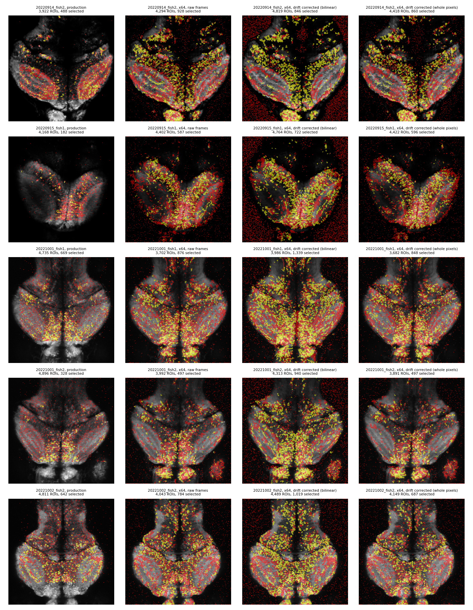
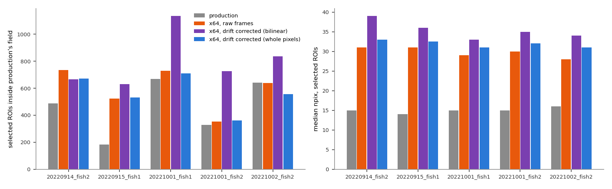
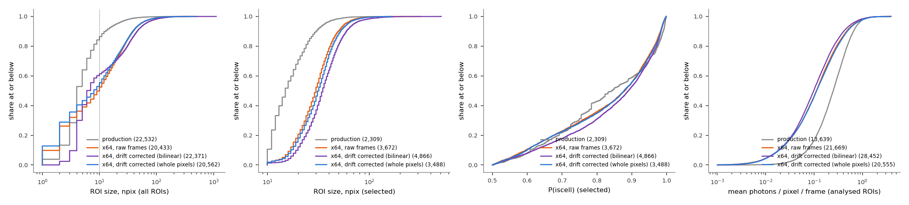
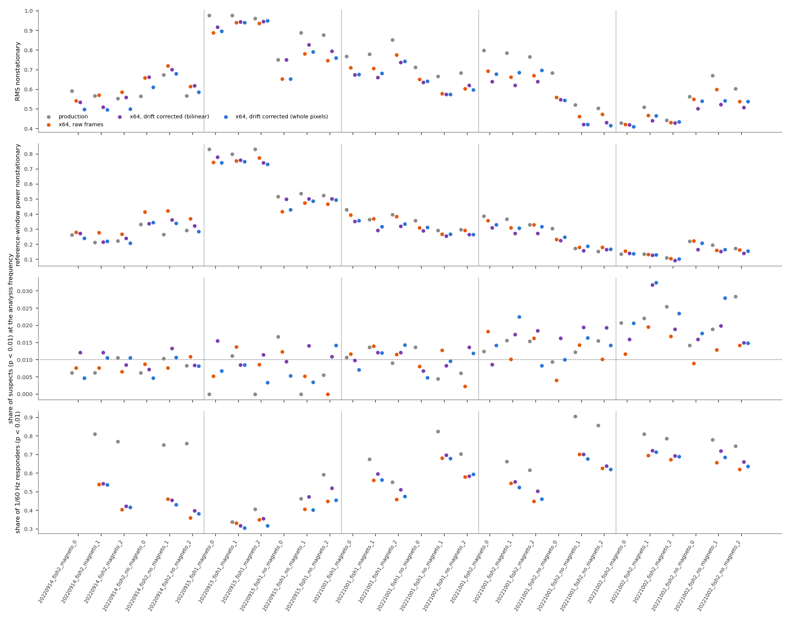

# Re-segmenting the photon-starved zebrafish: ROIs twice as large that collect twice the photons, and the magnetic results don't change

**Date:** 2026-10-12

**Scope:** the five photon-starved zebrafish sessions. These are every 0.1 / 0.3 Hz zebrafish session except 20221002_fish1, whose tiffs were saved ×256. They hold 30 experiments.
- suite2p is re-run three ways, and production's analyses are repeated on each result.
- **Production status:** the recommended version (×64, drift corrected in whole pixels) went into production on 2026-10-12. The run script is [`resegmentation/run_production.sh`](resegmentation/run_production.sh) (`docs/suite2p_v1/run_suite2p_v1.py --scale 64 --shifts`). The 30 YAMLs point at `C:\Users\dan\suite2p_v1_production\<session>_x64_drift\`, and the NWB files and the parquet were regenerated.
  - The production run has the same ROIs and P(iscell) as this report's run, and its traces agree to float32 rounding. This report's "x64, whole pixels" rows now read the production run.
  - The other variants live in `C:\Users\dan\suite2p_v1_custom_reg\`.
  - "Production" in the tables below means the previous production run.

**Related:**
- [`photon_starved_imaging.md`](photon_starved_imaging.md): the index for the photon-starved recordings.
- [`custom_registration.md`](custom_registration.md): the first session done (20220915_fish1); the drift measurement and why suite2p doesn't register these movies.
- [`nonstationarity.md`](nonstationarity.md): the nonstationarity tests.
- [`cv2.md`](cv2.md): why suite2p halving these movies leaves only a few grey levels.

## Summary

Production segments these sessions on the unscaled tiffs. suite2p halves them, which leaves only a few grey levels, so most of its ROIs are small fragments (median 14–16 px).

Re-running suite2p on tiffs ×64, with its registration off, gives larger ROIs that cover more of each cell:
- **Size:** median 28–39 px.
- **Count:** 1.5–2.1× as many ROIs pass production's selection.
- **Same cells, better traces:** on the same cells, a re-segmented ROI collects about twice the photons per frame of the production fragments inside it. It responds to the grating at least as often.

The conclusions don't change:
- the 0.3 Hz suspects stay at chance;
- the 0.1 Hz excess is the same as in production, with the coil on and off alike;
- nonstationarity drops by a few points.

**Recommendation:** the most conservative version is ×64 with the drift corrected in whole pixels. It finds 3,488 selected ROIs against production's 2,309; this is the variant shown in the videos. A bilinear (sub-pixel) correction finds more (4,866), but part of that gain probably comes from the interpolation smoothing the noise, not from more real cells (section 2).

| | finding |
|---|---|
| **Established** | ×64 tiffs give selected ROIs twice production's size (median 28–39 vs 14–16 px) in all five sessions (Table 1, Figures 1–2). |
| **Established** | The same cells give better traces. A re-segmented ROI collects 7.5 photons per frame (median) against 4.2 for the production fragments inside it. It responds to the grating as often (67% vs 66%), with a slightly stronger p (Table 2). |
| **Established** | The magnetic results are unchanged in every variant (Table 3). The 0.3 Hz suspects are at chance (0.7–1.1%). The 0.1 Hz suspects are 1.0–1.7% in every segmentation, production's included, with the coil on and off alike. |
| **Established** | suite2p's detection never stops by itself in these movies. Every run, production's included, stops at production's limit of 5,000 ROIs (section 4). |
| **Leading hypothesis, untested** | The bilinear variant's extra ROIs come from the interpolation smoothing the photon noise. It also puts 29–64% of its ROIs on the dark background (Table 1). |
| **Done** | The whole-pixel re-segmentation is in production since 2026-10-12. Every check passed: the NWB round trip on all 30 recordings, ROI counts and suspect counts identical to this report's, and Fig 2's flagged recordings unchanged. |

## What was compared

**Four segmentations of each session.**
- **production:** production's suite2p run on the unscaled tiffs, with suite2p's registration (one constant shift in these sessions), and its full-resolution traces (`F_full.npy`).
- **x64, raw frames:** the tiffs multiplied by 64, as medaka is run, with suite2p's registration off.
- **x64, drift corrected (bilinear):** as above, with each frame first moved back by the drift `docs/custom_registration/measure.py` measured. The shift is sub-pixel, with bilinear interpolation.
- **x64, drift corrected (whole pixels):** the same drift rounded to whole pixels. Every pixel keeps its photon counts.

Every other suite2p setting is production's (`docs/custom_registration/segment.py`).

**Drift.** In the four sessions not done before, the drift is at most 2.0–2.8 px; in 20220915_fish1 it is 20 px. It is measured to a median precision of 0.02–0.04 px (`C:\Users\dan\suite2p_v1_custom_reg\logs\measure_*.log`, `results_bins_*.csv`).

**ROI selection.** Production's rule is applied to each segmentation (`common.selection`), and "selected" means passing it:
- P(iscell) > 0.5 and npix ≥ 10;
- inside the fish outline, drawn with the YAML's parameters on that run's own mean image;
- per recording, flatline removal.

**Analyses**, per experiment and segmentation, as in [`nonstationarity.md`](nonstationarity.md) (`analyze.py`):
- block-shuffle nonstationarity;
- production's `fit_Fourier` p at the analysis frequency;
- p at 1/60 Hz (the grating) where the YAML sets `visual_f`.

**Matched cells** (Table 2). A production ROI is inside a re-segmented ROI when at least half its pixels are. Production's ROIs are moved into the raw frame's coordinates by suite2p's constant shift, (−52.6, 20.4) px, the same in all five sessions. Each re-segmented ROI is compared with the production ROIs inside it that are analysed in the same recording.

## Findings

### 1. The re-segmented ROIs are twice the size, and more of them pass the selection

How do the ROIs differ in number, size and classifier score?



<sub>**Figure 1. Every ROI of every segmentation**, over the bilinear run's mean image (log scale), in raw-frame coordinates. Yellow: selected. Red: the others. Rows: sessions. Columns: segmentations.</sub>

**Table 1.** Per session; segmentations in the order production / x64 raw / x64 bilinear / x64 whole pixels.
- **In field:** selected ROIs centred inside the area production could detect in. Production's constant shift cut off 45–55 px of margin; the new runs see the whole frame.
- **Background:** share of all ROIs outside the fish outline. Production's outline, drawn on its own halved mean image, covers every production ROI.

| session | selected, in field | median npix, selected | median P(iscell), selected | background |
|---|---|---|---|---|
| 20220914_fish2 | 488 / 734 / 666 / 672 | 15 / 31 / 39 / 33 | 0.81 / 0.90 / 0.94 / 0.90 | – / 26% / 64% / 32% |
| 20220915_fish1 | 182 / 524 / 631 / 531 | 14 / 31 / 36 / 33 | 0.91 / 0.88 / 0.88 / 0.86 | – / 27% / 59% / 30% |
| 20221001_fish1 | 669 / 728 / 1,135 / 711 | 15 / 29 / 33 / 31 | 0.81 / 0.86 / 0.88 / 0.88 | – / 14% / 29% / 16% |
| 20221001_fish2 | 328 / 352 / 727 / 362 | 15 / 30 / 35 / 32 | 0.86 / 0.86 / 0.87 / 0.86 | – / 26% / 39% / 24% |
| 20221002_fish2 | 642 / 639 / 835 / 556 | 16 / 28 / 34 / 31 | 0.84 / 0.88 / 0.88 / 0.88 | – / 31% / 51% / 39% |
| **all, whole frame** | 2,309 / 3,672 / 4,866 / 3,488 | | | |



<sub>**Figure 2. Selected ROIs inside production's field (left) and their median size (right)**, per session and segmentation.</sub>



<sub>**Figure 3. Distributions pooled over the five sessions**, as cumulative shares. From left:
- ROI size, all ROIs (the dotted line is the minimum of 10 px);
- ROI size, selected ROIs;
- P(iscell), selected ROIs;
- brightness of the analysed ROIs: the mean of the trace above the offset, in photons per pixel per frame, weighted by suite2p's pixel weights.</sub>

- **Every re-segmentation doubles the ROI size.** The median of the selected ROIs goes from 14–16 px to 28–39 px in every session. Across all ROIs, the share below 10 px falls from 78–94% to 32–76%.
- **The count gain is session-dependent and modest for the conservative variants.**
  - With the whole-pixel correction: 0.9–1.4× production's count in four sessions, and 2.9× in 20220915_fish1, the session with the 20 px drift.
  - The bilinear correction adds the most: 1.3–2.2× in field, and 3.5× in 20220915_fish1.
- **The classifier likes the new ROIs at least as much.** Median P(iscell) is 0.86–0.94, against 0.81–0.91.
- **The new ROIs are dimmer per pixel** (Figure 3, right). They take in the cell's dimmer surround, while production's fragments are the brightest pixels. That is the halving at work: only pixels that collect ≥ 2 photons survive it.

### 2. The bilinear correction's extra ROIs probably come from smoothing the noise, not from better alignment

Why does the sub-pixel (bilinear) correction find more ROIs than the whole-pixel one, when both remove the same drift?

- **Aligning the frames alone barely changes the count.** The whole-pixel run finds about as many selected ROIs as the uncorrected one: 3,488 vs 3,672.
- **The bilinear run finds 4,866.** It also puts 29–64% of all its ROIs on the dark background, against 14–31% for the raw run.
- **Leading hypothesis, untested:**
  - Bilinear interpolation averages each pixel with its neighbours, with weights that change from frame to frame as the shift changes.
  - That smooths the photon noise, so dimmer regions cross suite2p's detection threshold.
  - It also gives the empty background a texture that changes with the drift, which suite2p picks up.
  - Whole-pixel shifts keep exact photon counts, and their background share returns to the raw run's level (16–39%).
- **Whether the extra ROIs are real cells is open.** Matched cells respond more strongly in the bilinear run (Table 2), but smoothing would raise that too. Under a conservative reading, the whole-pixel variant is the one to trust.

### 3. On the same cells, the re-segmented ROI gives the better trace

Is a bigger ROI a better measurement of the same cell, or just more pixels?

**Table 2.** Matched cells: a re-segmented ROI vs the production ROIs inside it, both analysed in the same recording. All five sessions, all recordings.
- **Photons per frame:** brightness × npix, the photons the ROI collects per frame. For production, the sum over its fragments inside.
- **Responds:** p < 0.01 at 1/60 Hz, grating trials only. For production, any fragment responds.
- **log₁₀ p:** for production, the best fragment.

| re-segmentation | pairs | median npix (new vs fragments) | photons per frame (new vs fragments) | responds (new vs any fragment) | median log₁₀ p at 1/60 Hz (new vs best fragment) |
|---|---|---|---|---|---|
| x64, raw frames | 5,213 | 33 vs 19 | 6.5 vs 3.9 | 65% vs 66% | −3.8 vs −4.0 |
| x64, bilinear | 5,675 | 41 vs 19 | 8.0 vs 4.1 | 69% vs 67% | −4.6 vs −4.1 |
| x64, whole pixels | 4,907 | 36 vs 19 | 7.5 vs 4.2 | 67% vs 66% | −4.2 vs −4.1 |

- **A drift-corrected re-segmented ROI collects about twice the photons** of all production's fragments of the same cell put together. It finds the grating response as often, with a p-value as strong or stronger.
- **Without drift correction the bigger ROI is slightly worse** (−3.8 vs −4.0). Pixels that drift in and out of a larger mask add noise.
- **The ROIs with no production counterpart are the dimmer cells production missed.** In the grating trials, the whole-pixel run has 10,429 (ROI, recording) pairs of ROIs holding no analysed production ROI. They collect 2.9 photons per frame (median), and 49% respond to the grating, against 67% for matched ROIs.

**The videos** show four examples side by side. These are the four `*_corrected_int.mp4` files in `docs/resegmentation/`, about 6 MB each.
- **Rule:** the examples follow a fixed rule (`examples.py`, `results_examples.csv`).
  - In 20220915_fish1, the ROI near production ROI 58.
  - Elsewhere, in trial magneto_1, the grating-responding whole-pixel ROI that collects the most photons and holds at least two kept production ROIs.
- **Layout:**
  - Left: production's registered frames with production's ROIs.
  - Right: the whole-pixel-corrected frames suite2p read, with its ROIs.
  - Each video frame is a 5-frame mean of a 96 × 96 px crop. Red solid: selected; light red dotted: other ROIs.
  - Teal: the example ROI (right) and the production ROIs inside it (left).
  - Below: their traces and the drift.
- **Checks:** each video asserts that its frames reproduce production's `F_full.npy` and the new run's `F.npy` / 32.

| video | example ROI | production ROIs inside | what it shows |
|---|---|---|---|
| [`vid_20220915_fish1_magneto_0_roi33_corrected_int.mp4`](resegmentation/vid_20220915_fish1_magneto_0_roi33_corrected_int.mp4) | 23 px, P(iscell) 0.62 | 5 (ROI 113 kept; 4 of 3–5 px dropped) | ROI 58's cell (`custom_registration.md` section 4). Its trace matches ROI 58's only weakly (r = 0.33): ROI 58's burst sits at the cell's lower edge, which this run assigns elsewhere. The 20 px drift of the first 3 minutes is removed on the right. |
| [`vid_20220914_fish2_magneto_1_roi696_corrected_int.mp4`](resegmentation/vid_20220914_fish2_magneto_1_roi696_corrected_int.mp4) | 97 px, 0.82 | 6 (4 kept) | One responding region covered by six fragments. |
| [`vid_20221001_fish2_magneto_1_roi75_corrected_int.mp4`](resegmentation/vid_20221001_fish2_magneto_1_roi75_corrected_int.mp4) | 61 px, 0.91 | 3 (all kept) | Three kept production ROIs that are one cell. |
| [`vid_20221002_fish2_magneto_1_roi79_corrected_int.mp4`](resegmentation/vid_20221002_fish2_magneto_1_roi79_corrected_int.mp4) | 40 px, 0.88 | 3 (2 kept) | Two kept fragments that are one cell. |

The same rule applied to the bilinear run gave the four videos without the `_corrected_int` suffix. Its 20220915_fish1 example (ROI 2056, r = 0.77 with ROI 58) and its 20221002_fish2 example (a 126 px band holding 7 production ROIs) show that its larger ROIs sometimes merge elongated regions, not single round cells.

### 4. Every run stops at production's 5,000-ROI limit, and the limit is kept

Is the number of ROIs set by the data or by a setting?

- **suite2p's detector (sparsery) adds ROIs in order of score.** It stops either when no candidate is above its threshold, or at `max_ROIs`.
- **Production's `max_ROIs` is 5,000**, carried over from the original runs' `max_iterations` (250 × 20).
- **Every run here stops at 5,000, production's included.** That leaves 3,682–4,896 ROIs after overlap removal.
- **The limit is the only thing stopping detection.** In one test (20220914_fish2, bilinear, `--max-rois 30000`), suite2p was still finding ROIs at 30,000 (score 9.5, falling slowly). It kept 24,306 after overlap removal, of which 1,386 were selected, against 846 at 5,000.
- **The limit is kept at 5,000.** The candidates come in order of score, so it acts as a conservative threshold that keeps the strongest. Raising it would add many low-score ROIs, and there is no evidence yet that they are real cells. The test run is not used anywhere else.

### 5. The magnetic and grating results are the same with every segmentation

Do the better ROIs change what the analyses find?

**Table 3.** Pooled over the recordings of each batch and coil condition (9 per 0.1 Hz cell, 6 per 0.3 Hz cell); segmentations in the order production / x64 raw / x64 bilinear / x64 whole pixels.
- **Suspects:** p < 0.01 at the analysis frequency (0.1 or 0.3 Hz). In brackets: the binomial p of the pooled count against 1%, which approximates the eps-corrected null.
- **Nonstationarity:** median share of ROIs with block-shuffle p < 0.05, K = 10.

| batch, coil | ROIs | suspects | RMS nonstationary | reference-window power nonstationary |
|---|---|---|---|---|
| 0.3 Hz, on | 1,978 / 4,470 / 4,578 / 4,301 | 0.7% (0.96) / 0.8% (0.92) / 1.1% (0.20) / 0.8% (0.95) | 78 / 74 / 74 / 70% | 53 / 51 / 51 / 49% |
| 0.3 Hz, off | 1,978 / 4,442 / 4,393 / 4,229 | 0.8% (0.83) / 0.8% (0.94) / 1.0% (0.40) / 0.8% (0.94) | 71 / 69 / 73 / 67% | 42 / 42 / 43 / 39% |
| 0.1 Hz, on | 4,830 / 6,368 / 9,726 / 6,018 | 1.6% (< 0.001) / 1.4% (0.001) / 1.6% (< 0.001) / 1.7% (< 0.001) | 77 / 67 / 64 / 68% | 37 / 33 / 27 / 32% |
| 0.1 Hz, off | 4,853 / 6,389 / 9,755 / 6,007 | 1.4% (0.007) / 1.0% (0.61) / 1.4% (< 0.001) / 1.4% (0.003) | 67 / 56 / 52 / 54% | 22 / 22 / 17 / 21% |

**Grating responders** (p < 0.01 at 1/60 Hz, the recordings with the grating):

| batch | production | x64 raw | x64 bilinear | x64 whole pixels |
|---|---|---|---|---|
| 0.1 Hz | 4,780 of 6,463 (74%) | 5,155 of 8,503 (61%) | 8,181 of 12,993 (63%) | 4,895 of 8,008 (61%) |
| 0.3 Hz | 1,806 of 2,635 (69%) | 2,493 of 5,942 (42%) | 2,611 of 5,982 (44%) | 2,349 of 5,692 (41%) |



<sub>**Figure 4. Per recording.** From top: share of ROIs nonstationary by RMS, and by reference-window power; share of suspects at the analysis frequency (dotted line: the 1% chance level); share of grating responders (only recordings with the grating). Vertical lines separate sessions.</sub>

- **0.3 Hz: the suspects stay at chance in every segmentation.**
- **0.1 Hz: the same excess in every segmentation.**
  - The share is 1.4–1.7% in production and in both drift-corrected runs, with the coil on and off alike.
  - So it isn't magnetic. It is the already-known excess of these sessions: the grating's 6th harmonic, and 20221002_fish2's unexplained excess (`.claude/CLAUDE.md`).
  - The raw run's coil-off share (1.0%) is the one exception.
  - More ROIs give the binomial test more power, so p falls without the share changing.
- **Nonstationarity drops by up to 15 points in the 0.1 Hz sessions** (RMS 77 → 64–68% with the coil on). It drops by up to 8 points in the 0.3 Hz sessions. Most ROIs remain nonstationary.
- **The grating responders go up in number, but their share goes down** (61–63% vs 74%, 41–44% vs 69%).
  - The new ROIs include the dimmer cells production never had (section 3).
  - For the same cells, the response is found as often (Table 2).

## Implications

1. **Done 2026-10-12: the re-segmentation is in production for these five sessions,** with ×64 tiffs, suite2p's registration off, and the drift corrected in whole pixels.
   - It gives cell-sized ROIs that collect twice the photons, without changing any magnetic conclusion.
   - Its count is 0.9–1.4× the previous production's in four sessions; 20220915_fish1, with its 20 px drift, gains 2.9×.
2. **It changes the imaging numbers.**
   - Different ROI identities and counts for these 30 recordings in Fig 2 and the neuron-count tables (about +1,200 selected ROIs). Zebrafish neurons in the magnetic population go from 5,533 to 6,709.
   - Fig 2's flagged recordings are unchanged ([`photon_starved_imaging.md`](photon_starved_imaging.md)).
   - `pipeline/ophys_extraction.py` now also extracts runs without registration: no warp, and the lossy path is the halving alone, still checked against `F.npy`.
3. **Keep `max_ROIs` at 5,000.** Raising it adds ROIs with no evidence that they are cells (section 4).
4. **The bilinear variant is not recommended for now.** Its extra ROIs are probably partly a smoothing effect (section 2). If more detection is wanted, it would be cleaner to ask for it explicitly, e.g. through suite2p's own detection settings, and to test it.
5. **Nonstationarity stays a property of the data.** No segmentation or registration tried removes most of it.

## Reproducing

```bash
# from the worktree root; local disk only
bash docs/resegmentation/run_all.sh        # drift (parallel), tiffs (parallel), suite2p (one GPU): ~12 min
for s in <the five sessions>; do           # the whole-pixel variant was added afterwards
  python docs/custom_registration/segment.py --session $s --variant corrected_int; done
NS_DATA_DIR=<checkout>/data python docs/resegmentation/analyze.py    # magneto2, ~30 min
python docs/resegmentation/analyze.py --figures-only
python docs/resegmentation/examples.py                               # magneto2
python docs/resegmentation/seg_video.py --examples                   # suite2p1.0, GPU
```

**In the folder** `docs/resegmentation/`:
- **Scripts:**
  - `common.py`: sessions, segmentations, production's ROI selection, the coordinate offset;
  - `analyze.py`: all analyses, tables and figures;
  - `examples.py` and `seg_video.py`: the videos;
  - `run_all.sh`: the suite2p runs of the report; `run_production.sh`: the production runs.
- **Results:**
  - `results_rois.csv`: per analysed ROI, recording and segmentation;
  - `results_sessions_rois.csv`: every ROI of every segmentation;
  - `results_sessions.csv`: Table 1;
  - `results_fragments.csv` / `_summary.csv`: overlaps;
  - `results_matched.csv`: Table 2;
  - `results_experiments.csv`, `results_pooled.csv` and `results_responders.csv`: Table 3;
  - `results_bins_<session>.csv`: drift per 10-frame bin.
- **Figures and videos:** `fig_*.png` and `vid_*.mp4`.

**Production:** `bash docs/resegmentation/run_production.sh`, then processing and analysis of the 30 experiments, then `pipeline/aggregate.py`. The production runs are in `C:\Users\dan\suite2p_v1_production\<session>_x64_drift\`:
- the tiffs, hard-linked from the previous run;
- `tiffs_x64\`, the corrected ×64 tiffs suite2p read;
- `drift_shifts.npz`;
- suite2p's output, with `F_full.npy` from `pipeline/ophys_extraction.py`.

**Local disk:** `C:\Users\dan\suite2p_v1_custom_reg\<session>\` holds:
- `shifts.npz`, the drift measurement;
- `s2p_raw_x64\` and `s2p_corrected_x64\`, the variants not taken into production;
- `s2p_corrected_int_x64\`, a duplicate of the production run;
- the test run `2022_09_14-fish2_cytoGCaMP\s2p_corrected_x64_max30000\`.

The duplicate, the test run, and the variants' tiffs and `data.bin` were deleted on 2026-10-12; no script needs them. `analyze.py` needs only the variants' `stat.npy`, `iscell.npy`, `ops.npy` and `F.npy`, and `segment.py --tiffs-only` rewrites their tiffs.

Logs are in `C:\Users\dan\suite2p_v1_custom_reg\logs\`.

**Checks run by the scripts:**
- **Loader:** `common.load` on production's runs reproduces exactly the ROIs and traces in the NWB files, for all 30 experiments.
- **Reconciliation:** production's p-values at the analysis frequency match the parquet to 6 × 10⁻⁷, with identical suspect counts in all 30 recordings.
- **Videos:** the frames reproduce `F_full.npy` exactly and the new runs' `F.npy` / 32 to within 1/64 photon.

### Parameters

| parameter | value |
|---|---|
| suite2p | production's settings (1.1.0, sparsery, `max_ROIs` 5,000), `do_registration = 0`, tiffs ×64 |
| drift | `measure.py`: 10-frame bins, two-pass reference, per-frame interpolation within 60-frame chunks |
| drift correction | bilinear sub-pixel shift, or rounded to whole pixels; fill value 100 |
| selection | the YAMLs' P(iscell) > 0.5, npix > 9, fish outline (on each run's own mean image), flatline removal |
| matched cells | production ROI inside a re-segmented ROI if ≥ 50% of its pixels are; offset (−52.6, 20.4) px rounded |
| tests | nonstationarity K = 10, 1,000 block shuffles of 10 s, p < 0.05; Fourier p < 0.01 at the YAML's frequency and Q_frac, and at 1/60 Hz with Q_frac 0.5 |
| videos | 96 × 96 px crops, 5-frame means, 15 fps, H.264 |
