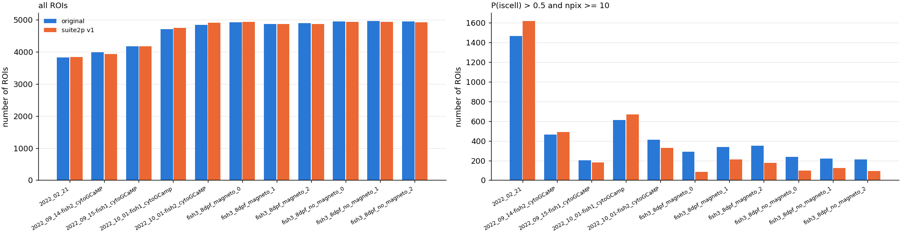
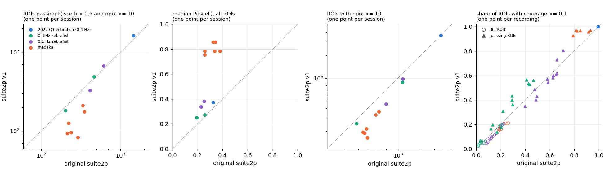
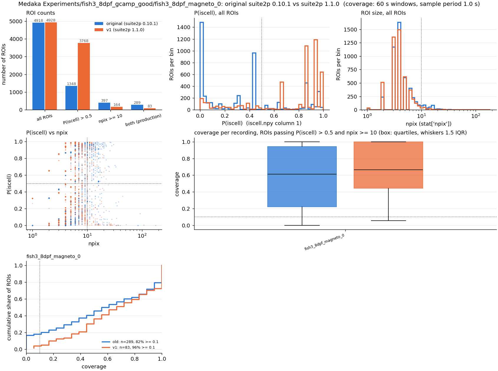
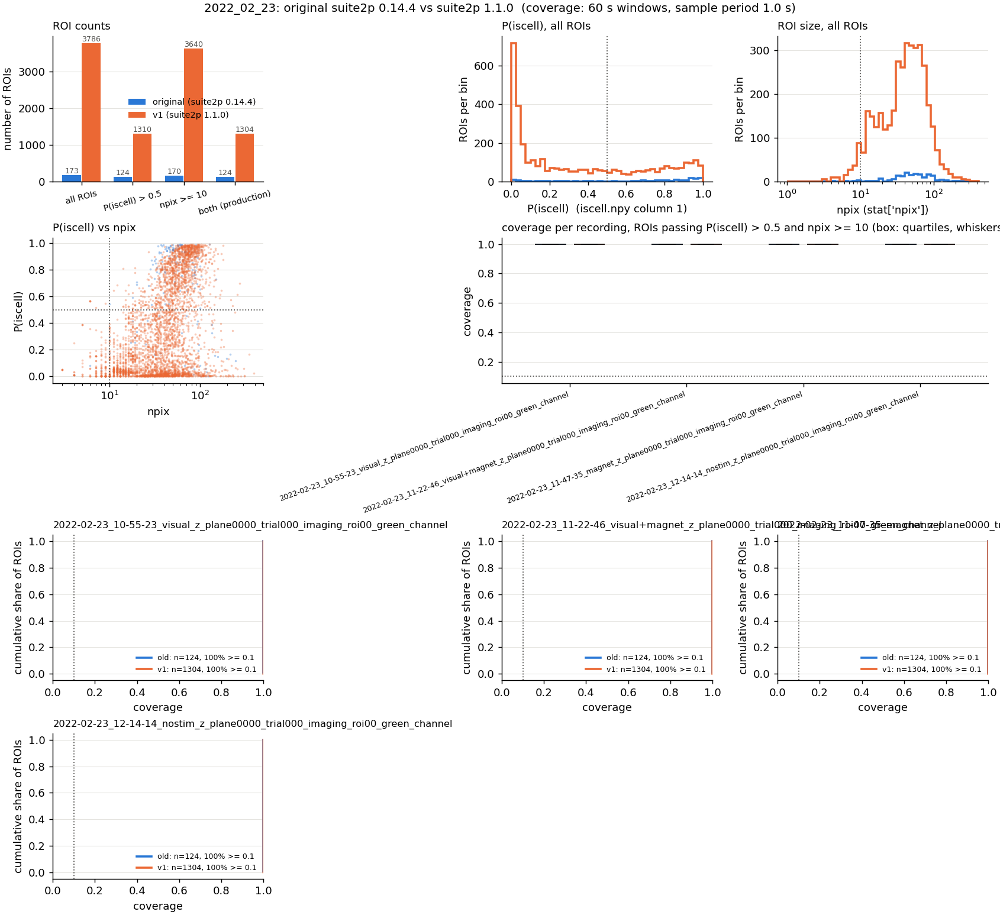
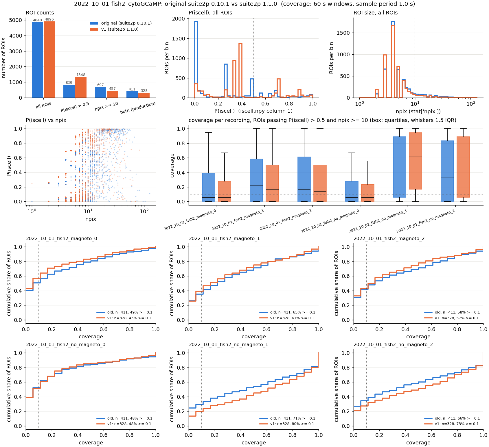

# suite2p v1 against the original suite2p runs: ROIs, P(iscell), ROI size, coverage

**Date:** 2026-10-05. **Branch:** `suite2p-v1-comparison`. **Scripts** (in `docs/suite2p_v1/`, see
[`README_runs.md`](suite2p_v1/README_runs.md)):
- `run_suite2p_v1.py`: re-runs one session with suite2p 1.1.0 on the GPU, settings mapped from the original `ops.npy` (env `suite2p1.0`). Writes only to `C:/Users/dan/suite2p_v1_runs/`.
- `compare_v1.py`: original vs v1, per session and per recording; writes `results/sessions.csv`, `recordings.csv`, `halving.csv` and the per-session figures (env `magneto2`).
- `summarize_v1.py`: the across-session tables below and Figure 2.

**Coverage of this report: all 15 sessions.**

**Summary.**
- **One session gains more than a thousand ROIs: 2022_02_23** (2022 Q1 zebrafish). v1 finds
  as many ROIs there as in the other two 2022 Q1 sessions. The original 0.14.4 run's correlation
  image is ~6 times weaker than in any other session (section 2a), so production has lost almost
  all of this fish.
- **Otherwise the total number of ROIs is the same.** Both versions stop near the 5000-ROI cap
  of sparsery, so this number says little.
- **v1 gives higher P(iscell):** strongly in medaka, a little in the 0.1 and 0.3 Hz zebrafish,
  barely in the 2022 Q1 zebrafish. The exception is 2022_02_23, where the original kept only its
  most cell-like ROIs.
- **v1 makes ROIs slightly smaller** in the floor-clipped recordings, so fewer reach npix ≥ 10.
  The 2022 Q1 sessions are unchanged (apart from 2022_02_23's extra ROIs).
- **The production ROI set changes most in medaka,** which loses about half of its ROIs passing
  P(iscell) > 0.5 and npix ≥ 10, because the npix loss outweighs the P(iscell) gain. In the
  0.1/0.3 Hz zebrafish the change has no consistent sign; in the 2022 Q1 zebrafish almost all of
  the gain comes from 2022_02_23.
- **Coverage barely moves for all ROIs; among passing ROIs it rises in medaka** and in the
  0.3 Hz zebrafish, and falls slightly in 2022_10_01-fish1 and 2022_10_02-fish2.
- **v1 keeps the floor; only re-extraction removes it.** v1 still halves uint16 tiffs and still
  writes the registered movie as int16, so the floor at 50.0 remains in every floor-clipped
  session. The 2022 Q1 sessions are halved too, but their raw values are large enough that they
  lose nothing that matters and their traces have no floor; 2022_10_02-fish1's tiffs are stored
  ×256, so halving is lossless there.

## Terms and populations

- **Original:** the suite2p output on the NAS that production uses: 0.10.1 for the 0.3 Hz and
  0.1 Hz zebrafish and the medaka trials, 0.14.4 for the 2022 Q1 zebrafish.
- **v1:** suite2p 1.1.0 run on the same tiffs, in the same order, with settings mapped from the
  original `ops.npy` (caveats below).
- **Session:** one suite2p segmentation. A zebrafish session covers several recordings (tiffs)
  that share one set of ROIs; each medaka trial was segmented on its own, so a medaka session is
  one recording.
- **Recording (trial):** one tiff; its frames are a slice of the session's F.
- **P(iscell):** column 1 of `iscell.npy`, the classifier's probability.
- **npix:** `stat["npix"]`, the ROI's number of pixels.
- **Passing ROIs:** the production thresholds P(iscell) > 0.5 and npix ≥ 10 (without the
  outline, flatline and coverage filters that production applies later).
- **Coverage:** the share of a recording's 60 s windows in which the ROI's trace has at least 3
  frames above its floor (`pipeline/roi_coverage.py`). Production keeps ROIs with coverage ≥ 0.1.
- **Floor-clipped:** a trace that sits at its minimum value most of the time; `share_clipped`
  in `recordings.csv` is the share of ROIs whose trace is clipped in this sense.

## Settings mapping caveats

From [`README_runs.md`](suite2p_v1/README_runs.md); the full table is in each run's
`settings_used.json`.
- **`fs` stays at 10 Hz,** the value in the original ops, although the movies run at ~1 frame/s.
  It sets the detection bin size, baseline window and deconvolution; changing it would confound
  the comparison.
- **The classifier is the built-in one** in v1. The original runs used the processing machine's
  user classifier, which ops does not record; on this machine the user classifier is
  byte-identical to the built-in one of 1.1.0 and 0.14.4. If the processing machine's differed,
  part of the P(iscell) change would come from that.
- **`max_iterations` → `sparsery_settings.max_ROIs = 250 × max_iterations` (5000).** Both
  versions hit close to this cap, so compare counts after the thresholds.
- `spatial_taper` (40), `nimg_init`, registration batch size, block size, the high-pass and
  neuropil settings and the baseline settings are carried over. Old settings with no v1
  equivalent (`1Preg`, `spatial_hp_reg`, `pre_smooth`, `spatial_hp`, `frames_include`, `aspect`,
  `pretrained_model`, `spatial_hp_cp`) are dropped; `1Preg` was off in every original run.
- Spatial scale estimation fails in both versions and falls back to 6 px.
- **Runtimes are not comparable.** Several v1 runs shared the GPU with other runs and spilled
  GPU memory to system RAM, which made them up to ~100× slower (e.g. medaka no_magneto_2: 1835 s
  against 17–98 s for the other trials; 2022_10_02-fish1 10 509 s against 57 s for fish2).
  Uncontended, v1 took 17–135 s per session against 110–1003 s for the original runs, and 358 s
  against 1367 s for the 2022 Q1 session 2022_03_01 (4 × 2936 frames).

## 1. Does v1 find a different number of ROIs?

**The question.** For each session, does v1 detect more or fewer ROIs, before and after the
production thresholds?

**Figure 1. ROI counts per session, original (blue) and suite2p v1 (orange).** *Left:* all ROIs. *Right:* ROIs passing P(iscell) > 0.5 and npix ≥ 10.

| session | batch | original | ROIs | P(iscell) > 0.5 | npix ≥ 10 | passing both | change in passing | median P(iscell) | median npix | 90th pct npix |
|---|---|---|---|---|---|---|---|---|---|---|
| 2022_02_21 | 2022 Q1 zebrafish (0.4 Hz) | 0.14.4 | 3821 → 3834 | 1477 → 1624 | 3669 → 3676 | 1464 → 1619 | +11% | 0.32 → 0.37 | 46 → 47 | 96 → 97 |
| **2022_02_23** | 2022 Q1 zebrafish (0.4 Hz) | 0.14.4 | **173 → 3786** | 124 → 1310 | 170 → 3640 | **124 → 1304** | +952% | 0.80 → 0.25 | 54 → 42 | 100 → 86 |
| 2022_03_01 | 2022 Q1 zebrafish (0.4 Hz) | 0.14.4 | 3239 → 3233 | 1494 → 1478 | 3129 → 3117 | 1482 → 1461 | −1% | 0.43 → 0.44 | 55 → 55 | 103 → 106 |
| 2022_09_14-fish2_cytoGCaMP | 0.3 Hz zebrafish | 0.10.1 | 3981 → 3922 | 705 → 986 | 1145 → 883 | 465 → 488 | +5% | 0.19 → 0.25 | 6 → 5 | 21 → 17 |
| 2022_09_15-fish1_cytoGCaMP | 0.3 Hz zebrafish | 0.10.1 | 4165 → 4168 | 549 → 517 | 286 → 254 | 202 → 182 | −10% | 0.26 → 0.27 | 3 → 2 | 8 → 7 |
| 2022_10_01-fish1_cytoGCamp | 0.1 Hz zebrafish | 0.10.1 | 4705 → 4735 | 1048 → 1579 | 1157 → 975 | 613 → 669 | +9% | 0.23 → 0.34 | 6 → 5 | 17 → 15 |
| 2022_10_01-fish2_cytoGCaMP | 0.1 Hz zebrafish | 0.10.1 | 4840 → 4896 | 839 → 1348 | 697 → 457 | 411 → 328 | −20% | 0.25 → 0.38 | 4 → 4 | 12 → 9 |
| 2022_10_02-fish1_cytoGCaMP | 0.1 Hz zebrafish | 0.10.1 | 4635 → 4644 | 899 → 868 | 1370 → 1339 | 485 → 486 | 0% | 0.13 → 0.25 | 7 → 6 | 23 → 24 |
| 2022_10_02-fish2_cytoGCaMP | 0.1 Hz zebrafish | 0.10.1 | 4793 → 4811 | 912 → 1567 | 1203 → 989 | 510 → 642 | +26% | 0.23 → 0.34 | 5 → 5 | 20 → 16 |
| fish3_8dpf_magneto_0 | medaka | 0.10.1 | 4918 → 4928 | 1348 → 3768 | 397 → 164 | 289 → 83 | −71% | 0.32 → 0.85 | 4 → 4 | 8 → 7 |
| fish3_8dpf_magneto_1 | medaka | 0.10.1 | 4859 → 4865 | 1210 → 3363 | 561 → 363 | 336 → 211 | −37% | 0.26 → 0.75 | 4 → 4 | 10 → 8 |
| fish3_8dpf_magneto_2 | medaka | 0.10.1 | 4889 → 4868 | 1217 → 3767 | 511 → 329 | 350 → 176 | −50% | 0.26 → 0.78 | 4 → 4 | 10 → 8 |
| fish3_8dpf_no_magneto_0 | medaka | 0.10.1 | 4941 → 4926 | 1282 → 3784 | 348 → 195 | 238 → 96 | −60% | 0.34 → 0.78 | 4 → 4 | 8 → 7 |
| fish3_8dpf_no_magneto_1 | medaka | 0.10.1 | 4957 → 4929 | 2334 → 3772 | 384 → 215 | 221 → 126 | −43% | 0.38 → 0.78 | 4 → 4 | 8 → 7 |
| fish3_8dpf_no_magneto_2 | medaka | 0.10.1 | 4946 → 4917 | 2260 → 3749 | 364 → 190 | 213 → 93 | −56% | 0.34 → 0.85 | 4 → 4 | 8 → 7 |

Table 1. Per session, original → v1. "Passing both": P(iscell) > 0.5 and npix ≥ 10. Totals of passing ROIs: medaka 1647 → 785 (−52%); 0.1 Hz zebrafish 2019 → 2125 (+5%); 0.3 Hz zebrafish 667 → 670 (0%); 2022 Q1 zebrafish 3070 → 4384 (+43%).

- **All ROIs: no difference except 2022_02_23** (Figure 1, left; section 2a). Every other
  session changes by less than 2%, and all 0.1 Hz zebrafish and medaka sessions sit just under
  the 5000 cap.
- **Passing ROIs: medaka loses about half** (Figure 1, right; Table 1). In the other zebrafish
  sessions the change has no consistent sign.

## 2. Does v1 assign different P(iscell)?

**The question.** Is the distribution of the classifier probability the same in both versions?

**Figure 2. Original (x) against v1 (y), one point per session or recording.** Dotted: no change. Colours: batch. *1st:* ROIs passing P(iscell) > 0.5 and npix ≥ 10 (log axes). *2nd:* median P(iscell) of all ROIs. *3rd:* ROIs with npix ≥ 10 (log axes). *4th:* share of ROIs with coverage ≥ 0.1, per recording, for all ROIs (rings) and passing ROIs (triangles).

- **v1's median P(iscell) is higher in every session except 2022_02_23** (Figure 2, 2nd
  panel; Table 1; for 2022_02_23 see section 2a). The shift is large in medaka, where most ROIs
  now exceed 0.5.
- In the other zebrafish sessions the shift is modest. The number of ROIs above 0.5 rises in
  most of them and falls slightly in three (2022_09_15-fish1, 2022_10_02-fish1, 2022_03_01).
- The original medaka distribution has large spikes at 0 and near 0.43 (Figure 3, top middle);
  v1's is concentrated above 0.6, in a few narrow peaks. Both look like the classifier
  responding to a handful of discrete feature values, which is what floor-clipped traces with
  few distinct values produce.

**Figure 3. One medaka trial, fish3_8dpf_magneto_0, original 0.10.1 (blue) vs v1 (orange).** *Top:* ROI counts at each threshold; P(iscell) histogram (dotted: 0.5); npix histogram (log x; dotted: 10). *Middle:* P(iscell) against npix per ROI; coverage of passing ROIs (box: quartiles, whiskers 1.5 IQR; dotted: 0.1). *Bottom:* cumulative distribution of coverage among passing ROIs. The other trials' figures: `suite2p_v1/figs/fish3_8dpf_*.png`.

## 2a. Why did the original run of 2022_02_23 find so few ROIs?

**The question.** 2022_02_23 is the one session where the two versions disagree on the number
of ROIs by more than 2%. Is that v1 inventing ROIs, or the original missing them?

**Figure 4. 2022_02_23 (4 recordings), original 0.14.4 (blue) vs v1 (orange).** Panels as in Figure 3.

- **The fish moved a lot in both runs (Figure 4):** registration shifts of about 50 px, so the movie is
  cropped to 604 × 588 px, against about 690 × 680 px in the other 2022 Q1 sessions.
- **The original's correlation image is degraded.** Detection seeds ROIs from the correlation
  image (`Vcorr`). Its median is 1.08 in the original run and 6.3 in v1; in 2022_02_21 and
  2022_03_01 the two versions agree (6.07 vs 6.07, 6.16 vs 6.16). With a flat correlation image
  the original found only a few ROIs, the largest and most cell-like (Table 1).
- **v1's ROIs look like those of the other 2022 Q1 sessions** in number, P(iscell) and size
  (Table 1).
- **So the original missed them.** Production uses the original segmentation and therefore has
  lost most of this fish's passing ROIs.

## 3. Does v1 produce ROIs of a different size?

**The question.** Is the npix distribution the same, and does the npix ≥ 10 threshold keep as
many ROIs?

- **v1's ROIs are slightly smaller in the floor-clipped sessions.** The median npix barely
  changes, but the upper tail shrinks (Table 1, 90th percentile; Figure 5 shows one 0.1 Hz
  zebrafish session).
- Because the threshold of 10 px sits in that tail, **the count with npix ≥ 10 drops in medaka
  and in the 0.1/0.3 Hz zebrafish** (Figure 2, 3rd panel). In medaka this loss is larger than
  the gain from P(iscell), hence the drop in passing ROIs.
- **The 2022 Q1 sessions are unchanged** (2022_02_23 aside). Their ROIs are an order of
  magnitude larger than in the other batches.

**Figure 5. One 0.1 Hz zebrafish session, 2022_10_01-fish2_cytoGCaMP (6 recordings), original 0.10.1 (blue) vs v1 (orange).** Panels as in Figure 3, with one coverage box pair and one cumulative coverage panel per recording. The other sessions: `suite2p_v1/figs/<session>.png`.

## 4. Does v1 change coverage?

**The question.** Per recording, does the share of 60 s windows with ≥ 3 frames above the floor
differ between the versions, for all ROIs and for passing ROIs?

- **All ROIs: v1's coverage is the same or slightly lower** (Figure 2, 4th panel, rings). It is
  lower in 36 of 54 recordings, and higher only in 2022_02_21, 2022_03_01 and 2022_09_15-fish1.
- **Passing ROIs, medaka: v1's are more often covered** (Figure 2, triangles; Figure 3, bottom),
  because v1 keeps fewer, mostly well-covered ROIs. The median coverage barely moves.
- **Passing ROIs, zebrafish: mixed.** Up in the 0.3 Hz sessions (10 of 12 recordings) and in
  2022_10_01-fish2's no_magneto_1/2; down in all six recordings of 2022_10_01-fish1 and of
  2022_10_02-fish2. The ranking of recordings is preserved: magneto_0/no_magneto_0 are the
  least covered in both versions.
- **2022 Q1 sessions: full coverage in both.** The original's zero-coverage ROIs (8 in
  2022_02_21, 23 in 2022_03_01) have an all-zero F; v1 has none.

The per-recording values (original → v1: share of all ROIs with coverage ≥ 0.1; passing ROIs'
n, median coverage and share with coverage ≥ 0.1) are in
[`suite2p_v1/results/coverage_per_recording.csv`](suite2p_v1/results/coverage_per_recording.csv),
rounded to two decimals; the unrounded values are in `results/recordings.csv`. A zebrafish
session's recordings share one set of ROIs, so the passing n repeats within a session. The
recordings of each 2022 Q1 session, and of 2022_10_02-fish1 (whose tiffs are ×256 and whose
trials 2–3 are copies of trial 1), are collapsed into one row there because they give identical
values: almost every passing trace is above its floor in every window.

## 5. Does v1 still halve uint16 tiffs and floor the traces?

**The question.** suite2p 0.10.1 stored uint16 tiffs as `im // 2` in int16, which merges the
raw offset floor 100 and 101 into 50 and erases most above-floor pixels. Does 1.1.0 do the same,
in every session?

| session | raw tiff: share at most common value (value) | raw distinct values | v1 data.bin / raw mean | v1 data.bin: share at most common value | original data.bin: same | passing-ROI F at its most common value, original → v1 |
|---|---|---|---|---|---|---|
| 2022_02_21 | 1.1% (9985) | 4220 | 0.4999 | 1.6% (4992) | 1.5% (4992) | 0.5% (at 0) → 0.0% |
| 2022_02_23 | 1.2% (9986) | 4086 | 0.4999 | 1.8% (4992) | 1.8% (4992) | 0.0% → 0.0% |
| 2022_03_01 | 1.1% (9989) | 4208 | 0.4999 | 1.6% (4992) | 1.6% (4991) | 1.6% (at 0) → 0.0% |
| 2022_09_14-fish2 | 93.9% (100) | 20 | 0.4996 | 99.3% (50) | 99.8% (50) | 93.5% → 95.8% (at 50) |
| 2022_09_15-fish1 | 98.7% (100) | 11 | 0.4999 | 99.5% (50) | 100.0% (50) | 94.1% → 97.1% (at 50) |
| 2022_10_01-fish1 | 94.3% (100) | 29 | 0.4995 | 99.3% (50) | 99.8% (50) | 94.3% → 95.1% (at 50) |
| 2022_10_01-fish2 | 95.4% (100) | 28 | 0.4996 | 99.4% (50) | 99.9% (50) | 92.2% → 92.7% (at 50) |
| 2022_10_02-fish1 | 96.7% (25600) | 41 | 0.5000 | 85.4% (12800) | 89.7% (12800) | 23.2% → 11.1% (at 12800) |
| 2022_10_02-fish2 | 93.5% (100) | 30 | 0.4995 | 99.3% (50) | 99.8% (50) | 88.3% → 91.3% (at 50) |
| medaka magneto_0 | 93.2% (100) | 51 | 0.4994 | 99.3% (50) | 99.7% (50) | 89.1% → 88.6% (at 50) |
| medaka magneto_1 | 92.8% (100) | 38 | 0.4993 | 99.2% (50) | 99.6% (50) | 89.8% → 91.3% (at 50) |
| medaka magneto_2 | 93.1% (100) | 36 | 0.4994 | 99.3% (50) | 99.7% (50) | 89.8% → 89.5% (at 50) |
| medaka no_magneto_0 | 93.6% (100) | 43 | 0.4994 | 99.3% (50) | 99.7% (50) | 89.9% → 90.8% (at 50) |
| medaka no_magneto_1 | 93.5% (100) | 42 | 0.4994 | 99.3% (50) | 99.7% (50) | 89.9% → 92.2% (at 50) |
| medaka no_magneto_2 | 93.7% (100) | 34 | 0.4994 | 99.3% (50) | 99.8% (50) | 88.9% → 92.0% (at 50) |

Table 2. First 100 frames of the first tiff of each session: raw uint16 tiff, v1's registered `data.bin` and the original's (both int16). Last column: all frames of F for passing ROIs. From `results/halving.csv`.

- **Yes, in every session.** v1's `data.bin` has half the raw mean, the same ratio as the
  original's (Table 2). v1 also still stores the registered movie as int16, so the second lossy
  step (truncation after the bilinear nonrigid shift) is there too.
- **In the floor-clipped sessions the floor survives unchanged:** the raw floor at 100 becomes
  50 after halving and registration in both versions, and passing ROIs' F sits at exactly 50.0
  in most samples in both (Table 2). Nearly every trace is clipped in both versions (share of
  clipped traces 0.999–1.0, all ROIs).
- **The 2022 Q1 sessions are halved but not floored.** Their raw values are around 10 000 with
  thousands of distinct values, so dropping the last bit loses nothing that matters, and no
  trace is clipped in v1 (the original's clipped samples are the all-zero ROIs of section 4).
- **2022_10_02-fish1 is halved losslessly.** Its tiffs are stored ×256 (offset 25 600), so
  `// 2` only drops a bit that is always 0. Its traces still sit at the offset in many frames
  (photon-free frames, as in the other photon-starved sessions), but the faint signal between
  them survives.
- So re-running with suite2p v1 does not remove the floor-clipping that breaks the Fourier null
  in the 0.1/0.3 Hz zebrafish and medaka data; that needs a re-extraction that skips the
  halving (see [`cv2.md`](cv2.md)).
