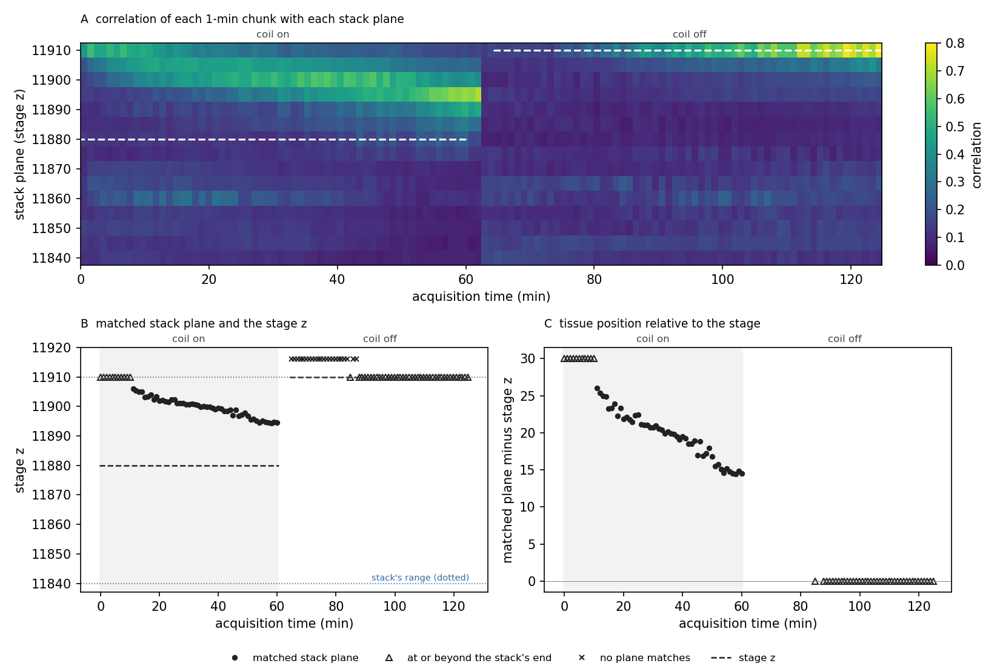
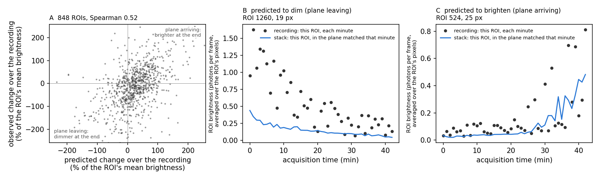
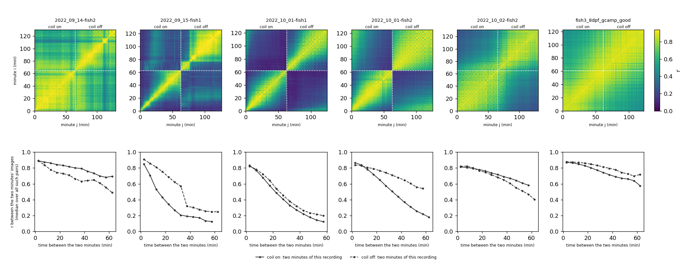
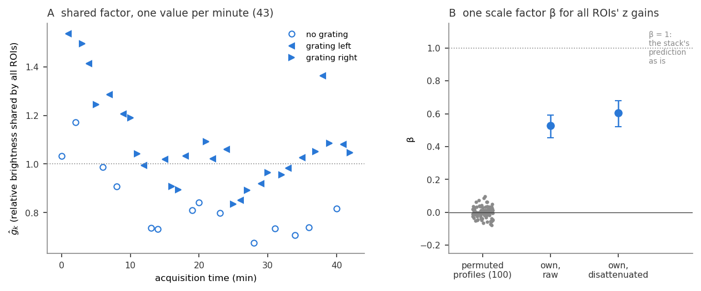
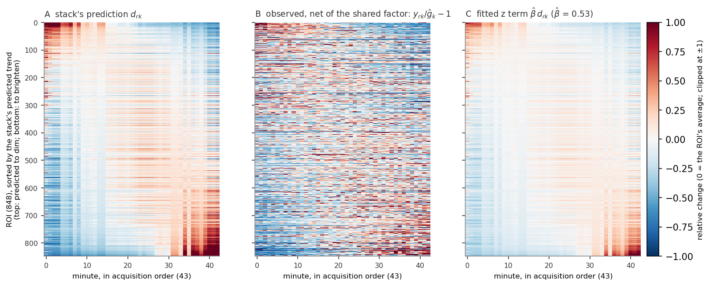

# The focal plane drifts in the photon-starved zebrafish and changes each cell's brightness, but it explains little of the nonstationarity

**Date:** 2026-10-13

**Scope:** Tests the hypothesis of [`photon_starved_imaging.md`](photon_starved_imaging.md) section 4: the slow change in the image that remains after lateral drift correction comes from the focal plane (z) moving. No production code changed. The NAS is only read.

**Related:** [`photon_starved_imaging.md`](photon_starved_imaging.md) (index), [`custom_registration.md`](custom_registration.md) (lateral drift, block analysis), [`resegmentation.md`](resegmentation.md) (the production segmentation used here), [`nonstationarity.md`](nonstationarity.md).

**Terms.**
- **Chunk:** one acquisition file, 60 frames (1 minute). Each trial tiff is 18 chunks of one condition stitched together (`.claude/CLAUDE.md`).
- **Stage z:** the microscope's z position, written in each filename. Its unit is not documented; a unit is probably about 1 µm (see Open).
- **Stack:** an anatomy z-stack, one chunk per plane, taken in the same session.

## Summary

Three of the five photon-starved zebrafish sessions have a z-stack on the NAS, but only 20221001_fish1's covers the recorded plane at a usable spacing (Table 1). Matching each minute of that session against its stack shows that the tissue drifts steadily through the focal plane while the stage stays put, and that the coil-on and coil-off recordings, although segmented together, image different planes. The drift changes the ROIs: each ROI's own brightness profile through the stack predicts whether it brightens or dims, and a neighbour's profile predicts it less well the farther away the neighbour is. That rules out a smooth change across the field such as a tilt or uneven illumination. A dimming shared by all ROIs, such as bleaching, comes on top. Yet the drift is only a small part of the nonstationarity: dividing it out of the traces leaves most of it in place.

Sessions without a usable stack can't be placed in z, but a drifting plane also shows up as image content that keeps changing after lateral alignment. It does so in all six photon-starved sessions, and in 20221001_fish1 the change follows the stack's z.

| | finding |
|---|---|
| **Established** | In 20221001_fish1 the tissue drifts through the focal plane by ≥ 15 stage units in the coil-on hour, and coil on and coil off are different planes (Figure 1). |
| **Established** | The drift changes each ROI as its stack profile predicts, cell by cell (Figure 2, Table 2). |
| **Established** | A dimming shared by all ROIs (bleaching or laser power) comes on top (section 2). |
| **Established, indirect** | The image content drifts with acquisition time in all six photon-starved sessions (Figure 3). Only in 20221001_fish1 can it be tied to z; elsewhere other slow changes of the tissue aren't excluded. |
| **Established** | The z drift accounts for little of the nonstationarity: dividing it out lowers the flagged share by a few points (section 4, Table 5). |
| **Open** | What the rest of the nonstationarity is. |
| **Open** | z in the other sessions, which have no usable stack (Table 1). |
| **Open** | The stage's z unit. The match halves between planes 5 units apart, which suggests about 1 µm per unit. |

## The data

The stage z is field 5 of every acquisition filename (`<chunk>.<cond>.0.<rep>.<z>.1000.<zoom>.<zoom>.59.0.tif`). The stacks use the same naming and the same zoom (3.5) as the recordings.

**Table 1.** The stacks and the recordings, with acquisition times from the file times.

| session | stack | planes (stage z) | taken | recordings: stage z, time | covers the recording? |
|---|---|---|---|---|---|
| 20221001_fish1 | `anatomy stack no magneto` | 11840–11910, every 5 (15 planes) | 19:22–19:38 | coil on 11880, 17:10–18:10; coil off 11910, 18:15–19:15 | coil on yes; coil off at its top edge |
| 20221001_fish2 | `anatomy stack no magneto` | 11480–11575, every 5 (20) | 20:28 | coil on 11610, 21:00–22:00; coil off 11630, 22:05–23:05 | no: the recordings are 35–55 units beyond it |
| 20221002_fish2 | `anatomy_stack_magneto` | 11810–11930, every 20 (7, ×3 repeats) | 18:19–18:41 | coil on and off 11925, 20:07–22:18 | yes, but 20 units apart is too coarse |
| | `anatomy_stack-no_magneto` | 11850–11970, every 20 (7, ×3) | 18:56–19:17 | | yes, but too coarse |
| | `high_power_stack_magneto` | 11845–11893, every 2 (25), zoom 2.0 | 19:33–19:59 | | no; different zoom |
| 20220914_fish2, 20220915_fish1, medaka | none | | | | |

The stacks are as photon-starved as the recordings (median pixel 100, the offset). A plane can only be recognised by its anatomy, averaged over its 60 frames.

## Methods

**Plane match** ([`zplane/zpos.py`](zplane/zpos.py)). Each chunk is averaged over its 60 frames, smoothed and high-passed as in the lateral drift measurement ([`custom_registration/measure.py`](custom_registration/measure.py)), and compared with each stack plane. The score, **r**, is a Pearson-type correlation between the two images' cell-scale structure: both are smoothed (σ 1.5 px), have their broad background subtracted, are scaled to mean 0 and SD 1 and tapered at the edges, and the second is shifted to the lateral position (within ±40 px) that matches best. So r runs from −1 to 1, ignores overall brightness, and isn't affected by lateral motion. It is r, not r². suite2p's `register_to_zstack` does the same for single frames; suite2p 1.1.0's `compute_zpos` is an empty stub. The chunk's z is the peak of a parabola through the best plane and its two neighbours. If the best plane is the stack's first or last, the chunk is **at the edge**: its true z is beyond the stack and only a bound is known.

**ROI prediction** ([`zplane/roi_z.py`](zplane/roi_z.py)). For each selected ROI of the production segmentation:
1. **Stack profile:** the ROI's brightness in each stack plane: the mean over the ROI's own pixels only, weighted by suite2p's per-pixel weights (`lam`), in photons per frame. No pixel outside the ROI contributes. The stack is first aligned laterally onto the run's mean image with one shift for all planes, measured on the planes within 10 units of the recording.
2. **Observed:** the ROI's full-resolution trace (`F_full`/64 − 100), which suite2p computes from the same pixels and weights, averaged over each chunk.
3. **Predicted:** the profile read off at each chunk's z.
4. **Trend:** the relative change per stage unit, of the observed and of the predicted series.

A shared change such as bleaching shifts every ROI's observed trend by the same amount. It can't make observed and predicted trends agree ROI by ROI, so their correlation across ROIs is the test.

Only chunks inside the stack with a best-plane r ≥ 0.35 are used: 43 chunks of the coil-on trials, z 11895–11906.

## Findings

### 1. The recorded plane drifts by at least 15 units in an hour, and coil on and coil off are at different planes

Where in the stack does each chunk of 20221001_fish1 sit?



<sub>**Figure 1. 20221001_fish1 against its z-stack.** **A:** r between each chunk and each stack plane. **B:** the plane each chunk matches best. Triangles: the best match is the stack's last plane, so the tissue is there or beyond the stack, where its position is unknown. Crosses (drawn at an arbitrary height): no plane matches (r < 0.35). Dashed: the stage z, read from the filenames. **C:** matched plane minus stage z; triangles are lower bounds.</sub>

The stage z is where the microscope was focused; the matched plane is where the imaged tissue actually was. Their difference (C) is the tissue's movement relative to the objective, and it changes at a steady rate across both recordings. The apparent jump back up at the switch in B is the experimenter raising the stage by 30 units; reversing the order of the recordings would instead require the tissue to jump. So coil on and coil off image different planes, although they share one segmentation. A chunk's z is reproducible to about 0.05 units between its odd and even frames.

### 2. The stack predicts which ROIs brighten and which dim, cell by cell

As the plane moves, ROIs on cells it is leaving should dim and ROIs on cells it is arriving at should brighten, as each ROI's stack profile predicts. The prediction for an ROI (Figure 2A, x axis) comes from the stack planes the recording actually passed through, from about 11906 at the start of the analysed stretch to 11895 at its end: an ROI that is brighter in the 11895 plane than in the 11906 plane lies on the side the plane is moving towards, and is predicted to brighten; one that is brighter at 11906 lies on the side it is leaving, and is predicted to dim. Whether lower stage z is deeper or shallower in the fish isn't recorded, so the two sides can't be called up or down. Only the crossed planes are used, not each ROI's brightest plane in the whole stack: a single noisy minute per plane doesn't localise a dim ROI reliably over the full 70 units. A cell the plane passes all the way through brightens and then dims, so its net change is near zero, like a cell that never changes; the test rests on the cells that clearly leave or arrive. Bleaching or a laser change would change all ROIs alike.



<sub>**Figure 2. Each ROI's slow brightness change against the stack's prediction**, 20221001_fish1, coil on, 848 selected ROIs (production's selection, inside the fish outline), 43 chunks. **A:** one dot per ROI: the change in brightness from the first to the last analysed chunk (a straight-line fit, as a percentage of the ROI's mean), predicted from the stack (x) and observed (y). Positive: brighter at the end. **B, C:** two of the brighter-than-median ROIs, predicted to dim and to brighten. Only the ROI's own pixels are used, weighted by suite2p's per-pixel weights, and the same pixels and weights in the recording and in the stack. Dots: the ROI's brightness in each minute of the recording. Line: the ROI's brightness in the stack plane that minute matched.</sub>

Fig2A compares predictions of how units would dim or brighten (corresponding to negative or positive values), net, over the course of the recording. So this indicates that a unit can either exit the recording starting at the beginning, enter and exit as the 3d ROI is passed through by the imaging plane, or the imaging plane just starts to pass through the unit at the end of the recording

**Table 2.** Spearman correlation across ROIs between the observed trend and the predicted trend of the same ROI, or of an ROI drawn at random at a given distance (between centroids).

| prediction from | n | Spearman | p |
|---|---|---|---|
| the same ROI | 848 | 0.52 | 1e-60 |
| an ROI 0–8 px away | 664 | 0.37 | 2e-22 |
| 8–16 px | 818 | 0.23 | 1e-11 |
| 16–32 px | 848 | 0.12 | 4e-4 |
| 32–64 px | 848 | 0.03 | 0.39 |
| 64–128 px | 848 | −0.04 | 0.24 |
| > 128 px | 848 | −0.06 | 0.07 |

The prediction holds, and it is specific to the cell: it fades with distance between ROIs, as a change of plane would make it, and not as a tilt or vignetting would, which would let distant ROIs predict each other. ROIs within 8 px are often fragments of the same cell, which is why near neighbours still predict well.

The minute-to-minute zigzag in Figure 2B and C is the grating, not noise. The analysed minutes interleave the three coil-on conditions (no grating, grating moving left, grating moving right) in their acquisition order, and most ROIs respond differently to them; ROI 524, for instance, brightens mainly for the rightward grating. The slow change from the drift runs underneath that alternation. The small wiggle in C's predicted line is different: there the matched z doesn't fall perfectly smoothly from minute to minute, and this ROI's stack profile is steep across the crossed planes.

On top of the cell-specific change, all ROIs dim together: over the analysed 42 minutes the median ROI dims by 9% of its mean, where the stack predicts it should brighten by 25%. Bleaching or a drop in laser power would do this. How large it is depends on how strongly the ROIs follow the stack's prediction, which section 4 estimates.

### 3. Without a stack: the image content drifts in every session, and in 20221001_fish1 it follows z

Does a chunk still look like the same field an hour later, once lateral motion is factored out? This test needs no stack, so it covers all six photon-starved sessions.

In 2021001_fish1, we have a known issue, and in this session we will attempt to identify metrics from inside the data that can be applied to other recordings without usable anatomy stacks.


**Method** ([`zplane/similarity.py`](zplane/similarity.py)): a session's 122 chunks (both conditions) are put in acquisition order. Chunk *i*'s odd frames are compared with chunk *j*'s even frames by the same r as the plane match. Using different frames keeps the two images' photon noise independent. Because r ignores overall brightness, bleaching alone doesn't lower it.



<sub>**Figure 3. How alike two minutes of a session look, against when they were taken.** **Top:** each pixel is one pair of minutes, *i* and *j*, both axes in acquisition time; colour is r between their images (one scale for all panels). Dashed lines: the switch from the coil-on recording to the coil-off one, recorded back to back. **Bottom:** the same pairs, restricted to pairs within one recording (coil on, solid; coil off, dashed) and sorted by how many minutes apart the two minutes were taken. Each point is the median r of all pairs in a 5-minute bin. r is always between the two minutes of a pair; there is no fixed reference image.</sub>

**Table 3.** 20221001_fish1, coil on: similarity of two chunks against the difference of their z from the stack.

| z difference (stage units) | pairs | median similarity | median time apart (min) |
|---|---|---|---|
| 0–1 | 412 | 0.83 | 3 |
| 1–2 | 380 | 0.78 | 8 |
| 2–4 | 652 | 0.66 | 13 |
| 4–6 | 518 | 0.51 | 22 |
| 6–8 | 310 | 0.35 | 32 |
| 8–12 | 178 | 0.24 | 40 |

The content drifts in every session, by different amounts: least in 20220914_fish2 and medaka, most in 20220915_fish1 and the two 20221001 fish. The decline is smooth, as a slow drift would make it, except in 20220915_fish1, whose first ~20 coil-on minutes coincide with its 20 px lateral drift and whose coil-off recording has a step at about 75 minutes. Coil on and coil off differ about as much as the most distant chunks within a condition, which is what continued drift between two recordings taken one after the other gives; 20221001_fish2 has the same sharp boundary between conditions as 20221001_fish1, where the stack shows two planes.

In 20221001_fish1 the similarity falls with the z difference between chunks as fast as it falls between stack planes the same distance apart (Table 3). Because z there changes almost in proportion to time, Table 3 alone can't separate z from time; the plane match of section 1 does.

What this test can't show is the cause in the sessions without a usable stack: the tissue itself could change (swelling, the fish settling in the agarose). A drifting plane is the simplest explanation consistent with 20221001_fish1.

### 4. Dividing out the z drift removes little of the nonstationarity

How much of the nonstationarity ([`nonstationarity.md`](nonstationarity.md)) is the z drift? The test: if the drift causes it, a trace divided by its own predicted z gain should become stationary, and dividing by another ROI's gain should not help.

**The model in brief.** Each ROI's brightness in each minute is split into three parts:
- **$d$, the stack's prediction for that ROI.** As the plane drifts, the stack says which cells should brighten and which should dim, and when. It differs from cell to cell, and it is computed from the stack, not fitted.
- **$\beta$, how strongly the ROIs follow their own predictions.** One number for all ROIs: 1 means fully, 0 means not at all.
- **$g$, what all ROIs share in that minute** once each ROI's own z effect is accounted for. One number per minute; here it is mostly the grating, plus a slow dip.

The z effects of different ROIs point in different directions and largely cancel across the population, so $g$ can't absorb them; they can only be explained through $\beta$. If the predictions are right, $\beta$ comes out well above 0. Given each ROI another ROI's prediction, it should come out near 0.

**Scaling the prediction.** Section 2 shows that the stack predicts the direction of each ROI's change. Before the prediction can be divided out, how strongly the ROIs actually follow it has to be estimated.

Let $r$ index the 848 ROIs and $k$ the 43 minutes of the coil-on recording that have a z. $m_{rk}$ is ROI $r$'s brightness in minute $k$ (photons per pixel per frame over its own pixels), and $\bar m_r$ is its average over all 43 minutes. Its relative brightness in minute $k$ is

$$
y_{rk} = \frac{m_{rk}}{\bar m_r} .
$$

$I_r(z)$ is the ROI's brightness in the stack plane at stage z, and $z_k$ is the plane minute $k$ matches, so $I_r(z_k)$ is how bright the stack says the ROI should be in minute $k$. With $\bar I_r$ its average over the 43 minutes, the stack's predicted relative change is

$$
d_{rk} = \frac{I_r(z_k)}{\bar I_r} - 1 ,
$$

so $d_{rk} = 0.2$ means the stack says the ROI should be 20% brighter than its average in minute $k$. The model is

$$
y_{rk} = g_k \left(1 + \beta\, d_{rk}\right) + \varepsilon_{rk} ,
$$

where $g_k$ is a brightness factor shared by all ROIs in minute $k$ (one free value per minute: whatever raises or lowers every ROI together, such as bleaching, laser power, or the whole population's response to that minute's stimulus) and $\beta$ is a single number for all ROIs that scales the stack's prediction: $\beta = 1$ takes it as it stands, $\beta = 0$ means it predicts nothing. $\beta$ and the $g_k$ are fitted by least squares,

$$
\min_{\beta,\, g_1, \dots, g_K} \; \sum_{r,k} \Big( y_{rk} - g_k \left(1 + \beta\, d_{rk}\right) \Big)^2 ,
$$

alternating between $\beta$ and the $g_k$ until they converge. Only $\beta$ and the 43 $g_k$ are fitted, 44 numbers in all; the $d_{rk}$ are not fitted but computed from the stack and the matched z.

Why one $\beta$ and not one per ROI: z falls steadily with time, so a free $\beta_r$ lets any steadily changing curve fit, including another ROI's prediction or a straight line. With a shared $\beta$, a prediction helps only if it points the right way for that particular ROI. The control refits the model with the profiles shuffled among ROIs, $d_{\pi(r)k}$ for a random permutation $\pi$. The "disattenuated" estimate is $\hat\beta / \rho$, where $\rho$ is the reliability of the stack's predicted trend (the correlation between profiles built from the stack's odd and even frames, stepped up by Spearman–Brown); it corrects for noise in the stack.



<sub>**Figure 4. The fitted parameters.** **A:** the shared factor $\hat g_k$, one per minute, against acquisition time; marker: the minute's stimulus condition. **B:** β fitted with each ROI's own stack profile (blue; 95% interval from resampling ROIs), as is and corrected for the noise in the stack's profiles ("disattenuated"), and refitted 100 times with the profiles shuffled across ROIs (grey). Dotted: β = 1, the stack's prediction unscaled.</sub>

The shared factor (Figure 4A) is mostly the grating, not bleaching: in minutes with a grating the whole population is brighter than in minutes without, and the conditions alternate minute by minute. A slower dip over the first half hour sits underneath. Within one trial tiff the condition is fixed, so only that slow part matters for the nonstationarity test.

The z gain is real: with each ROI's own profile β is about 0.5, with shuffled profiles it is zero. So each ROI's brightness changes in the predicted direction, but by only about half the predicted amount. Noise in the stack doesn't explain that, because correcting for it moves β little. Why the real changes are smaller is not known.

**How much each part accounts for.** Table 4 gives the share of the ROIs' minute-to-minute variation in brightness that each part of the fitted model accounts for, using the same $\hat g_k$ and $\hat\beta$ throughout (nothing refitted per ROI).

**Table 4.** Share of the variance of $y_{rk}$ (848 ROIs, 43 minutes) accounted for: $1 - \sum(\text{residual})^2 / \sum (y_{rk} - 1)^2$, pooled over ROIs, and the median over ROIs. From `zplane/results_ns_z_variance.csv`.

| model part | pooled | median ROI |
|---|---|---|
| shared factor only, $\hat g_k$ | 10% | 12% |
| z term only, $1 + \hat\beta\, d_{rk}$ | 4% | 0% |
| both, $\hat g_k (1 + \hat\beta\, d_{rk})$ | 17% | 22% |
| both, with profiles shuffled across ROIs (control) | 11% | 15% |

The two parts together account for under a fifth of the variation, and the z term adds about 6 points beyond what a shuffled profile does. More than 80% is left: the cells' own activity, which neither part describes.

**Dividing it out.** Each coil-on trace is divided, minute by minute, by $\hat g_k$ (the shared factor) and then by $\hat g_k (1 + \hat\beta\, d_{rk})$ (also its own scaled z gain), and the nonstationarity test of [`nonstationarity.md`](nonstationarity.md) is run again unchanged. It uses the minutes that have a z (14 per trial), one-minute chunks (K = 14). As controls, the traces are also divided by a shuffled ROI's z gain, and by a constant, which must change nothing.

**Table 5.** Share of ROIs flagged as nonstationary (block-shuffle p < 0.05; chance 5%), 20221001_fish1, coil on, three trials, 2,513 ROI-trials. Other K and the disattenuated β: `zplane/results_ns_z_shares.csv`.

| traces divided by | RMS | reference-window power |
|---|---|---|
| nothing | 52% | 18% |
| the shared factor | 49% | 18% |
| the shared factor and the ROI's own z gain | 47% | 15% |
| the shared factor and a shuffled ROI's z gain (control) | 54% | 19% |

Removing the z drift lowers the flagged share by only a few points, at every K; most of the nonstationarity remains. The drop is specific to the ROI's own gain: a shuffled gain of the same size makes the traces more nonstationary, not less. Removing the shared factor helps little too. So in this session the z drift is real but a small part of what makes the traces nonstationary. What the rest is (the cells' own slow changes in activity, or drift the stack can't capture) is open. CV², the third metric (spectral shape), tells the same story: removing the z gain brings it back to where it was before the shared factor was removed, and no lower (`zplane/results_ns_z_shares.csv`).

Figure 5 shows why so little goes. It lays out, for every ROI and minute, what the model divides out next to what the recording shows.



<sub>**Figure 5. The z term against the data, every ROI and minute.** Rows: the 848 ROIs, sorted by the stack's predicted trend (top: predicted to dim, bottom: to brighten); the same order in all panels. Columns: the 43 minutes with a z, in acquisition order. Colour: change relative to the ROI's own average (clipped at ±1). **A:** the stack's prediction $d_{rk}$ (computed, not fitted). **B:** the recording, net of the shared factor, $y_{rk}/\hat g_k - 1$. **C:** the fitted z term $\hat\beta\, d_{rk}$, which is what gets divided out.</sub>

The large-scale pattern of A, cells the plane leaves dimming and cells it reaches brightening, is visible underneath B, which is the cross-ROI agreement of section 2. But most of B's minute-to-minute variation is the cells' activity, which C doesn't contain, so dividing C out leaves most of B, and with it most of the nonstationarity. The vertical stripes in A and C are minutes in which the matched z steps slightly; since $d_{rk}$ depends on the minute only through its z, every ROI moves at once.

**Checks** ([`zplane/ns_z.py`](zplane/ns_z.py)): given the same traces, the script reproduces `nonstationarity.py`'s values and p-values exactly; its traces equal the NWB traces; dividing by a constant changes no p-value. **Limits:** one session, coil on only, and the last 14 of 18 minutes of each trial.

## What was ruled out, and how

- **A smooth field instead of z** (tilt, vignetting, uneven illumination): a distant ROI's profile predicts nothing (Table 2).
- **Bleaching alone:** bleaching can't make the stack predict which ROIs brighten. It is present, as a shared change on top.
- **Lateral motion:** the plane match and the similarity take the best lateral shift within ±40 px, and the ROI analysis uses the drift-corrected production run.

## Implications

1. **The z hypothesis now has direct support,** in the one session where it can be tested. [`photon_starved_imaging.md`](photon_starved_imaging.md) section 4 says so, with that caveat.
2. **In 20221001_fish1 coil on and coil off are different planes** that share one segmentation, so a shared ROI can sample different tissue in the two conditions. The per-recording Fourier tests are unaffected, since each uses one recording, but any comparison of the same ROI between coil on and coil off is affected.
3. **Future recordings should take a short stack around the imaged plane before and after each recording,** every 5 units or finer (20 is too coarse). That gives z over time for every session.
4. **The z drift doesn't explain the nonstationarity.** Correcting for it would not make these traces stationary, so the nonstationarity has to be handled, or explained, some other way.

## Reproducing

```bash
# magneto2 env, from the repository root; reads the NAS, caches mean images on local disk
python docs/zplane/zpos.py --workers 24          # plane match, ~5 min the first time
python docs/zplane/roi_z.py                      # 20221001_fish1 ROI prediction, ~1 min
python docs/zplane/similarity.py --workers 6     # image similarity, all sessions, ~10 min
python docs/zplane/ns_z.py --workers 8           # 20221001_fish1: z share of the nonstationarity, ~25 min
python docs/zplane/figures.py                    # figures from the saved results
```

- `zpos.py`: `results_zpos.csv` (one row per chunk and stack), `results_stack_selftest.csv`, `results_corr.npz` (chunk × plane correlations).
- `roi_z.py`: `results_roi_z.csv` (one row per ROI), `results_roi_z_rings.csv` (Table 2), `results_roi_z_series.npz` (the chunk series behind Figure 2).
- `similarity.py`: `results_similarity.csv` (one row per chunk pair; not in git, 9.5 MB), `results_similarity_summary.csv` (medians per session, by time apart and across conditions), `results_similarity_vs_dz.csv` (Table 3).
- `ns_z.py`: `results_ns_z_fit.csv` (β, Figure 4), `results_ns_z_roi.csv` (per ROI), `results_ns_z_shares.csv` (Table 5, all K), `results_ns_z_variance.csv` (Table 4), `results_ns_z_g.csv` and `results_ns_z_d.npz` (Figures 4A and 5), `results_ns_z_checks.csv`, `results_ns_z_p.csv` (per ROI and version; not in git, 12 MB).
- Mean-image cache: `C:\Users\dan\zplane_cache\<session>.npz`, outside the repository.

**Checks:** stack self-test (every plane of every stack); odd/even z precision; stage z against the matched plane; `ns_z.py` against `nonstationarity.py` (section 4).

### Parameters

| | value |
|---|---|
| chunk | 60 frames, one acquisition file |
| image preprocessing | Gaussian σ 1.5 px, minus a σ 20 px Gaussian, Hann window (as `measure.py`) |
| lateral search | ±40 px |
| usable chunk | not at the stack's edge, best-plane r ≥ 0.35 |
| stack alignment | one shift, median over planes within 10 units of the recording |
| ROIs | production selection on the x64 whole-pixel run (P(iscell) > 0.5, npix > 9, inside the outline) |
| distance rings | 0–8, 8–16, 16–32, 32–64, 64–128, > 128 px |
